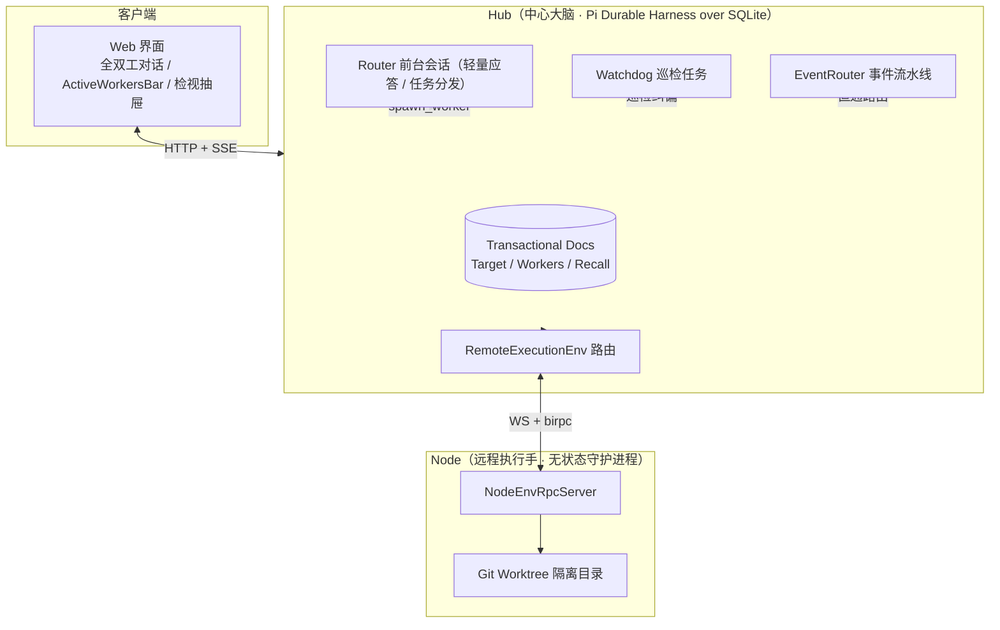

<p align="center">
  
</p>

<h1 align="center">botd</h1>

<p align="center">
  <strong>多角色 Super-agent 协同平台。基于 Pi Durable 引擎构建，实现脑手分离与全双工交互。</strong>
</p>

<p align="center">
  自托管 · 状态持久化 · 双层智能体 · Git Worktree 隔离 · 崩溃自愈
</p>

<p align="center">
  <a href="https://github.com/team4u/botd/actions/workflows/ci.yml"></a>
  <a href="LICENSE"></a>
  <a href="package.json">= 24.12.0"></a>
</p>

<p align="center">
  <a href="docs/getting-started.md">快速开始</a> ·
  <a href="docs/architecture.md">系统架构</a> ·
  <a href="docs/user-guide.md">用户指南</a> ·
  <a href="docs/README.md">文档导航</a> ·
  <a href="CONTRIBUTING.md">参与贡献</a>
</p>

## 为什么选择 botd

复杂软件开发需要长时间执行的模型推理。传统方案常遇到三个瓶颈：

1. 前台会话执行长耗时工具，用户无法继续对话。
2. 进程崩溃或网络闪断后，执行状态丢失。
3. 多个任务同时修改代码仓库，造成写冲突。

botd 采用脑手分离架构。Hub 负责状态持久化与调度，Node 负责无状态环境执行。



## 核心设计

### 1. 脑手分离架构

Hub 独占 SQLite 存储。Hub 管理所有对话上下文、任务图和持久状态。

Node 作为无状态执行节点。Node 通过 RPC 接收文件读写与命令执行指令。

节点断线重连后，任务自动从中断点继续执行。

### 2. 双层智能体模型（Router 与 Worker）

系统为每个角色分身配备双层架构：

- **Router 前台层**：负责轻量沟通与任务分发。前台移除长耗时工具，响应时间保持在毫秒级。
- **Worker 后台层**：负责多步骤编码与测试。Worker 挂载代码工具与工作流引擎。

前台对话永不阻塞。

### 3. Git Worktree 并发隔离

Worker 执行代码修改时，Node 会创建独立的 Git Worktree。

每个 Worker 拥有独立的工作目录与分支。

多个 Worker 可以并发修改同一个代码仓库，互不干扰。

### 4. 崩溃持久恢复

系统基于 Pi Durable Harness 引擎构建。

所有步骤提交为任务检查点。

Hub 重启后，调度器自动恢复未完成的任务。

### 5. 事件驱动与主动自愈

EventRouter 提供事件四步流水线。外部事件经由线程标识直通活跃 Worker。

Watchdog 定时巡检任务状态。Watchdog 自动纠偏卡死任务并恢复临时错误。

## 快速开始

开发环境要求 **Node.js ≥ 24.12.0** 与 **pnpm 10.34.9**。

### 1. 启动 Web 与 Hub

克隆代码仓库并安装依赖：

```bash
git clone https://github.com/team4u/botd.git
cd botd
corepack enable
pnpm install
pnpm build
```

启动开发服务：

```bash
BOTD_PORT=3002 pnpm dev
```

浏览器打开 `http://localhost:3001`。使用默认管理员账号登录。

> [!IMPORTANT]
> 本机开发必须指定 `BOTD_PORT=3002`。开发服务使用 3001 与 3002 端口，不占用 3000 端口。

### 2. 接入执行节点

打开另一个终端，链接并接入本机节点：

```bash
npm link ./apps/node
botd join http://localhost:3001 --code 123456 --name my-worker
botd start
```

Web 界面会显示节点在线状态。

### 3. 体验全双工协同

1. 在 Web 界面选择默认助手。
2. 发送耗时指令：`分析当前项目目录并运行测试`。
3. Router 会调用 `spawn_worker` 派发后台任务。
4. 顶部 `ActiveWorkersBar` 显示实时任务胶囊。
5. 你可以继续在前台输入其他消息，对话立即得到响应。
6. 点击顶部胶囊打开 `WorkerInspectDrawer`，实时查看执行过程或发送插话指令。

## 模块导览

- [apps/hub](apps/hub)：Hub 服务端核心，包含 Pi Durable Harness、Router、Worker 与状态文档。
- [apps/node](apps/node)：Node 守护进程，包含远程执行 RPC 服务与 Git Worktree 管理。
- [apps/web](apps/web)：前端交互界面，提供全双工对话视图、ActiveWorkersBar 与 WorkerInspectDrawer。
- [packages/protocol](packages/protocol)：共享协议契约，包含 `env-rpc.ts` 与模型类型定义。

## 文档索引

查阅完整文档清单请访问 [文档导航](docs/README.md)。

| 分类 | 核心文档 | 说明 |
| :--- | :--- | :--- |
| **起步与使用** | [快速入门指南](docs/getting-started.md) · [用户协同指南](docs/user-guide.md) | 环境搭建、节点接入与全双工协同操作。 |
| **系统架构** | [系统架构说明](docs/architecture.md) · [工作区指南](docs/workspace.md) · [模型与供应商](docs/models.md) | 脑手分离拓扑、Pi Durable 引擎、Git Worktree 与模型配置。 |
| **开发与参考** | [开发指南](docs/development.md) · [CLI 命令参考](docs/cli.md) · [HTTP API 参考](docs/api.md) · [测试指南](docs/testing.md) | 本地调试、命令行管理、REST/SSE 接口与测试套件。 |
| **自动化与交互** | [自动化工作流](docs/automation.md) · [触发器与网关](docs/triggers.md) · [外部渠道](docs/channels.md) · [生成式 UI](docs/generative-ui.md) | SubagentWorkflow、事件触发器、多渠道接入与机密零泄漏。 |
| **运维与安全** | [部署指南](docs/deployment.md) · [配置参考](docs/configuration.md) · [安全边界](docs/security.md) · [团队协作](docs/team.md) · [排障自愈](docs/troubleshooting.md) | 生产部署、配置字典、沙箱防护、团队协同与 Watchdog。 |

## 开源协议

本项目基于 [MIT License](LICENSE) 协议开源。
