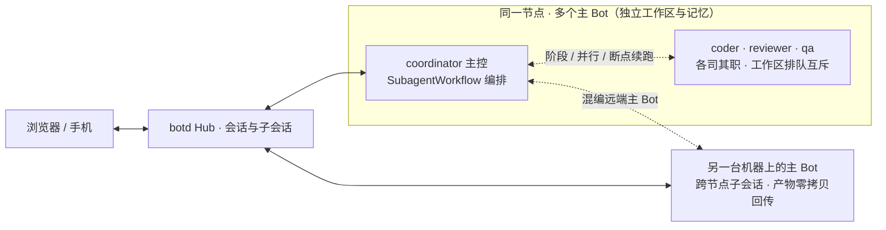

<p align="center">
  
</p>

<h1 align="center">botd</h1>

<p align="center">
  <strong>个人与团队的多 Agent 协同工作空间：无论在一台服务器上运行多个专业主 Bot，还是连接多台机器，都能在同一个界面里对话、委派与编排跨 Bot 工作流。</strong>
</p>

<p align="center">
  自托管 · 多模型 · 跨 Bot 工作流 · Web / PWA
</p>

<p align="center">
  <a href="https://github.com/team4u/botd/actions/workflows/ci.yml"></a>
  <a href="LICENSE"></a>
  <a href="package.json">= 24.12.0"></a>
</p>

<p align="center">
  <a href="docs/getting-started.md">开始使用</a> ·
  <a href="#可以这样用">使用场景</a> ·
  <a href="docs/deployment.md">自托管部署</a> ·
  <a href="docs/README.md">完整文档</a> ·
  <a href="CONTRIBUTING.md">参与贡献</a>
</p>

你的代码在笔记本上，服务在 Linux 服务器上。团队共用一台服务器，想让协调、编码、审查、测试各有专职 Bot；或者机器分散在多处，想让它们在同一界面里协同。

botd 为每个 Bot 提供一个单聊会话，把跨 Bot 协作收敛进同一条时间线。主控 Bot 在所属机器上执行命令、并发调度子代理，也可以用 `SubagentWorkflow` 把本地子代理、同节点其他主 Bot 与远端机器上的主 Bot 编排成一条工作流；任务需要独立上下文时，再委派成子会话，回复与文件自动带回。会话或 Bot 可以绑定本地 Git 仓库目录（Space），Bot 直接在你的真实仓库里工作，变更进入 Diff 抽屉审查与回滚。手机也能通过 PWA 接着用。

从一台机器、一个 Bot 开始。需要分工时，在同一节点上加几个专职主 Bot；需要跨机时，接入第二台机器。



## 可以这样用

### 跨 Bot 工作流：编排、观测、干预

主控 Bot 用 `SubagentWorkflow` 编排跨 Bot 工作流：`phase()` 划分阶段，`parallel()` 并发执行；每一步可以指定共享工作区的本地子代理，也可以写 `agentType: "@<botId>"` 委派给同节点或远端机器上的主 Bot，并用 JSON Schema 约束结构化输出。脚本副本与断点日志落在 `<workspace>/.workflows/`，某步失败后用 `resumeFromRunId` 从断点续跑，已完成的步骤直接复用结果。

需要独立上下文的任务委派成子会话：父会话文件零拷贝继承，子会话产物自动回传，`Barrier` 等所有分支汇合后再继续，`[PASS]`/`[IGNORE]` 让汇总静默收敛。运行中随时打开子会话抽屉，实时看思考流与工具调用；方向偏了就插话 `steer`（前台子代理自动转后台），跑完了 `resume` 追问，出问题可以单独停掉某个 run。

→ [多角色协同与子会话](docs/user-guide.md) · [自动化指南](docs/automation.md)

### Space：让 Bot 工作在你的 Git 仓库里

把会话或 Bot 绑定到本地 Git 仓库目录。绑定后 `AGENTS.md` 自动注入上下文，输入 `#` 直接补全仓库文件，并发的子代理各自在独立 worktree 里工作，互不踩踏；同一目录的回合跨会话排队互斥，避免并发写入。

每次代码变更进入 Git Diff 抽屉：Pin 双栏并排对比，消息里引用到具体行，不满意时按单文件两段式回滚。

→ [工作区指南](docs/workspace.md)

### 触发器与外部通知：任务自己跑，结果找到你

Webhook、Cron 与 once 三种触发器让会话自动开始：`eventFilter` 按点号路径匹配载荷字段与数组，`subsession` 派生模式让每次触发都拿到独立上下文，触发载荷隔离落盘。

结果推送到飞书、Slack、Telegram 或通用 Webhook。`tellPolicy` 决定什么时候可以打扰你，Outbox 指数退避保证送达；`botd ask` 在你不在线时降级为渠道摘要，附带免登录 HMAC 一键确认 URL，点链接就能拍板。

→ [触发器](docs/triggers.md) · [外部渠道](docs/channels.md)

### 长任务不怕断连

回合在节点上执行，浏览器断开或 Hub 重启不会杀掉正在跑的任务。重新连接后附着到在途回合，单槽磁盘回执保证每条指令恰好执行一次。Hub 重启后，无法确认结果的孤儿回合诚实标记为 failed 并提示「继续」；节点离线期间积压的任务在 72 小时内补投。

→ [架构说明](docs/architecture.md)

### 从一台机器到一个机群

同一节点上创建 `coordinator`、`coder`、`reviewer` 等专职主 Bot，各自有独立工作目录、模型与记忆；多人共用时，Node 侧按工作区排队互斥。机器分散在多处时，每台接入自己的节点，主 Bot 照常跨节点委派与编排。

节点支持手动或自动升级（`BOTD_AUTO_UPGRADE`）：金丝雀 15 秒就绪探针，失败自动回滚并封禁该版本 30 分钟冷却，tarball 经 sha512 供应链校验。

→ [团队协作](docs/team.md) · [部署指南](docs/deployment.md)

### 为高频操作保留肌肉记忆

输入框就是终端：`#` 唤起四级模糊匹配的文件补全，`@` 点名 Bot，`/` 打开技能、提示词与扩展命令菜单；底栏秒切模型与七档思考（`off`~`max`）；空输入框按 `↑` 直接编辑上一条，本地保留 50 条发送历史。侧边栏用注意力状态灯标出每个会话的状态（failed 红、待验收绿、运行中蓝脉冲），活跃雷达置顶最多 4 条需要关注的会话，全局搜索直达任意历史消息。

→ [用户指南](docs/user-guide.md)

## 先跑起来

需要 **Node.js ≥ 24.12.0** 和 **pnpm 10.34.9**。首次体验需要一个可用的模型账号或 API Key。

### 1. 启动 Web 和 Hub

```bash
git clone https://github.com/team4u/botd.git
cd botd
corepack enable
corepack prepare pnpm@10.34.9 --activate
pnpm install
pnpm build

# 把示例密码换成自己的密码，保留此终端运行
BOTD_PORT=3002 BOTD_ADMIN_PASSWORD='replace-with-a-long-password' pnpm dev
```

打开 **http://localhost:3001**。使用 `admin` 和刚才设置的密码登录。密码只在首次创建管理员时生效。

开发时，浏览器通过 `3001` 访问前端。Hub 在 `3002` 接收代理请求。

### 2. 接入第一台机器

在网页的节点管理中生成配对码。另开一个终端，在仓库根目录执行：

```bash
# 将 123456 换成网页显示的配对码
pnpm node join http://localhost:3001 --code 123456 --name my-workstation
pnpm node start
```

保持此终端运行，等待网页显示节点在线。`pnpm dev` 只启动 Web 和 Hub，节点需要单独启动。

### 3. 发出第一条任务

1. 在网页的模型设置中选择在线节点，登录供应商。
2. 在「节点与智能体」中编辑默认助手，选择可用模型。
3. 打开与 Bot 的单聊，发送：

   > 查看你的工作目录。运行命令，告诉我当前操作系统和 Node.js 版本。

看到工具执行轨迹和回复后，你就有了第一个能在本机做事的 Bot。

完整步骤、常见问题和停止方法见[入门指南](docs/getting-started.md)。长期运行可按[部署指南](docs/deployment.md)配置源码服务或 Docker Compose。

## 能力一览

### 对话体验

| 能力 | 说明 |
| --- | --- |
| `#` 文件补全与 `@` 提及 | 四级模糊匹配补全仓库文件，`@` 直接点名 Bot |
| 底栏秒切模型与思考档位 | 输入框底栏切换 Model 与七档思考（`off`~`max`），不进设置页 |
| `↑` 编辑上一条 | 空输入框按 `↑` 直达编辑最近一条发送，本地保留 50 条历史 |
| `/` 命令菜单 | 技能、提示词与扩展命令统一在一个菜单里渐进式披露 |
| 消息分叉与只读分享 | 从任意消息分叉新话题；会话生成只读链接外发 |
| 上下文水位与 `/compact` | 胶囊提示上下文余量，随时手动压缩 |
| 生成式 UI | 17 个声明式组件（64KB / 64 元素 / 深 6），渲染确认卡、表单与命令面板 |

### 工作区

| 能力 | 说明 |
| --- | --- |
| Space 仓库绑定 | 会话 / Bot 绑定本地 Git 仓库目录，`AGENTS.md` 自动注入 |
| 子代理 worktree 隔离 | 并发子代理各自在独立 worktree 里工作，互不踩踏 |
| Git Diff 抽屉 | 双栏并排、行级引用、单文件两段式回滚 |
| 回合互斥 | 同一目录的回合跨会话排队，避免并发写入 |

### 多智能体

| 能力 | 说明 |
| --- | --- |
| `SubagentWorkflow` | 阶段 / 并行 / 断点续跑，混编本地子代理与跨 Bot 步骤 |
| 深度干预 | `steer` 插话、`resume` 追问、单停某个 run |
| 跨 Bot 子会话委派 | 产物零拷贝继承、`Barrier` 汇合、`[PASS]`/`[IGNORE]` 静默收敛 |
| 分层长期记忆 | 节点共享 / Bot 独立 / 按需读取的主题记忆三层 |

### 自动化

| 能力 | 说明 |
| --- | --- |
| 触发器 | `webhook` / `cron` / `once`；`eventFilter` 支持点号路径与数组匹配 |
| 子会话派生 | 触发器按 `subsession` 模式派生独立会话，载荷隔离落盘 |
| 后台任务与产物 | 耗时命令后台化并在抽屉里管理；产物跨会话、跨节点流转 |

### 通知

| 能力 | 说明 |
| --- | --- |
| 四渠道 | 飞书 / Slack / Telegram / 通用 Webhook |
| `tellPolicy` | 按策略决定什么时候可以打扰你 |
| Outbox 重试 | 指数退避，保证通知送达 |
| `botd ask` 降级 | 你不在线时降级为渠道摘要，附带免登录 HMAC 一键确认 URL |

### 可靠性

| 能力 | 说明 |
| --- | --- |
| 断连容错 | 断连不杀回合；在途附着 + 单槽磁盘回执，保证恰好执行一次 |
| 孤儿回合处理 | Hub 重启后诚实置 `failed`，提示一键「继续」 |
| 离线补投 | 离线节点积压的任务 72 小时内补投 |
| 节点升级 | 金丝雀 15s 就绪探针、失败自动回滚 + 版本封禁 30 分钟、tarball sha512 校验 |

### 安全

| 能力 | 说明 |
| --- | --- |
| 凭据本地化 | 模型凭据只保存在节点 `~/.botd/`，不经过 Hub |
| 明确的权限边界 | 工具以节点系统用户权限执行，边界与部署要求见[安全文档](docs/security.md) |

### 生态

| 能力 | 说明 |
| --- | --- |
| 技能与扩展安装 | npm / git / GitHub 单目录 / Pi Package 兼容，`install --bot` 一键挂载到 Bot |
| 跨节点技能同步 | 技能在节点之间自动同步 |
| PWA | 手机安装到主屏幕，独立窗口使用 |

## 运行在哪里，数据就怎样分工

**Hub** 提供网页、账户、会话记录和任务调度。**Node Agent** 在每台接入的机器上运行，负责模型调用、文件读写和工具执行。一个 **Bot** 属于一个节点。

模型凭据保存在节点本地。Bot 的配置、记忆、工作目录和模型会话文件默认放在 `~/.botd/`。Hub 保存公屏消息、用户与节点信息等数据。

Bot 的 Bash 和文件工具使用 Node Agent 的系统用户权限。工作目录隔离不等于操作系统沙箱。部署前请了解[安全边界](docs/security.md)。

实现使用 TypeScript、React / Vite、Hono、SQLite 和 Pi SDK。通信与存储的细节见[架构说明](docs/architecture.md)。

## 文档

全部文档按读者路径组织，见[文档目录](docs/README.md)。常用入口：

- 上手：[入门指南](docs/getting-started.md) · [用户指南](docs/user-guide.md) · [工作区指南](docs/workspace.md)
- 自动化：[自动化指南](docs/automation.md) · [触发器](docs/triggers.md) · [外部渠道](docs/channels.md)
- 运维：[部署指南](docs/deployment.md) · [配置参考](docs/configuration.md) · [安全边界](docs/security.md) · [故障排查](docs/troubleshooting.md)
- 开发：[开发指南](docs/development.md) · [架构说明](docs/architecture.md) · [扩展开发](docs/extensions.md) · [生成式 UI](docs/generative-ui.md) · [HTTP API](docs/api.md) · [CLI 参考](docs/cli.md) · [测试指南](docs/testing.md)

## 开发与贡献

需要 Node.js ≥ 24.12.0 和 pnpm 10.34.9。本机开发 Web 使用 `3001`、Hub 使用 `3002`（`BOTD_PORT=3002`），不占用 `3000`；生产部署与 Compose 默认端口仍为 `3000`。

```bash
git clone https://github.com/team4u/botd.git
cd botd
corepack enable
corepack prepare pnpm@10.34.9 --activate
pnpm install
pnpm build
BOTD_PORT=3002 pnpm dev
```

提交 Pull Request 前请阅读[贡献指南](CONTRIBUTING.md)。欢迎提交问题、使用反馈和 Pull Request：描述具体任务、复现步骤与预期结果，能帮助我们更快定位问题。

botd 使用 [MIT 许可证](LICENSE)。
