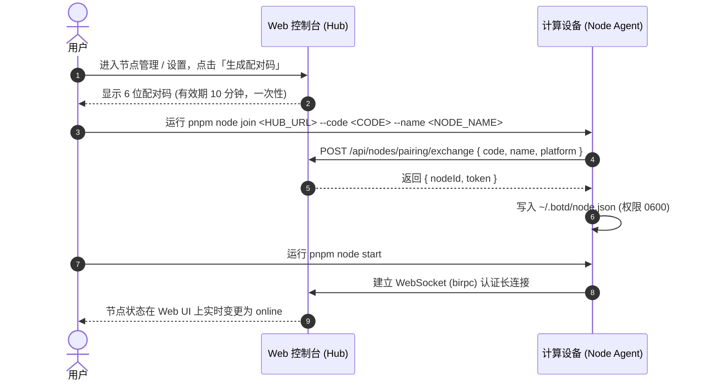

# botd

> 遵循 UNIX 哲学的轻量级多节点个人 AI BOT 协作平台。以 Web/PWA 为统一入口，通过自包含的 Node Agent 接入多台计算设备，驱动不同大模型与本地 CLI 工具（如 `ad`、`herdr`）协同工作。

***

## 1. 核心架构与设计哲学

- **独立配置与资源加载**：Node Agent 将 Pi SDK 作为内部库加载，所有状态存储在独立的 `~/.botd/` 目录下。SDK 不自动扫描宿主机的 `~/.pi/`、祖先 `.pi/` 或 `AGENTS.md`。
- **一切皆目录**：每个 BOT 严格映射为所属节点上的 `~/.botd/bots/<botId>/` 目录，包含配置、人设、记忆与独立工作区。
- **零业务 Adapter**：不编写任何 `ad-adapter` 或 `herdr-actions` 等中介包装代码。BOT 直接阅读 `SKILL.md` 学习命令行用法，并通过内置 `bash` 工具直接调用本机 CLI 命令。
- **公屏共享结论，私域隔离草稿**：群聊中各 BOT 仅共享公屏最终结论；各 BOT 运行 bash、读写文件的完整日志保留在各自节点的私有 `.jsonl` 文件中，互不干扰。
- **非阻塞执行与 `botd wake` 回调**：耗时任务在后台执行，外部脚本或事件钩子可通过 `botd wake` 命令向会话注入唤醒消息，触发 BOT 在群内自动汇报。
- **跨节点文件管道与产物交换**：原生支持多模态附件与产物在 Web 界面和各计算节点间透明流转，自动落盘隔离工作区，免除外部依赖。
- **人机协同确认最小阻力**：一行 `botd ask` 即可在 Web 端实时弹出交互确认卡片挂起等待人类决策，结果直接返回标准输出。

***

支持的模型 ID 取决于锁定版本的 Pi SDK 模型目录。默认助手使用 `anthropic/claude-sonnet-4-5`；未知模型会明确报错。配置和工作目录隔离不构成操作系统沙箱，Bash 与文件工具使用启动 Node Agent 的系统用户权限。

## 2. 环境要求与前置依赖

- **Node.js**：`>= 24.12.0`（利用原生 `node:sqlite`、最新标准库及安全特性）
- **pnpm**：`10.34.9`（通过 Corepack 激活管理）

### 启用 pnpm

```bash
corepack enable
corepack prepare pnpm@10.34.9 --activate
```

***

## 3. 本地安装与开发流程

### 3.1 安装依赖与编译

```bash
# 1. 检出代码并安装依赖
pnpm install

# 2. 编译所有子包（@botd/protocol, apps/hub, apps/node, apps/web）
pnpm build

# 3. 类型校验
pnpm typecheck

# 4. 执行测试套件
pnpm test
```

### 3.2 运行脚本一览

| 命令 | 说明 |
| :--- | :--- |
| `pnpm dev` | 并行启动 Cloud Hub（端口 3000）与 Web Vite Dev Server（端口 5173，自动反向代理 API 与 WS） |
| `pnpm dev:hub` | 仅以开发监听模式启动 Hub 服务 |
| `pnpm dev:web` | 仅启动 Web 前端开发服务器 |
| `pnpm start` | 启动生产环境 Cloud Hub（兼具 API 与 Web 静态托管） |
| `pnpm node <cmd>` | 调用 Node Agent CLI（即 `botd` 命令），支持 `join`、`start`、`wake`、`ask`、`artifact` 等 |

***

## 4. Web 登录与认证

- **登录地址**：
  - 生产环境 / Docker：`http://localhost:3000`
  - 开发环境：`http://localhost:5173`
- **多用户登录**：使用「用户名 + 密码」登录（`POST /api/auth/login`），成功后写入绑定用户的 `HttpOnly; SameSite=Strict` Cookie（有效期 7 天），后续调用自动鉴权。
- **首个自举账号**：首次启动时自动创建管理员账号 `admin`，密码由环境变量 `BOTD_ADMIN_PASSWORD` 初始化（默认 `admin`）：
  ```bash
  export BOTD_ADMIN_PASSWORD="YourSecurePasswordHere"
  ```
- **用户管理（仅 admin）**：admin 可在 Web「用户管理」中创建/删除成员账号、重置成员密码；成员无法访问用户管理接口。
- **按用户隔离**：团队可共用同一个 Hub。每个用户只能看到自己的节点、BOT 与会话；配对码绑定创建者，非本人的节点/BOT/会话接口一律返回 403。

***

## 4.1 Web 会话交互模型

侧边栏采用「Bot 通讯录 + 话题重置」模型：

- **智能体（通讯录）**：直接展示所有 BOT，点击即进入与其的默认单聊会话；会话不存在时自动静默创建，无需弹窗选人。列表项同时展示所属节点与在线状态。
- **群聊**：主持/圆桌模式会话列表，支持新建、重命名、成员调整、清空消息与删除。
- **历史话题**：默认折叠。开启新话题后旧会话自动归档至此，仍可点开查看或继续；给历史单聊发消息会按最近活跃自然回归为该 BOT 的当前窗口。
- **开启新话题**：三种入口——聊天头部按钮、「更多」菜单项、输入框发送 `/new`。底层会克隆配置新建 Session 并归档旧会话，既保留完整的多会话上下文隔离，又拥有「一个 BOT 一个窗口」的顺滑体验。
- **编辑重发**：任意已发送的用户消息可编辑（铅笔按钮，编辑复用底部输入框，支持斜杠命令与 @ 提及补全）。保存后：该消息之后的所有回复被移除，全体成员 BOT 的本地会话记忆（`.jsonl`）同步删除，并自动从编辑后的消息重新生成回复。
- **分叉**：任意消息（含 BOT 回复）可一键分叉断会话（⑂ 按钮）：从该消息（含）复制历史到新会话，原会话不受任何影响；新会话首回合自动从复制的全量历史重建 BOT 上下文。适合对照实验与多方案并行探索。
- **工具执行轨迹（Tool Trace）**：Assistant 消息持久化展示可折叠的工具调用步骤（名称、状态、命令/文件摘要及毫秒级耗时），执行细节与长输出收敛折叠，不冲乱公屏。
- **Token 与上下文水位线**：每条回复底部精确展示输入/输出 Token 消耗及当前会话占模型最大上下文窗口的百分比（例如 `2,140 tokens · 1% ctx`），水位直观可见。
- **多模态附件与预览**：输入框支持粘贴图片（截图直发）与上传文件附件，发送后由 Node Agent 自动下载并落盘至目标 BOT 的 `workspace/inbox/` 目录；公屏消息流原生支持图片缩略预览（点击放大）与产物文件点击下载。
- **人机交互确认卡片**：配合 `botd ask`，公屏实时弹出包含选项按钮的交互卡片，人类点击决策或输入文本后即时解挂终端命令。
- **「对话即沉淀」与 Skill Creator（技能创建器）**：内置「创建技能」元技能，BOT 在对话中即可将刚跑通的流程沉淀为标准 `SKILL.md`（写入 `~/.botd/skills/<id>/`），执行 `botd reload` 立即上线，Web 端勾选启用；节点管理页支持将技能一键同步分发至其他在线计算节点。
- **主动触发器与后台系统通知**：支持为会话配置自动化触发器（Webhook + 标准 Cron 表达式定时任务）；当浏览器标签页处于后台时，BOT 回复完成自动通过 Web Notification 弹出系统桌面通知。
- **消息操作**：整条消息悬停复制、代码块复制、跨天时间显示；会话运行中可随时停止（发送/停止二合一按钮）。
- **记忆一致性**：删除会话、清空消息、编辑重发均会同步重置成员 BOT 的本地会话记忆，保证 BOT 不会「记得」已被删除的内容。

***

## 5. 真实节点配对与上线流程

整个配对流程无需手动复制私钥或令牌，通过安全的 6 位临时配对码完成交换：



### 5.1 步骤详解

1. **生成配对码**：在 Web 界面点击「生成配对码」，或运行 `botd nodes pair`，得到形如 `839201` 的一次性配对码。
2. **在目标机器上配对**：
   ```bash
   pnpm node join http://127.0.0.1:3000 --code 839201 --name mac-studio
   ```
   *Node Agent 会调用 `/api/nodes/pairing/exchange` 交换凭证，并安全写入 `~/.botd/node.json`（权限设为 0600）。*
3. **启动 Node Agent 守护进程**：
   ```bash
   pnpm node start
   ```
   *守护进程启动后，建立到 Hub 的 WebSocket 长连接，并监听本地 Unix Domain Socket `~/.botd/agent.sock`。*

***

## 6. 异步任务唤醒与人机协同机制（`botd wake` / `botd ask`）

在长耗时任务（如通过 `herdr` 执行后台编译、外部脚本轮询）完成后，外部程序可通过执行 `botd wake` 命令主动唤醒指定会话。

### 6.1 命令格式

```bash
botd wake --session <sessionId> --bot <botId> --message "构建成功，所有单元测试均已通过！" [--reply-to <botId>]
```

本地源码运行时，可用 `pnpm node wake ...` 执行相同命令。BOT 的 Bash 环境会自动加入独立的 `bin/botd`；容器内也可直接调用 `botd`。新增 `--reply-to <botId>` 参数支持在异步唤醒完成后自动将发言权交接给指定 BOT，实现跨节点自动化接力。

### 6.2 环境变量自动回退

当 BOT 通过 `bash` 工具在本地执行脚本时，Node Agent 会自动在执行环境中注入以下环境变量：
- `BOTD_SESSION_ID`
- `BOTD_BOT_ID`

此时外部脚本可省略参数，直接调用：
```bash
botd wake --message "后台任务执行完成"
```

### 6.3 唤醒原理

1. `botd wake` 向本地 Unix Domain Socket `~/.botd/agent.sock` 发送 `POST /wake` 请求。
2. Node Agent 通过当前长连接向 Cloud Hub 调用 `hubRpc.requestWakeupTurn`。
3. Hub 在公屏消息流中插入一条系统回调消息（`role: "callback"`, `content: "[Wake-up] ..."`）。
4. Hub 将该唤醒任务推入会话的串行队列，触发对应的 BOT 接续发言汇报进度（若指定 `--reply-to` 则接续交由该 BOT 发言）。

### 6.4 一行命令的人机协同交互卡片（`botd ask`）

当 BOT 在节点上运行自动化脚本需要人类确认（如生产环境部署确认、敏感命令授权、参数选择）时，可直接在 Bash 中调用 `botd ask`：

```bash
choice=$(botd ask "是否确认执行数据库迁移？" --options "确认,取消" --timeout 300)
if [ "$choice" = "确认" ]; then
  pnpm migrate
fi
```

- **交互卡片实时弹出**：`botd ask` 向本地 Unix Domain Socket `~/.botd/agent.sock` 发送请求，Cloud Hub 在 Web 聊天界面向该会话公屏实时推送交互按钮卡片并挂起等待用户操作（支持 `--options "选项1,选项2"` 渲染选项按钮，未指定时渲染单行输入框）。
- **纯净 stdout 管道输出**：用户在 Web 端点击选项或输入后，答案即时传回节点并直接输出到 stdout（支持 `--json` 输出 `{ ok: true, answer: "..." }`），供脚本无缝捕获；若超时未作答则以非零状态码退出并报错。

***

## 7. 节点数据布局与隔离规范（`~/.botd`）

Node Agent 默认将所有数据保存在 `~/.botd/` 目录下（支持通过 `--data-dir` 或环境变量 `BOTD_DATA_DIR` 覆盖）：

```text
~/.botd/
├── node.json                        # 节点通信凭证 (nodeId, name, hubUrl, token, 0600)
├── agent.sock                       # 本地 UDS 监听（供 botd wake 触发回调）
├── skills/                          # 本节点公共 Skill 资源池
│   └── cli-helper/
│       └── SKILL.md                 # 首次启动时创建的 CLI 示例技能
├── .agent/                          # 独立的 SDK 凭据与模型目录配置（auth.json 凭据、models.json 自定义供应商）
├── bin/botd                         # 首次运行模型时创建的本地 CLI 入口
└── bots/                            # BOT 实例存储目录
    ├── pm-claude/
    │   ├── bot.json                 # BOT 元数据配置（模型、启用技能等）
    │   ├── SYSTEM.md                # 角色人设与基础系统提示词
    │   ├── MEMORY.md                # 长期记忆（BOT 可自主读写更新）
    │   ├── workspace/               # BOT 执行 bash 命令的专属工作区（隔离 cwd）
    │   │   └── inbox/               # Web 上传多模态附件自动落盘目录
    │   ├── prompts/                 # Pi 原生提示词模板，文件名对应 /命令名
    │   │   └── review.md
    │   └── sessions/                # 私域对话与完整工具执行日志
    │       └── sess_01J9X.jsonl
    └── mac-coder/
        └── ...
```

### 7.1 模型凭证优先级（Key Precedence）

Node Agent 运行时严格遵循以下凭证加载优先级：
1. **最高优先级**：宿主机显式声明的环境变量 `BOTD_API_KEY_<PROVIDER>`（例如 `BOTD_API_KEY_ANTHROPIC`、`BOTD_API_KEY_OPENAI`、`BOTD_API_KEY_DEEPSEEK`、`BOTD_API_KEY_GOOGLE`、`BOTD_API_KEY_OPENROUTER`）。
2. **节点本地凭据**：节点本地 `~/.botd/.agent/auth.json` 中由 Pi SDK 登录流程保存的 API Key 或 OAuth 凭据（通过 Web 的节点登录流程写入，详见 7.2）。
3. **配置隔离**：不读取宿主机 `~/.pi/` 中的配置或登录状态，也不自动回退到宿主机普通供应商 Key 环境变量；Hub 不存储任何模型 Key。

### 7.2 完整供应商、模型与鉴权

模型设置与 BOT 编辑器从 Pi SDK 获取供应商和模型目录，不在网页中维护固定列表。当前锁定的 SDK 1.4.0 提供 42 个供应商、1599 个聊天模型，包括 Mistral、Groq、Cerebras、xAI、Z.AI、Kimi、MiniMax、GitHub Copilot、Azure、Bedrock 等。后续升级 SDK 时，目录会随之更新。

进入「模型设置」后，可以搜索供应商并选择在线节点，使用该供应商由 SDK 声明的原生鉴权方式完成登录。OAuth 授权、设备码、手动回调和 API Key 的账号/区域等附加配置均复用 Pi SDK 的交互流程。所有凭据（包括 API Key 与 OAuth 令牌）都保存在所选节点本地（`~/.botd/.agent/auth.json`）；Hub 只转发登录交互和状态，不保存任何 Key 或令牌。

在远程节点授权时，若浏览器回调无法到达节点，按页面提示粘贴完整回调 URL 或授权码。可随时取消登录或清除该节点的 SDK 凭据。只支持 OAuth 的供应商不显示新增 API Key 输入框。

BOT 编辑器可搜索供应商，并从节点实际的模型目录选择型号、查看推理能力和上下文长度。节点自定义模型也会进入目录。手动输入的型号需要先在节点注册，运行时不会猜测供应商接口。


***

## 8. 会话模式与多 BOT 协作

botd 支持统一的 Session 模型，提供三种会话模式：

### 8.1 模式行为规则

| 模式 | 交互规则 |
| :--- | :--- |
| `direct`（单聊） | 用户与指定的单一 BOT 进行一对一对话。人类发言默认触发该 BOT。 |
| `lead`（负责人群聊） | 设立一个 `Lead BOT`（群负责人）。若人类发言未包含 `@`，默认由 `Lead BOT` 响应；`Lead BOT` 可在输出正文中通过 `@member-bot` 将子任务委派给其他成员，形成传麦接力。 |
| `roundtable`（圆桌讨论） | 适用于多模型同题评审。普通圆桌中，除 `Lead BOT` 外的所有成员 BOT 按序依次发言，最后由 `Lead BOT` 发言进行全场总结；开启「独立盲评并发模式」时，成员 BOT 互不锚定、并发思考。 |

### 8.2 精准 `@` 传麦

普通聊天中，无论是人类发言还是 BOT 输出，只要正文中包含有效的 `@<botId>`，调度器均会精准解析并将指定 BOT 顺序推入当前会话的执行队列。斜杠命令的目标选择遵循下方的独立规则，参数中的 `@` 不会触发传麦。

### 8.3 Pi 原生斜杠命令

在消息开头输入 `/`，即可搜索当前 BOT 可用的 Skill、提示词模板和已允许的扩展命令。菜单直接使用 Pi 加载的命令名称和描述；上下键选择，Enter 或 Tab 补全命令后继续输入参数，发送时由 Pi 解析和执行。Esc 关闭菜单并保留原文。网页不展开模板，也不把技能正文插入输入框。

- **Skill**：使用 `/skill:<name> 补充要求`，名称与描述来自已启用技能的 `SKILL.md` frontmatter。Pi 在系统提示词中原生广播已启用技能的名称与描述，全文按需加载：显式 `/skill:` 调用，或由 BOT 自主读取 `SKILL.md`。只有框架内置的 `botd-cli` 技能仍全文常驻注入。
- **提示词模板**：将原生 Markdown 模板放入节点的 `~/.botd/bots/<botId>/prompts/`，例如 `review.md` 对应 `/review`。Pi 负责解析 frontmatter 和替换 `$1`、`$@` 等参数。已启用扩展包声明的提示词也由 Pi 加载。
- **扩展命令**：继续通过 `pi.registerCommand()` 定义。在 BOT 编辑器中启用扩展后，其注册的命令会自动出现在 `/` 菜单中，无需逐项配置命令名称。旧配置中的 `webCommandNames` 不再影响命令展示或执行。
- **TUI 边界**：`/hotkeys`、`/settings` 等 Pi 终端内置命令不进入网页菜单。扩展内部是否调用终端 UI 无法仅凭命令目录提前判断，因此扩展命令会正常列出；实际调用 `ctx.ui.select()`、`confirm()`、`input()` 或自定义 TUI 组件等未支持的 UI 时，网页明确返回“此命令需要终端界面，当前网页不支持”，不会显示执行成功。提供无界面降级的扩展可通过 `ctx.hasUI` 判断当前环境。

斜杠命令每次只交给一个 BOT：直接发送 `/review 参数` 时由会话负责人执行，圆桌模式也遵循此规则；发送 `@coder /review 参数` 时交给指定成员。命令前只能指定一个 BOT，参数里的 `@other` 保留为参数。历史消息、BOT 回复和唤醒消息中的斜杠不会被重新当作当前命令执行。

模板示例（`prompts/review.md`）：

```markdown
---
description: 审查当前代码修改
argument-hint: "[关注点]"
---
审查当前工作区的代码修改，重点关注 ${1:-正确性和边界情况}。
```

新增接口 `GET /api/bots/:botId/commands` 返回当前 BOT 的可用命令列表，需要登录（仅 BOT 归属用户）且节点在线。命令发现与执行继续保持 BOT 的资源隔离，不扫描宿主机 Pi 配置。

### 8.4 圆桌独立盲评并发模式（Parallel Blind Roundtable）

- **互不锚定，独立推理**：普通圆桌模式下各 BOT 依次串行发言，后发言者容易受到前序模型观点的“认知锚定”影响。在圆桌群聊设置中开启「独立盲评并发模式」（`parallelRoundtable: true`）后，人类提问将同时并发派发给所有成员 BOT，各 BOT 基于同一份上下文独立并行思考与调用工具。
- **同屏流式并发输出**：各模型在 Web 公屏上同屏实时流式呈现，各自展现无偏见的独立分析与决策建议。
- **Lead 汇总裁决**：待全体成员 BOT 独立完成盲评输出后，调度器自动唤起 `Lead BOT`，对全场不同观点进行对比、权衡并输出最终综合裁决。

### 8.5 离线节点队列挂起与上线自愈（Queued State & Auto-Resume）

- **队列挂起（Queued）**：当会话任务轮到某个 BOT 执行，而该 BOT 所在的计算节点处于离线（offline）状态时，调度器不会粗暴报错中断，而是将会话状态自动置为 `queued`（挂起排队），并将任务安全保存在调度队列中。
- **上线自动恢复**：一旦目标节点重新建立 WebSocket 长连接上线（`onNodeOnline`），Cloud Hub 自动探测并激活被挂起的会话队列，自愈式恢复执行后续任务流程，保障跨节点协作的高可用。

***

## 9. 跨节点文件管道与多模态附件（Artifact Pipeline）

botd 原生打通了 Web 控制台与分布在各处的 Node Agent 计算节点之间的文件流转通道，无需配置任何第三方对象存储或共享 NFS：

### 9.1 Web 多模态交互与自动落盘

- **剪贴板粘贴与附件上传**：Web 聊天输入框支持直接粘贴截图（Ctrl+V / Cmd+V）或点击附件按钮上传任意文件。
- **自动落盘到目标工作区**：当会话将任务分发给目标 BOT 时，Node Agent 自动从 Hub 下载文件并落盘至该 BOT 专属工作区的 `workspace/inbox/<filename>` 目录下。
- **上下文感知与工具调用**：Node Agent 自动在提示词中注入附件通知（包含路径、MIME 类型和字节大小），BOT 可直接通过 `bash` 工具读取、解析或处理该文件。
- **公屏预览与下载**：公屏消息流原生支持图片缩略预览（点击放大查看）以及普通附件的一键下载链接。

### 9.2 CLI 跨节点文件流转（`botd artifact`）

BOT 或用户可在计算节点上通过 `botd artifact` 系列命令跨节点传递文件与构建成果：

- **上传产物**：
  ```bash
  botd artifact put ./build/report.pdf --message "测试报告生成完毕，请查收"
  ```
  *将本地文件推送到当前会话共享产物管道，并在公屏广播通知。*
- **拉取产物**：
  ```bash
  botd artifact pull <artifactId> -o ./dist/report.pdf
  ```
  *从会话产物管道中拉取指定产物到本地文件系统（默认保存为 `./<filename>`）。*
- **查看列表**：
  ```bash
  botd artifact list
  ```
  *列出当前会话的所有产物清单（产物 ID、文件名、大小及创建时间）。*

典型跨节点协作：节点 A 上的 Coder BOT 编译打包产出文件后调用 `botd artifact put`，节点 B 上的 Reviewer BOT 或部署脚本通过 `botd artifact pull` 直接拉取验证，实现完全去中心化的节点协同。

***

## 10. 「对话即沉淀」Skill Creator 与跨节点同步

botd 践行“对话即沉淀”理念，让 BOT 的优秀经验与自动化流程快速转化为持久资产。提炼能力不再是 Web 界面按钮，而是框架内置的元技能——由 BOT 自己写文件完成：

### 10.1 Skill Creator（技能创建器）

- **内置元技能**：框架自带的 `botd-cli` 内置技能包含「Skill creator」章节，每个 BOT 天然掌握技能沉淀方法。当用户说「沉淀为技能」「记住这个流程」，或 BOT 刚在本机跑通一个可复用流程时，即可自行提炼。
- **BOT 亲手写文件**：BOT 直接写入 `~/.botd/skills/<skill-id>/SKILL.md`（短小写 id：a-z0-9-），包含 YAML frontmatter（`name`、`description`）与 **When to use** / **Steps**（可直接复制的真实命令）/ **Gotchas** 三段正文，全文控制在约 80 行内——只沉淀新会话真正需要的内容，拒绝占位符与臆造参数。
- **立即上线**：写入后执行 `botd reload`，daemon 重新向 Hub 注册资源，新技能即时出现在 Web 端；随后在 Web BOT 编辑器（或 `botd bots update --help`）中为对应 BOT 勾选启用即可。

### 10.2 跨节点一键同步

- **单机沉淀，全网复用**：在 Web「节点管理」页面中，每个节点的公共技能列表均配备一键「同步」功能。
- **按需分发**：勾选其他在线目标节点后，Hub 自动通过节点 RPC 读取源节点文件并批量分发写入目标节点，同时刷新各节点的技能注册表，无需手动复制或 SSH 登录各设备。

***

## 11. 主动触发器与自动化任务（Triggers & Webhooks）

botd 支持在会话中配置多种主动触发器，让 BOT 从“被动问答”升级为“主动监控与执行”：

### 11.1 触发器类型

| 触发器类型 | 标识（`kind`） | 说明 |
| :--- | :--- | :--- |
| **Incoming Webhook** | `webhook` | 会话生成唯一的安全 URL（`POST /api/webhooks/:token`，无需 Cookie）。外部 CI/CD、监控系统（如 Prometheus、Sentry）或飞书/企业微信机器人推送时，Hub 自动提取 JSON Payload 或文本，组装提示词唤醒指定 BOT。 |
| **定时任务（Cron）** | `cron` | 按标准 5 字段 Cron 表达式（服务器本地时间，支持 `*/n` 步进、区间、列表与周几；Web 端内置常用预设一键填充，如 `*/15 * * * *` 每 15 分钟、`30 9 * * *` 每天 09:30、`0 9 * * 1-5` 工作日 09:00）自动唤醒指定 BOT 执行巡检、轮询或每日报表任务。 |

### 11.2 CLI 触发器管理

```bash
# 查看会话的所有触发器
botd triggers list <sessionId>

# 创建 Webhook 触发器
botd triggers create <sessionId> --name "CI 构建告警" --bot ci-bot --prompt "分析构建日志并汇报" --kind webhook

# 创建周期轮询触发器（每 15 分钟）
botd triggers create <sessionId> --name "磁盘巡检" --bot ops-bot --prompt "检查各磁盘水位并告警" --kind cron --cron "*/15 * * * *"

# 创建每日定时触发器（每天 09:30）
botd triggers create <sessionId> --name "晨会报表" --bot pm-bot --prompt "生成昨日指标简报" --kind cron --cron "30 9 * * *"

# 工作日每天 09:00
botd triggers create <sessionId> --name "工作日站会" --bot pm-bot --prompt "汇总站会要点" --kind cron --cron "0 9 * * 1-5"

# 删除指定触发器
botd triggers delete <triggerId>
```

### 11.3 浏览器后台系统通知（Web Notification）

当用户切换至其他标签页或浏览器处于后台时，会话中任意 BOT 执行完成或触发器响应完毕后，botd 会调用浏览器原生 Web Notification 发出桌面系统通知。点击通知卡片可直接聚焦浏览器并切换至对应会话，兼顾免打扰与即时触达。

***

## 12. 安全边界、取消与异常处理

1. **接力上限熔断（Relay Limit）**：
   - 为杜绝多 BOT 间相互 `@` 陷入死循环，系统对单次人类发言触发的接力链条设置最大轮次上限 `MAX_RELAY_TURNS = 5`。达到上限后自动停止接力。
2. **任务取消（Cancellation）**：
   - 用户在 Web 端点击「Stop」按钮或调用 `POST /api/sessions/:id/cancel` 时，Hub 立即清空该会话的待处理队列，并通过 RPC 向当前正在运行的 Node Agent 发送 `cancelTurn` 中断底层推理与工具执行，抑制延迟响应。
3. **失败处理（Failure Handling）**：
   - 若遇到模型调用超限、API Key 缺失或网络中断，系统将会话状态更新为 `failed`，通过 SSE 向公屏推送系统级错误提示，并立即终止后续接力，**绝不伪造虚假回复内容**。

***

## 13. CLI 工具与零 Adapter 原则

botd 拒绝在后端堆叠硬编码的 SDK 适配器：
- 节点安装真实的 ActionDock（`ad`）与 Herdr（`herdr`）命令行工具。
- 用户或 BOT 将 CLI 的 `--help` 与操作说明存入 `~/.botd/skills/<skillId>/SKILL.md`。
- BOT 在推理时自主查阅 `SKILL.md`，使用原生 `bash` 工具直接在独立 `workspace` 中执行命令。
- **内置 `botd-cli` skill**：daemon 启动时自愈式保证 `~/.botd/skills/botd-cli/SKILL.md` 存在且为当前版本（同版本内用户可改，版本升级时覆盖），每个 BOT 的轮次无条件注入该 skill（不受 `enabledSkills` 限制），使所有 BOT 天然掌握框架 CLI 的用法纪律：`--json` 输出、`--help` 发现、`botd wake` 异步回报、以及“勿在自身轮次中 restart daemon”等安全约束。

### 13.1 `botd` 命令行（Commander 重构后）

同一个 `botd` 二进制承载两种角色，命令面与 Web 端功能一一对应，供 AI 代理/脚本驱动全部管理能力：

**全局选项**（可出现在任意子命令前后）：`--json`（机器可读输出，错误统一为 stderr + 非零退出码）、`--data-dir <dir>`、`--hub <url>`、`--password <pwd>`（或 `BOTD_ADMIN_PASSWORD`）、`--timeout <seconds>`。

**节点侧角色**（操作本机 daemon）：

| 命令 | 用途 |
|---|---|
| `botd join <hubUrl> --code <code> --name <name>` | 用配对码接入 Hub |
| `botd start [-d\|--detach] [--log-file <path>]` | 启动 daemon；`-d` 后台运行（日志默认 `<dataDir>/daemon.log`） |
| `botd status` | daemon 运行状态（pid/uptime/Hub 连接；未运行时退出码 1） |
| `botd stop` | 优雅停止（socket `/shutdown` → pid 文件 SIGTERM 兑底） |
| `botd restart [-d]` | 停 + 起一条命令完成重启 |
| `botd reload` | 重新向 Hub 注册本机 skills/extensions/bots（拾取 Web 外写入的文件，如 BOT 新沉淀的技能） |
| `botd wake --session <id> --bot <id> --message <msg> [--reply-to <botId>]` | 异步唤醒会话（支持环境变量，`--reply-to` 唤醒后自动传麦） |
| `botd ask <prompt> [--options "选项1,选项2"] [--timeout 300]` | 人机交互确认，Web 弹卡片，输出结果至 stdout |
| `botd artifact put <file> [--message "..."]` | 上传本地文件至会话共享产物管道 |
| `botd artifact pull <artifactId> [-o <path>]` | 下载会话共享产物至本地工作区 |
| `botd artifact list` | 查看当前会话产物列表 |
| `botd install <source> [--kind auto\|skill\|extension] [--id <id>]` | 本机安装资源并热重载 |

daemon 在本地 `agent.sock` 上暴露控制端点（`/wake`、`/reload`、`/status`、`/shutdown`），并维护 `<dataDir>/daemon.pid`；`botd stop/restart/status` 都基于这套控制面实现，改完代码后 `botd restart -d` 即生效。

**Hub 管理角色**（与 Web 端一一对应）：

| 命令组 | 命令 | 对应 API |
|---|---|---|
| 认证 | `login <hubUrl> [--username <name>] [--save-credentials]` / `logout` / `health`（`--username` 默认 `admin`，可用 `BOTD_USERNAME` 指定） | `/api/auth/*`、`/api/health` |
| 节点 | `nodes list` / `nodes pair` / `nodes install <node> <source>` | `/api/nodes*`（含 `POST /api/nodes/:id/restart` 远程重启；Web 端节点卡片提供同功能按钮与 PID/运行时长展示，远程重启 = daemon 先 spawn 替代进程再优雅退出，自动重连） |
| BOT | `bots create\|update\|delete`、`bots system get\|put`、`bots memory get\|put` | `/api/bots*` |
| 会话 | `sessions list\|create\|update\|messages\|cancel\|delete\|clear\|edit\|fork` | `/api/sessions*`（含 `DELETE`、`PUT messages/:id`、`POST fork`） |
| 聊天 | `chat send <sess> <msg...> [--wait [s]]` / `chat watch <sess> [--duration s]` | 消息接口 + SSE 事件流 |
| 产物 | `artifact put\|pull\|list` | `/api/sessions/:id/artifacts*`、`/api/artifacts/:id/content` |
| 触发器 | `triggers list <sess>` / `triggers create <sess> --name <n> --bot <b> --prompt <p> [--kind webhook\|cron] [--cron <expr>]` / `triggers delete <id>` | `/api/sessions/:id/triggers*`、`/api/triggers/:id`、`/api/webhooks/:token` |
| 资源 | `skills get\|put\|delete`、`extensions get\|put\|delete`（需节点在线） | `/api/nodes/:id/skills\|extensions` |
| Provider | `providers login\|status\|respond\|cancel\|logout` | Provider 登录流接口 |
| 模型 | `models catalog [--node <id>]` | `/api/models/catalog` |

内容写入类命令（`skills put`、`bots system put` 等）统一支持 `--file <path>` 与 stdin 管道；`chat send --wait` 先订阅 SSE 再发送，等待本轮 BOT 回复完成后输出（`--json` 返回 `MessageRecord[]`）。

典型 AI 闭环：

```bash
botd login https://hub.example.com --password $BOTD_ADMIN_PASSWORD
botd nodes pair                      # 生成配对码 → 目标机 botd join
botd sessions create --title 任务 --lead assistant-xxx
botd chat send <sessionId> "帮我检查磁盘空间" --wait 120   # 问答一步到位
```

会话凭据持久化在 `~/.botd/cli.json`（0600）；Hub 重启后 token 失效时，带 `--password`/`BOTD_ADMIN_PASSWORD` 的命令会自动重登一次。

***

## 14. Docker 与容器化部署

本项目提供多阶段构建 `deploy/Dockerfile` 与 `deploy/docker-compose.yml` 配置。

### 14.1 架构与端口说明

- **单一对外端口**：生产镜像将 Hono 后端 API、WebSocket Upgrade 以及编译后的 Web SPA 静态资源整合，统一通过 **HTTP 3000** 端口提供服务。
- **环境定义已确认**：
  - Cloud Hub 数据库路径：`BOTD_DB_PATH=/data/hub.sqlite`
  - 服务监听：`BOTD_HOST=0.0.0.0`，`BOTD_PORT=3000`
  - 节点数据持久化路径：`BOTD_DATA_DIR=/data/node`
- **容器内 PATH**：Docker 镜像全局内置 `/usr/local/bin/botd` 执行脚本，确保容器内任意位置可直接执行 `botd wake`。
- **宿主机环境严格隔离**：构建流程已通过 `.dockerignore` 彻底屏蔽宿主机 `~/.pi` 与 `.pi` 目录。

### 14.2 使用 Docker Compose 快速启动 Hub

```bash
# 1. 复制环境变量配置文件并按需修改
cp .env.example .env

# 2. 构建并启动 Cloud Hub
docker compose -f deploy/docker-compose.yml up -d hub

# 3. 检查容器状态
docker compose -f deploy/docker-compose.yml ps
```

访问 `http://localhost:3000` 即可进入 Web 管理界面，使用自举管理员账号 `admin` 登录（密码由 `BOTD_ADMIN_PASSWORD` 初始化，默认 `admin`）。

### 14.3 配对与启动云端附随节点（Cloud Node Profile）

若希望在云服务器上与 Hub 同机运行一个常驻 Node Agent，可以使用 Compose 提供的 `cloud-node` Profile：

```bash
# 步骤 1：在 Web 界面获取 6 位配对码（例如 654321）

# 步骤 2：执行一次性容器配对命令（通过内部网络 http://hub:3000 与 Hub 通信）
docker compose -f deploy/docker-compose.yml run --rm cloud-node join http://hub:3000 --code 654321 --name cloud-node-01

# 步骤 3：以守护进程模式启动 cloud-node
docker compose -f deploy/docker-compose.yml --profile cloud-node up -d
```

### 14.4 容器内执行唤醒测试

在 Cloud Node 启动后，可直接通过 `docker compose exec` 验证异步唤醒机制：

```bash
docker compose -f deploy/docker-compose.yml exec cloud-node botd wake --session <sessionId> --bot <botId> --message "来自云端容器的异步通知"
```

### 14.5 数据卷持久化说明

- `hub-data` 命名卷：挂载至 `/data`，持久化保存 `hub.sqlite` 数据库文件。
- `node-data` 命名卷：挂载至 `/data/node`，持久化保存云端节点的 `node.json`、`.agent/` 凭据目录、Skill 库以及各 BOT 的记忆与工作区。

***

## 15. 环境变量一览表

| 环境变量 | 默认值 | 作用对象 | 详细说明 |
| :--- | :--- | :--- | :--- |
| `BOTD_HOST` | `0.0.0.0` | Cloud Hub | 服务监听主机地址 |
| `BOTD_PORT` | `3000` | Cloud Hub | 服务监听 HTTP/WS 端口 |
| `BOTD_DB_PATH` | `~/.botd/hub.sqlite`（容器内 `/data/hub.sqlite`） | Cloud Hub | SQLite 数据库文件的绝对路径 |
| `BOTD_HUB_DATA_DIR` | `~/.botd` | Cloud Hub | Hub 数据根目录，未指定 DB 路径时使用 |
| `BOTD_ADMIN_PASSWORD`| `admin` | Cloud Hub | 自举 admin 账号密码（首次启动创建账号时生效） |
| `BOTD_USERNAME` | `admin` | CLI | `botd login` 使用的登录用户名（配合 `BOTD_ADMIN_PASSWORD`） |
| `BOTD_WEB_DIR` | `apps/web/dist` | Cloud Hub | 前端 SPA 静态产物目录 |
| `BOTD_DATA_DIR` | `~/.botd`（容器内 `/data/node`）| Node Agent | 节点持久化数据根目录 |
| `BOTD_API_KEY_ANTHROPIC` | 无 | Node Agent | Anthropic Claude API 密钥覆盖 |
| `BOTD_API_KEY_OPENAI` | 无 | Node Agent | OpenAI API 密钥覆盖 |
| `BOTD_API_KEY_DEEPSEEK` | 无 | Node Agent | DeepSeek API 密钥覆盖 |
| `BOTD_API_KEY_GOOGLE` | 无 | Node Agent | Google Gemini API 密钥覆盖 |
| `BOTD_API_KEY_OPENROUTER`| 无 | Node Agent | OpenRouter API 密钥覆盖 |

## 16. 验证范围与运行边界

`pnpm test` 使用临时数据库和数据目录。测试覆盖真实 HTTP/WebSocket RPC、跨节点接力、圆桌调度、接力上限、取消竞态、增量消息、节点重连，以及真实 CLI 配对与唤醒。Pi SDK 测试连接本机受控模型端点，实际执行 Bash，验证系统提示词、Skill 过滤、并发环境变量和私有 JSONL 日志。

这些测试不调用付费模型服务。实际使用前，在 Web 上对节点完成供应商登录（凭据保存在节点本地 `~/.botd/.agent/auth.json`），或给 Node Agent 设置相应的 `BOTD_API_KEY_<PROVIDER>`。内存队列和配对码不会跨 Hub 重启恢复；SQLite 中的配置和公屏消息会保留。Hub 重启后需要重新登录。

ActionDock 与 Herdr CLI 由节点使用者自行安装并提供 Skill；项目不内置这些工具的服务或业务适配器。自定义兼容模型可在节点的 `~/.botd/.agent/models.json` 配置 Pi SDK 模型目录，其 API Key 通过节点本地登录流程或 `BOTD_API_KEY_<PROVIDER>` 提供。
