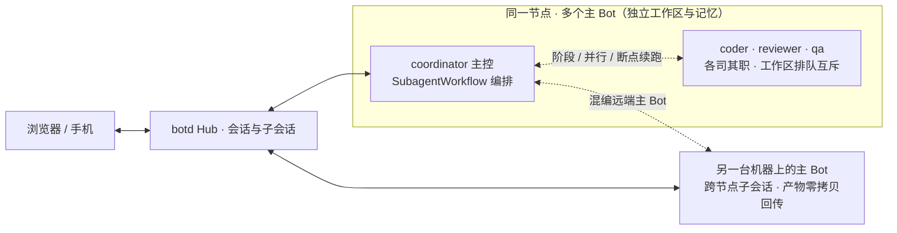

<p align="center">
  
</p>

<h1 align="center">botd</h1>

<p align="center">
  <strong>个人与团队的多 Agent 协同工作空间：无论在一台服务器上运行多个专业主 Bot，还是连接多台机器，都能在同一个界面里对话、委派与编排跨 Bot 工作流。</strong>
</p>

<p align="center">
  自托管 · 多模型 · 跨 Bot 工作流 · Web / PWA
</p>

<p align="center">
  <a href="https://github.com/team4u/botd/actions/workflows/ci.yml"></a>
  <a href="LICENSE"></a>
  <a href="package.json">= 24.12.0"></a>
</p>

<p align="center">
  <a href="docs/getting-started.md">开始使用</a> ·
  <a href="#可以这样用">使用场景</a> ·
  <a href="docs/deployment.md">自托管部署</a> ·
  <a href="docs/README.md">完整文档</a> ·
  <a href="CONTRIBUTING.md">参与贡献</a>
</p>

你的代码在笔记本上，服务在 Linux 服务器上。团队共用一台服务器，想让协调、编码、审查、测试各有专职 Bot；或者机器分散在多处，想让它们在同一界面里协同。

botd 为每个 Bot 提供一个单聊会话，把跨 Bot 协作收敛进同一条时间线。主控 Bot 在所属机器上执行命令、并发调度子代理，也可以用 `SubagentWorkflow` 把本地子代理、同节点其他主 Bot 与远端机器上的主 Bot 编排成一条工作流；任务需要独立上下文时，再委派成子会话，回复与文件自动带回。手机也能通过 PWA 接着用。

从一台机器、一个 Bot 开始。需要分工时，在同一节点上加几个专职主 Bot；需要跨机时，接入第二台机器。



## 可以这样用

### 跨 Bot 工作流编排与断点续跑

主控 Bot 用 `SubagentWorkflow` 编排一条跨 Bot 工作流：脚本里用 `phase()` 划分阶段、`parallel()` 并发执行，每一步可以指定本地子代理（共享工作区），也可以写 `agentType: "@<botId>"` 委派给同节点或跨节点的其他主 Bot（独立工作区），并用 JSON Schema 约束步骤的结构化输出，直接传给下一步。

每次运行会把脚本副本和断点日志落到 `<workspace>/.workflows/`。某步失败或超时后，用 `resumeFromRunId` 从断点继续：已完成的步骤直接复用上次结果，不重新执行；后台跑完的步骤同样会被复用。

适合多阶段发布流水线（构建 → 多平台测试 → 汇总）、需要边跑边修的长任务，或任何“只重跑失败步骤”的场景。

→ [多角色协同与子会话](docs/user-guide.md) · [自动化指南](docs/automation.md)

### 协同过程可观测、可交互

跨 Bot 工作流运行时，Web 端展示阶段队列与步骤进度。点击任意跨 Bot 步骤，右侧打开子会话检视抽屉（`SubSessionDrawer`）：实时查看该子会话的思考流、工具调用与输出，也能在抽屉里直接追问、停止或插话，不离开父会话。

子会话产出的报告和构建文件在父子会话间零拷贝双向同步：父会话的文件自动带到子会话，子会话的新产物自动回传并汇总。

→ [多角色协同与子会话](docs/user-guide.md)

### 单节点多人团队与多机协同

一台服务器就够了：在同一个节点上创建多个不同职责的主 Bot（如 `coordinator`、`coder`、`reviewer`、`qa`），各自有独立工作目录、模型与角色设定，开启团队共享给成员使用。多人同时用到同一个主 Bot 时，Node 侧自动按工作区排队互斥，避免并发写入冲突。

机器分散在多处时，每台机器接入自己的节点，主 Bot 照常跨节点委派与编排。同一套会话、产物与记忆模型在两种拓扑下通用。

→ [团队协作](docs/team.md)

### 分层长期记忆与自动化触发

Bot 的长期记忆分三层：节点共享记忆（同节点所有 Bot 可读，适合放机器级事实）、主 Bot 独立记忆（每个 Bot 自己的 `MEMORY.md` 索引）与按需读取的主题记忆（`memory/<topic>.md`，只在需要时才读，不占上下文）。

配合 Cron 触发器与 Webhook 事件收件箱，Bot 可以定时执行任务或响应外部事件；通知带重试 Outbox，按需策略决定什么时候打扰你。

→ [模型与供应商](docs/models.md) · [技能与自动化](docs/automation.md)

### 把任务留在机器上，把结果带到手机上

让服务器上的 Bot 分析日志，或让笔记本上的 Bot 运行测试。耗时命令可以交给后台任务。任务结束后，Bot 会收到回调，再到会话里汇报。

报告和构建文件可以作为产物上传。另一台机器上的 Bot 也能拉取这些文件。需要你选择下一步时，脚本可以在会话里发出确认卡片。

→ [后台任务、确认与文件交接](docs/automation.md)

### 让 Bot 用上你已经在用的工具

在节点上安装 CLI，再把操作方法写成 `SKILL.md`。Bot 读取技能后，通过 Bash 调用工具。跑通的流程可以保存成技能，供后续会话复用。

你可以为不同 Bot 设置模型、角色、记忆、技能和扩展。节点上的凭据和工作目录由你管理。

→ [模型与供应商](docs/models.md) · [技能与自动化](docs/automation.md)

## 先跑起来

需要 **Node.js ≥ 24.12.0** 和 **pnpm 10.34.9**。首次体验需要一个可用的模型账号或 API Key。

### 1. 启动 Web 和 Hub

```bash
git clone https://github.com/team4u/botd.git
cd botd
corepack enable
corepack prepare pnpm@10.34.9 --activate
pnpm install
pnpm build

# 把示例密码换成自己的密码，保留此终端运行
BOTD_PORT=3002 BOTD_ADMIN_PASSWORD='replace-with-a-long-password' pnpm dev
```

打开 **http://localhost:3001**。使用 `admin` 和刚才设置的密码登录。密码只在首次创建管理员时生效。

开发时，浏览器通过 `3001` 访问前端。Hub 在 `3002` 接收代理请求。

### 2. 接入第一台机器

在网页的节点管理中生成配对码。另开一个终端，在仓库根目录执行：

```bash
# 将 123456 换成网页显示的配对码
pnpm node join http://localhost:3001 --code 123456 --name my-workstation
pnpm node start
```

保持此终端运行，等待网页显示节点在线。`pnpm dev` 只启动 Web 和 Hub，节点需要单独启动。

### 3. 发出第一条任务

1. 在网页的模型设置中选择在线节点，登录供应商。
2. 在「节点与智能体」中编辑默认助手，选择可用模型。
3. 打开与 Bot 的单聊，发送：

   > 查看你的工作目录。运行命令，告诉我当前操作系统和 Node.js 版本。

看到工具执行轨迹和回复后，你就有了第一个能在本机做事的 Bot。

完整步骤、常见问题和停止方法见[入门指南](docs/getting-started.md)。长期运行可按[部署指南](docs/deployment.md)配置源码服务或 Docker Compose。

## 随着任务增加，再用这些能力

| 你想做的事 | 对应能力 |
| --- | --- |
| 换一个话题，又保留之前的讨论 | 新话题、历史会话、消息分叉 |
| 改正提问，重新生成后续回复 | 编辑重发、同步重置 Bot 的会话上下文 |
| 看清 Bot 做过什么 | 工具轨迹、执行输出、Token 用量 |
| 给 Bot 一张截图或一份文件 | 图片粘贴、附件上传、产物下载 |
| 编排多 Bot 多阶段任务，失败了从断点重跑 | 跨 Bot 工作流（`SubagentWorkflow`）与断点续跑 |
| 检视某个委派出去的子任务，中途插话或停止 | 子会话检视抽屉（`SubSessionDrawer`）与产物零拷贝回传 |
| 让每个 Bot 记住长期背景，又不臃肿上下文 | 分层长期记忆（节点 / Bot / 主题） |
| 让任务定时执行，或响应外部事件 | Cron 触发器、Webhook 事件收件箱、子会话派发 |
| 与同事共用 Bot、一起讨论 | 共享 Bot、多人会话、参与者管理 |
| 只在需要时被通知打扰 | 通知通道按需策略（`tellPolicy`）与重试 Outbox |
| 用脚本管理 Bot 和会话 | CLI、JSON 输出、HTTP API、SSE |

→ [用户指南](docs/user-guide.md) · [团队协作](docs/team.md) · [CLI 参考](docs/cli.md) · [HTTP API](docs/api.md)

## 运行在哪里，数据就怎样分工

**Hub** 提供网页、账户、会话记录和任务调度。**Node Agent** 在每台接入的机器上运行，负责模型调用、文件读写和工具执行。一个 **Bot** 属于一个节点。

模型凭据保存在节点本地。Bot 的配置、记忆、工作目录和模型会话文件默认放在 `~/.botd/`。Hub 保存公屏消息、用户与节点信息等数据。

Bot 的 Bash 和文件工具使用 Node Agent 的系统用户权限。工作目录隔离不等于操作系统沙箱。部署前请了解[安全边界](docs/security.md)。

实现使用 TypeScript、React / Vite、Hono、SQLite 和 Pi SDK。通信与存储的细节见[架构说明](docs/architecture.md)。

## 文档与贡献

- 第一次使用：[入门指南](docs/getting-started.md)。
- 准备长期运行：[部署指南](docs/deployment.md)和[配置参考](docs/configuration.md)。
- 想把任务接进现有流程：[自动化指南](docs/automation.md)和[API 参考](docs/api.md)。
- 想修改代码：[贡献指南](CONTRIBUTING.md)、[开发指南](docs/development.md)和[测试指南](docs/testing.md)。
- 按主题查找：[完整文档目录](docs/README.md)。

欢迎提交问题、使用反馈和 Pull Request。描述具体任务、复现步骤与预期结果，能帮助我们更快定位问题。

botd 使用 [MIT 许可证](LICENSE)。
