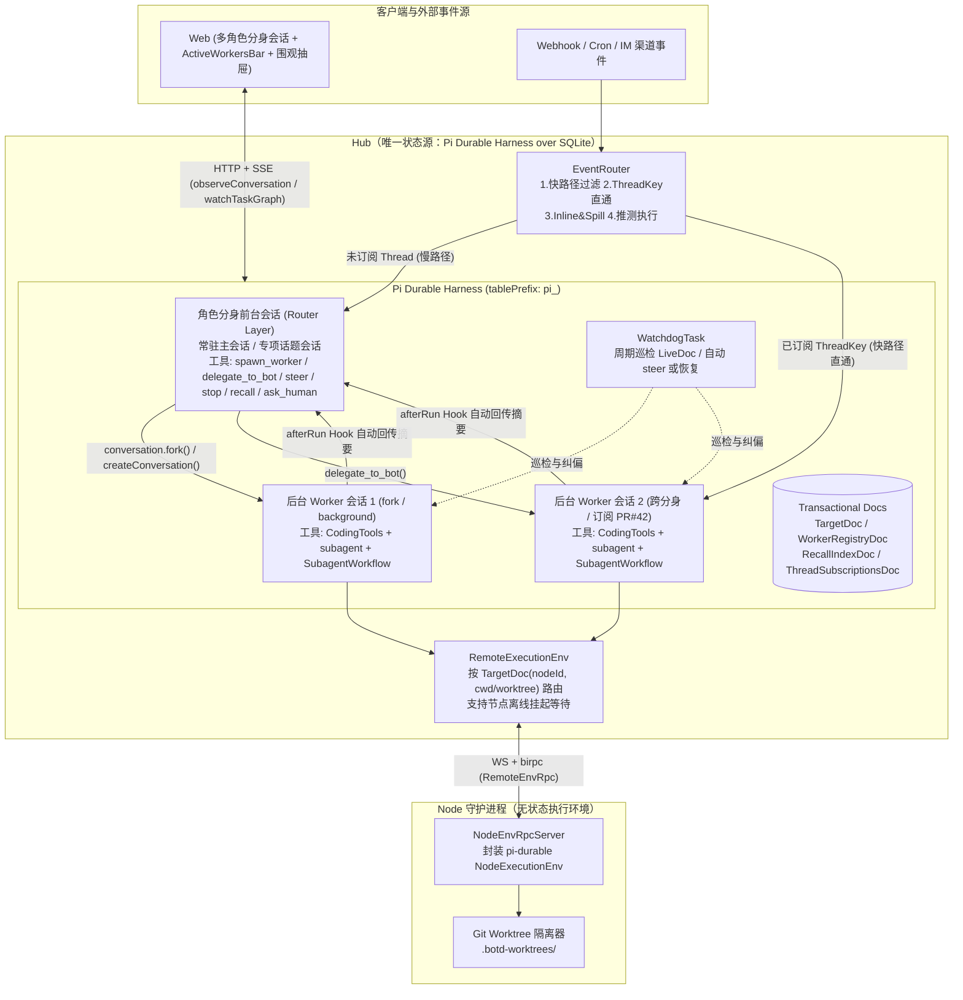
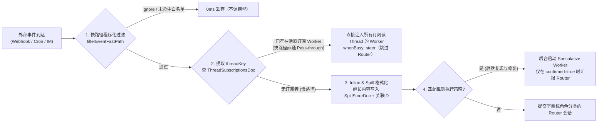

## 背景

### 现状与问题

现有 `botd` 采用“Hub 负责会话队列与存储、Node 负责运行 `@earendil-works/pi-coding-agent` 模型与工具循环”的架构。随着长周期开发任务、跨平台自动化触发以及多子代理并发编排需求增加，现有实现暴露出四个结构性问题：

1. **双状态源分裂与断线中断**
   会话元数据与公屏消息存储在 Hub SQLite（`apps/hub/src/db.ts` 的 `sessions`、`messages`、`cursor_map_json`、`outbound_task_queue`），而模型推理上下文与子代理历史存储在 Node 本地文件（`bots/<botId>/sessions/<sessionId>.jsonl`，见 `apps/node/src/runtime/execute-turn.ts`）。为对齐两边状态，系统维护了 `apps/node/src/runtime/turn-receipt.ts`、`apps/hub/src/subagent-run-mirror.ts` 以及 `resetSession` 全量重建逻辑。根据现有实现（`apps/node/src/daemon.ts` 与 `apps/node/src/runtime/turn-lifecycle.ts`），Node 与 Hub 的 WebSocket 断开时会立即调用 `cancelAllBotTurns` 中止正在运行的回合，模型请求与工具调用无法在进程重启或网络闪断后从断点恢复。

2. **前台对话与长耗时任务耦合阻塞（半双工）**
   在 `apps/hub/src/group-router.ts` 中，每个会话通过 `isRunning` 保证同一时刻只运行一个主回合批次，并通过 `birpc` 调用 Node 的 `runTurn`（超时 30 分钟）。主 Bot 一旦开始执行耗时工具或前台子代理，整个会话处于 `running` 状态。虽然现有实现通过 `apps/node/src/cross-bot/coordination.ts` 的 `SubagentHandoffScope` 在收到 `steerBotTurn` 时尝试将等待中的前台子代理切换为后台，但只要主会话自身直接调用 `bash`/`edit` 等工具，新到达的用户消息或外部触发事件就必须排队等待。

3. **节点工作区全局串行锁限制并发**
   在 `apps/node/src/runtime/execute-turn.ts:95` 中，`runRegistry.acquireWorkspace(runKey, dataDir, workspaceKey)` 对同一主 Bot 的工作区目录加了跨会话互斥锁。即使在 Hub 层通过 `apps/hub/src/delegation.ts` 派生多个子会话，或同时触发多个 Webhook 任务，只要落到同一主 Bot 的默认工作区，Node 侧仍会退化为串行排队执行。

4. **工作流断点续跑与外部事件路由过重**
   现有 `SubagentWorkflow` 编排依赖 `apps/node/src/cross-bot/workflow.ts`（930 行）手写 `.workflows/<runId>.workflow.jsonl` 与 `latest-unfinished.json` 标记文件，并在下一回合向主 Bot 注入系统提示词，依赖模型再次发起携带 `resumeFromRunId` 的工具调用才能恢复。同时，外部触发器（`apps/hub/src/trigger-service.ts`）仅支持 `append`（追加到固定会话）或 `subsession`（每次新建孤立子会话），缺少按外部事件线程（如同一 GitHub PR 或同一 IM 话题）自动将后续事件直通（Pass-through）给对应活跃任务的机制。

### 目标与边界

本次重构在不保留历史数据兼容与旧 RPC 兼容的前提下，以 `@earendil-works/pi-durable@1.5.0` 替换 `@earendil-works/pi-coding-agent` 与 `@tintinweb/pi-subagents`，达成以下可观察目标：

- **单一持久状态源与算存环分离**：将 Agent Loop、Conversation Transcript、Task 状态机与事务型 Document 全部收归 Hub 的 `pi-durable` SQLite 存储；Node 退化为无状态的远程 `ExecutionEnv`（文件系统 + Shell + Git Worktree 隔离），支持进程崩溃后自动从最近的 Task Checkpoint 恢复，以及 BYOM 节点断线重连后继续执行未完成工具调用。
- **保留多角色分身（Bot Personas）与多会话心智**：外层继续保留不同角色分身（各自拥有独立的 `SYSTEM.md`、`MEMORY.md`、模型配置与默认绑定节点/目录）以及每个分身的“常驻主会话 + 专项话题会话”列表。
- **会话内全双工双层架构（Router + Workers）**：每个角色分身的会话前台作为轻量 Router 运行，物理剥夺长耗时执行工具，仅通过毫秒级返回的 `spawn_worker`（支持基于 `conversation.fork()` 零拷贝继承当前上下文）或 `delegate_to_bot`（跨角色分身委派）将重任务派发给后台 Worker 会话，前台对话永不阻塞。
- **原生持久子代理与 `SubagentWorkflow`**：基于 `pi-durable` 的任务所有权树（Ownership Tree）与 `api.memo` 实现 `subagent` 与 `SubagentWorkflow`（保留 `pipeline`、`parallel`、`agent`、`gate`、`phase` 语法），进程重启后由 Harness 调度器自动重放并跳过已完成步骤，无需模型手动传参续跑。
- **事件四步流水线与 Watchdog 巡检**：外部事件经快路径过滤后，若命中活跃 Worker 订阅的 `threadKey` 则直接直通（Pass-through）注入该 Worker，跳过前台 Router 推理；超长上下文采用 Inline & Spill 与 `recall(id)` 按跳召回；内置周期性 `WatchdogTask` 自动检测并纠偏卡死或异常的 Worker。

非目标：本次重构不引入多 Hub 实例的分布式共识分片，单个 Hub 进程独占同一个 `hub.sqlite` 中的 `pi-durable` 存储。

建议分支：`refactor/pi-durable-superagent`（仅为建议分支名，当前尚未创建该名称的统一分支）。

---

## 整体设计

### 系统拓扑与职责重构

重构后系统分为三层：**Web 客户端**、**Hub（大脑与持久状态中心）**、**Node（无状态远程执行手）**。



### 核心设计判断

1. **以单 `Harness` 承载多角色分身与双层会话**
   不采用“旧 `pi-coding-agent` + 新 `pi-durable` 双底座并存”的方案，避免出现三套会话存储与两套工具扩展生态。Hub 全局开启一个 `pi-durable` `Harness` 实例，所有角色分身的前台会话、后台 Worker 会话、任务级子代理以及 `SubagentWorkflow` 均作为该 `Harness` 内的 `Conversation` 与 `Task` 运行。这样跨角色委派（`delegate_to_bot`）和父子会话汇报全部退化为同一 SQLite 内的原子事务提交（`api.commit`），彻底消除过去 Node 反连 Hub 的跨进程回路。

2. **用角色分身内部的 Router/Worker 分离兼顾“个人助理角色感”与“Super-agent 吞吐量”**
   如果全系统只保留单一全局 Router，不同领域的提示词设定、记忆与权限边界会混杂。本次设计将双层架构下沉到每个角色分身内部：
   - 用户在界面上仍然与熟悉的“架构师分身”“财务管家”“私人总管”对话，支持常驻主会话与多话题会话。
   - 但每个前台会话在系统级固定挂载 `botd-router` 扩展，**不挂载 `CodingTools`**。前台会话只做快速应答、上下文召回、人机确认与任务分发；任何耗时操作必须通过 `spawn_worker` 或 `delegate_to_bot` 派给挂载了 `botd-worker` 与 `CodingTools` 的后台 Worker 会话。
   - 当用户已在前台聊了多轮背景信息再要求执行任务时，`spawn_worker` 直接调用 `conversation.fork(entryId)` 在当前条目处零拷贝分叉出后台 Worker 会话，Worker 立即拥有完整的前序上下文，同时前台会话在百毫秒内结束本轮推理回到 `idle`，实现真正的全双工交互。

3. **用远程 `ExecutionEnv` + Git Worktree 替代 `runTurn` RPC 与全局目录锁**
   Node 不再理解“回合”“子代理”或“模型供应商”，只实现 `packages/protocol/src/env-rpc.ts` 定义的 `NodeEnvRpcFunctions`。当后台 Worker 需要修改代码仓库时，通过 `envAcquireWorktree` 在节点上创建 `<repoDir>/.botd-worktrees/<workerId>` 独立工作树，并将该路径写入该 Worker 会话的 `TargetDoc.worktreePath`。同一节点上的多个 Worker 在各自 Worktree 中并发读写与执行测试，不再受单工作区互斥锁限制。

---

## 详细设计

### 1. 脑手分离协议与远程执行环境（`env-rpc.ts` / `env-rpc-server.ts` / `remote-env.ts`）

#### RPC 契约变化

废弃 `NodeRpcFunctions` 中的 `runTurn`、`cancelTurn`、`steerBotTurn`、`stopSubagent`、`interactSubagent`、`resetSession`、`getModelCatalog`、`startProviderLogin` 系列接口，新增 `NodeEnvRpcFunctions` 与 `HubEnvStreamFunctions`（定义于 `packages/protocol/src/env-rpc.ts`）：

| 接口方向 | 方法名 | 输入 / 输出摘要 | 关键语义与错误处理 |
| :--- | :--- | :--- | :--- |
| Hub → Node | `envReadTextFile` / `envWriteFile` / `envEdit` 相关 FS 方法 | 对齐 `@earendil-works/pi-durable/env` 的 `FileSystem` 接口（二进制内容经 base64 传输） | 返回 `Result<T, { code: FileErrorCode; message: string; path?: string }>`，预期错误不抛异常 |
| Hub → Node | `envExec` | `{ execId, command, cwd, env, inheritEnv, timeout, spill, window }` → `Result<ShellExecResult, SerializedExecutionError>` | Node 侧为每个 `execId` 维护独立 `AbortController`；标准输出与错误流按 `window` 采样并通过 `onEnvExecOutput` 单向推回 Hub |
| Hub → Node | `envAbortExec` | `execId: string` → `Promise<void>` | 立即中止对应 `execId` 的子进程树，幂等 |
| Hub → Node | `envAcquireWorktree` | `{ repoDir, workerId, branchPrefix? }` → `{ worktreePath, branchName, isGitRepo }` | 若 `repoDir` 为 Git 仓库，执行 `git worktree add -B <branch> <worktreePath> HEAD`；非 Git 目录则返回原 `repoDir` 且 `isGitRepo: false` |
| Hub → Node | `envReleaseWorktree` | `{ repoDir, worktreePath, branchName?, deleteBranch? }` → `{ ok: boolean }` | 执行 `git worktree remove --force <worktreePath>` 与 `git worktree prune`，可选删除临时分支 |
| Node → Hub | `onEnvExecOutput` | `{ execId, text, stream: 'stdout' \| 'stderr', skipped? }` → `void` | 实时转发命令输出块，供 `RemoteExecutionEnv.exec` 的 `onOutput` 回调消费 |

#### BYOM 节点断线等待与恢复（`apps/hub/src/harness/remote-env.ts`）

`RemoteExecutionEnv` 实现 `@earendil-works/pi-durable/env` 的 `ExecutionEnv` 接口。每次工具调用或系统提示词渲染时，`HarnessOptions.env` 根据当前 Conversation 的 `TargetDoc` 构造 `RemoteExecutionEnv`：

- `id` 属性固定为 `"node:" + target.nodeId`，确保 `pi-durable` 内置的 `edit` 与 `write` 工具按同一节点同一路径自动串行化单文件并发写入。
- `cwd` 取 `target.worktreePath ?? target.cwd`。
- 当目标 `nodeId` 当前离线且配置了 `waitForNodeOnline` 时，文件与 Shell 操作不会立即报错，而是挂起等待该节点重新连接 WebSocket（同时监听传入的 Chord `Context` 取消信号；若用户在等待期间取消任务，立即返回 `aborted` 错误）。
- 若进程在工具调用中途崩溃重启，`pi-durable` 对标记了 `replay: "safe"` 的只读工具（如 `read`、`recall`、`subagent`、`SubagentWorkflow`）自动重放；对未标记 `replay: "safe"` 的副作用工具（如 `bash`、`write`、`edit`）不重复执行，而是将中断前已持久化的部分输出与 `interrupted` 诊断信息交给模型决策。

---

### 2. 事务型状态文档模型（`apps/hub/src/harness/docs.ts`）

所有与会话、任务、召回链相关的应用状态均通过 `defineDoc` 定义，与 `pi-durable` 的 Transcript Entry 在同一 SQLite 事务中原子提交：

```ts
// 1. 每个 Conversation 的环境与身份绑定
export const TargetDoc = defineDoc<{
  botId: string;
  role: "router" | "worker" | "subagent";
  parentConversationId?: string;
  nodeId: string;
  cwd: string;
  worktreePath?: string;
  threadKeys: string[];
  title?: string;
}>({
  kind: "botd.target",
  version: 1,
  scope: "conversation",
  history: "latest",
  fork: "asOf", // fork 出的 Worker 自动继承父会话当时的节点与目录配置
  initial: () => ({ botId: "default", role: "router", nodeId: "local", cwd: "/tmp", threadKeys: [] }),
});

// 2. 前台 Router 会话持有的后台 Worker 注册表
export const WorkerRegistryDoc = defineDoc<{
  workers: Record<string, {
    workerId: string;
    conversationId: string;
    botId: string;
    title: string;
    status: "running" | "completed" | "failed" | "aborted";
    threadKeys: string[];
    nodeId: string;
    cwd: string;
    worktreePath?: string;
    startedAt: number;
    finishedAt?: number;
    summary?: string;
  }>;
}>({
  kind: "botd.workers",
  version: 1,
  scope: "conversation",
  history: "latest",
  fork: "fresh", // 子会话不继承父会话的 Worker 列表
  initial: () => ({ workers: {} }),
});

// 3. 全局按跳召回索引（Chain of Recall）
export const RecallIndexDoc = defineDoc<{
  items: Record<string, {
    id: string;
    kind: "worker" | "trigger" | "entry" | "artifact" | "thread";
    title: string;
    summary: string;
    contentPreview: string;
    conversationId?: string;
    relatedIds: string[];
    createdAt: number;
  }>;
}>({
  kind: "botd.recall",
  version: 1,
  scope: "session",
  initial: () => ({ items: {} }),
});
```

此外还包含会话级人机交互请求文档 `AskDoc`（`kind: "botd.asks"`）以及事件直通订阅表 `ThreadSubscriptionsDoc`（`kind: "botd.thread_subscriptions"`，`scope: "session"`）。

---

### 3. 双层智能体扩展：Router 层与 Worker 层（`router-extension.ts` / `worker-extension.ts`）

#### 前台 Router 扩展（`botd-router`）

每个角色分身的主会话与话题会话仅启用 `botd-router` 扩展，通过 `modelTools` 过滤确保模型**无法直接调用** `bash`、`write`、`edit`：

- **动态 System Prompt Sections**：
  - `persona` section：渲染该角色分身的 `SYSTEM.md`、`MEMORY.md` 以及全双工路由守则。
  - `active_workers` section：从 `WorkerRegistryDoc` 读取当前正在运行与最近完成的后台 Worker 状态表。由于 `pi-durable` 仅在 section 输出发生变化时才向 Transcript 追加增量系统条目，平时不会破坏大模型 Prompt Cache。
- **全双工核心工具**：
  - `spawn_worker({ title, task, forkContext?, threadKey?, cwd?, worktree? })`：
    1. 若 `forkContext === true` 且当前前台会话已有历史条目，调用 `conversation.fork(latestEntryId, { ownership: { kind: "ownerless" } })` 零拷贝继承当前对话上下文；否则在 `api.commit` 中调用 `tx.createConversation({ ownership: { kind: "ownerless" } })`。之所以将后台 Worker 设为 `ownerless`（或挂载在 `background: true` 的锚点任务下），是为了保证前台会话立即回到 `idle`，且用户在前台按普通停止时不会误杀后台正在运行的 Worker。
    2. 若 `worktree === true`，调用目标节点的 `envAcquireWorktree` 获取独立工作树路径。
    3. 配置 Worker 会话启用 `botd-worker`、`CodingTools` 与 `SubagentWorkflow`，写入 Worker 的 `TargetDoc`、父会话的 `WorkerRegistryDoc` 及 `RecallIndexDoc`。
    4. 向 Worker 会话异步提交 `{ type: "input", content: task, requestId: "spawn:" + api.taskId }`（**不调用 `.wait()`**），立即向 Router 返回 `{ workerId, conversationId, status: "started" }`。
  - `delegate_to_bot({ targetBotId, title, task, threadKey? })`：
    加载目标角色分身 `targetBotId` 的模型、系统指令与默认 `nodeId/cwd`，创建归属于该角色分身配置的后台 Worker 会话并异步提交任务，完成跨角色分身协同。
  - `steer_worker({ workerId, message, mode })`：
    向指定后台 Worker 提交 `{ type: "input", content: message, whenBusy: mode ?? "steer" }`，在当前工具回合结束后立即注入干预指令。
  - `stop_worker({ workerId })`：
    调用 `workerConv.abort(context, { background: true })`，若绑定了临时 Worktree 则释放，并更新 `WorkerRegistryDoc` 状态为 `aborted`。
  - `recall({ id })`：
    查询 `RecallIndexDoc` 获取目标对象（Worker、Spill 事件、Thread）详情及其 `relatedIds` 的下一跳单行摘要；若目标为 Worker 会话，同时扫描其最近 Transcript 条目返回，实现多跳按需召回。
  - `ask_human({ prompt, options })`：
    使用 `api.memo("ask:" + api.taskId, ...)` 保证崩溃重放幂等，在 `AskDoc` 中登记待确认事项。

#### 后台 Worker 扩展（`botd-worker`）

后台 Worker 会话挂载 `CodingTools`（`read`、`write`、`edit`、`bash`）、`botd-worker` 与 `SubagentWorkflow`：

- **任务级 `subagent` 工具（`replay: "safe"`）**：
  允许 Worker 在执行复杂任务时派生生命周期受当前工具调用管辖的子代理（`ownership: { kind: "task", taskId: api.taskId }`）。在 `api.commit` 中先通过 `tx.scanConversations({ ownerTaskId: api.taskId }, 1)` 查找是否已有子会话，实现崩溃重启后的幂等重连。
- **完成自动汇报机制（`GenerationTask` 的 `afterRun` Hook）**：
  当 `TargetDoc.role === "worker"` 的会话完成回答时，`afterRun` 钩子自动执行：
  1. 提取 Worker 最终回复文本，生成 200 字以内的摘要写入 `RecallIndexDoc`（关联其 `threadKeys` 与父会话 ID），并将父会话 `WorkerRegistryDoc` 中对应条目的状态更新为 `completed`。
  2. 以确定性 `requestId: "worker-done:" + api.taskId` 向父 Router 会话 `submit` 一条精简汇报：
     `[Worker Completed: <workerId> | <title>]\nSummary: <summary>\n(Call recall({ id: "<workerId>" }) to inspect full details)`
  3. 父 Router 会话被该汇报唤醒后，结合当前渠道规范（如 IM 简短回复或 Web 完整展示）向用户输出结论。

---

### 4. 原生持久 `SubagentWorkflow`、事件直通与 Watchdog（`workflow-extension.ts` / `event-router.ts` / `watchdog.ts`）

#### 基于 `api.memo` 的确定性 `SubagentWorkflow`

`apps/hub/src/harness/workflow-extension.ts` 提供 `SubagentWorkflow` 工具（`replay: "safe"`），替代旧版 `apps/node/src/cross-bot/workflow.ts`：

- 支持脚本声明 `export const meta = { name, description, phases }`，并在沙箱上下文中注入 `agent(prompt, opts)`、`pipeline(items, ...stages)`、`parallel(thunks)`、`phase(title)`、`log(message)`、`args`、`budget`。
- **无 barrier 的 `pipeline`**：每个数据项独立流经 `stage1 -> stage2 -> ...`，快项无需等待慢项完成上一阶段。
- **崩溃断点自动续跑**：每个 `agent()` 调用生成确定性步骤键 `stepKey = "wf_step:" + stepSeq + ":" + (opts?.label ?? "")`。执行前先读取 `await api.memo(stepKey, context)`：
  - 若存在已提交结果，直接返回缓存值（0 毫秒，不重新发起模型调用）；
  - 若不存在，则创建或重连 `ownerTaskId: api.taskId` 下的子会话执行推理；若配置了 `opts.gate`（如 `gate: "npm test"`），则在 `api.env` 上执行该命令，非零退出码判定为步骤失败；验证通过后将结果写入 `await api.memo(stepKey, result, context)`。

#### 事件驱动四步流水线（`apps/hub/src/harness/event-router.ts`）



- **多对多 Thread 订阅**：一个 Worker 可订阅多个 `threadKey`（如同时订阅 `github:pr:repo#42` 和 `im:thread:dev#99`），多个 Worker 也可订阅同一 `threadKey`（共享事件直通通知，自行感知并发修改）。当新事件超出当前 Worker 职责范围时，Worker 可调用退订或 `handbackToRouter` 将事件交回 Router 重新分发。
- **Inline & Spill 上下文缓存控制**：注入模型前，默认只内联事件 ID、标题、前 120 字符摘要以及时间/空间相邻消息（如被引用的原消息、同一 PR Review 的相邻评论）；超出长度阈值的原始载荷写入 `SpillStoreDoc` 与 `RecallIndexDoc`，在消息末尾附上 `[Spilled: <spillId> | Call recall({ id: "<spillId>" })]`。

#### Watchdog 外部控制循环（`apps/hub/src/harness/watchdog.ts`）

通过 `defineTask` 定义常驻任务 `WatchdogTask`，利用 `runtime.setTimer` 按固定周期（默认 60 秒）唤醒，或由 `runWatchdogPass` 按需触发：

- 扫描 `harness.inspect(context)` 与所有活跃 Worker 的 `LiveDoc`：
  - **超时卡死检测**：若 Worker 处于 `running` 状态超过 `maxStallMs` 且 `LiveDoc` 长期无进展，自动向该 Worker 发送纠偏消息（`whenBusy: "steer"`）；连续纠偏仍无进展则调用 `abort` 并向父 Router 发送告警通知。
  - **瞬态模型错误恢复**：若检测到 `LiveDoc.runFailure` 为瞬态错误且留有未决输入，自动提交 `{ type: "continue" }` 恢复执行。
  - **可解释诊断**：提供 `diagnoseSystemHealth` 汇总当前所有受阻任务（`blocked`）、超时 Worker 与近期干预记录，供维护者或总管分身直接用自然语言查询。

---

### 5. Web 前端全双工交互与后台任务看板（`apps/web`）

保留左侧栏“角色分身 + 会话列表”，改造会话主视图：

1. **全双工输入**：移除前台会话因后台任务运行而禁用发送按钮的限制；当前台正在流式输出时，用户新发送的消息自动以 `whenBusy: "steer"` 提交。
2. **顶部后台任务胶囊栏（`apps/web/src/components/ActiveWorkersBar.tsx`）**：
   通过 `useSuperAgentWorkers(sessionId)` 订阅当前会话派生的所有后台 Worker 与 Workflow。有活跃任务时在聊天区顶部展示实时胶囊（显示状态动画、任务标题、当前工具/阶段、运行计时、`🌿 worktree` 标识与 `🔗 threadKey` 直通标识），支持一键停止单个后台任务。
3. **后台任务实时围观与插话抽屉（`apps/web/src/components/WorkerInspectDrawer.tsx`）**：
   点击任一胶囊滑出抽屉，实时渲染该后台 Worker 的思考块、工具调用输出、Workflow 阶段进度及历史插话记录，并在抽屉底部提供独立的实时插话输入框（支持运行中 `steer` 与结束后 `followUp` 追问）。

---

## 影响分析

| 受影响模块 | 现状基线 | 重构后变化 |
| :--- | :--- | :--- |
| `apps/node` | 包含 `runtime/`（15 个文件）、`cross-bot/`（3 个文件）、`models.ts`、`provider-auth.ts`，依赖 `@earendil-works/pi-coding-agent` 与 `@tintinweb/pi-subagents` | 删除 `runtime/` 与 `cross-bot/` 全部模型推理与子代理桥接代码；收敛为 `env-rpc-server.ts`（封装 `NodeExecutionEnv` + Git Worktree 管理）与守护进程连接管理 |
| `apps/hub` | `group-router.ts` 维护内存队列与游标，`delegation.ts` 管理子会话委派，`db.ts` 维护 `sessions`/`messages`/`outbound_task_queue` | 由 `apps/hub/src/harness/`（`hub-harness.ts`、`router-extension.ts`、`worker-extension.ts`、`workflow-extension.ts`、`event-router.ts`、`watchdog.ts`、`remote-env.ts`）统一接管；`hub.sqlite` 通过 `tablePrefix: "pi_"` 承载 `pi-durable` 持久表 |
| `packages/protocol` | 以 `runTurn(30min)` 和 `onSessionStream` 为核心的回合级 RPC | 升级为 `env-rpc.ts` 的细粒度文件系统/Shell RPC 及 `ActiveWorkerSummary`、`ThreadSubscriptionRecord`、`ChainOfRecallRef` 契约 |
| `apps/web` | 单会话半双工等待，仅能查看回合内同步子代理折叠面板 | 新增 `useSuperAgentWorkers`、`ActiveWorkersBar`、`WorkerInspectDrawer`，支持全双工对话与后台常驻 Worker 实时围观/插话 |

---

## 发布

### 上线前检查

1. **依赖确认**：确认 `apps/hub` 与 `apps/node` 已安装 `@earendil-works/pi-durable@1.5.0`、`@earendil-works/chord@1.5.0`、`@earendil-works/pi-ai@1.5.0`、`@earendil-works/pi-schema@1.5.0`、`@earendil-works/pi-codemode@1.5.0`。
2. **端口规范检查**：本地开发与验证严格遵守 `AGENTS.md` 端口约定，Hub 使用 `BOTD_PORT=3002`，Web Vite 使用 `3001`，禁止占用宿主机的 `3000` 端口。
3. **存储初始化**：因项目尚处早期开发阶段且无需迁移旧开发库，启动新版本前可直接清理旧开发环境的 `hub.sqlite` 与 `~/.botd/bots/*/sessions/*.jsonl`，由 `openNodeSqliteStorage` 自动初始化 `pi_*` 表结构。

### 发布顺序与恢复方式

1. **发布顺序**：先构建 `packages/protocol`，随后同时更新 `apps/hub` 与 `apps/node` 守护进程，最后刷新 `apps/web` 静态资源。
2. **运行期故障恢复**：
   - **Hub 进程重启**：新进程打开同一 `hub.sqlite` 并调用 `harness.resume()`，未完成的生成任务、工具任务、后台 Worker 及 `SubagentWorkflow` 自动从最后提交的 Checkpoint 恢复。
   - **Node 进程重启或断线**：Node 重连后重新注册 `NodeEnvRpcFunctions`，Hub 侧等待中的 `RemoteExecutionEnv` 自动唤醒继续执行；Node 侧残留的 `.botd-worktrees/*` 可通过 `envReleaseWorktree` 或 `git worktree prune` 幂等清理。
   - **版本回退**：若需回退至重构前版本，切回重构前 Git 提交并重置本地开发库即可。

---

## 测试

以下测试案例用于验收四个并行开发模块与集成链路的正确性：

| 编号 | 验证模块 | 前置条件与输入 | 目标路径 | 预期可观察结果 |
| :--- | :--- | :--- | :--- | :--- |
| TC-01 | 远程执行环境与 CodingTools（`tests/remote-env-worktree.test.ts`） | 启动 `createNodeEnvRpcServer` 与 `RemoteExecutionEnv`，挂载到 `Harness` 的 `CodingTools` | 依次调用 `write`、`read`、`edit`、`bash`（含流式输出）与二进制范围读取 | 文件读写与行号精确替换成功，`bash` 实时收到 `stdout`/`stderr` 流块并返回正确 `exitCode` |
| TC-02 | Git Worktree 并发隔离（`tests/remote-env-worktree.test.ts`） | 初始化临时 Git 仓库，两个 Worker 同时调用 `envAcquireWorktree` 并并发修改同名文件 `index.ts` | 两个 Worker 在各自 `worktreePath` 下并行写入不同内容，随后调用 `envReleaseWorktree` | 两次写入互不覆盖、无锁等待；释放后临时目录与 Worktree 记录被干净移除 |
| TC-03 | BYOM 节点离线等待与恢复（`tests/remote-env-worktree.test.ts`） | 目标节点初始处于离线状态，Worker 发起 `readTextFile` 工具调用；100ms 后模拟节点上线 | `RemoteExecutionEnv` 触发 `waitForNodeOnline` 挂起并在节点上线后继续执行 | 工具调用不报错，节点上线后成功返回文件内容 |
| TC-04 | 多角色分身隔离与全双工 `spawn_worker`（`tests/durable-superagent-core.test.ts`） | 创建“架构师”与“财务”两个角色分身；向“架构师”主会话发送耗时开发任务，紧接着发送第二条闲聊消息 | 前台 Router 调用 `spawn_worker` 立即返回 `started` 并响应第二条消息；后台 Worker 并发执行并在结束后触发 `afterRun` | 前台两次回复均在毫秒级完成且不阻塞；后台 Worker 完成后自动向主会话投递摘要并更新 `WorkerRegistryDoc` |
| TC-05 | 跨角色委派、`steer_worker` 与 `recall` 召回链（`tests/durable-superagent-core.test.ts`） | 主会话调用 `delegate_to_bot` 派活给另一分身，中途调用 `steer_worker` 插话，完成后调用 `recall({ id })` | 跨分身 Worker 接收 `steer` 指令调整输出，写入 `RecallIndexDoc` 供 `recall` 查询 | `recall` 返回完整的任务摘要、输出内容及关联 `relatedIds` 下一跳列表 |
| TC-06 | Harness 崩溃恢复（`tests/durable-superagent-core.test.ts`） | Worker 执行中途关闭当前 `Harness` 实例模拟崩溃，在同一 `Storage` 上重新打开 `Harness` 并调用 `resume()` | 调度器扫描未完成 Task 并从最后 Checkpoint 续跑 | 中断的 Worker 自动跑完并向主会话汇报，且因 `requestId` 幂等保护不会产生重复汇报 |
| TC-07 | `SubagentWorkflow` 编排与断点续跑（`tests/workflow-event-watchdog.test.ts`） | 执行包含 `pipeline`、`parallel`、`gate` 的工作流脚本；在 Stage 1 完成后模拟中断重跑 | `SubagentWorkflow` 通过 `api.memo` 读取已完成步骤并继续执行 Stage 2 | Stage 1 直接命中缓存（模型调用次数不增加），Stage 2 正常执行并通过 `gate` 校验 |
| TC-08 | 事件过滤、ThreadKey 直通与推测执行（`tests/workflow-event-watchdog.test.ts`） | 发送噪音事件、首个 `github:pr:botd#42` 事件、以及后续 3 条同 PR 事件；发送匹配推测规则的 Bug 报告 | `filterEventFastPath` 拦截噪音；同 PR 后续事件经 `ThreadSubscriptionsDoc` 直通 Worker；推测 Worker 按 `confirmed` 决定是否汇报 | 噪音事件 0 模型调用；后续 3 条同 PR 事件直接到达订阅 Worker 且 Router 调用次数为 0；未确认的推测任务静默丢弃 |
| TC-09 | Watchdog 巡检自愈（`tests/workflow-event-watchdog.test.ts`） | 构造一个超出 `maxStallMs` 无进展的异常 Worker 会话，运行 `runWatchdogPass` | `Watchdog` 检测超时并自动发送纠偏 `steer` 或中止告警 | 异常 Worker 收到纠偏指令或被中止，`diagnoseSystemHealth` 准确输出干预原因 |
| TC-10 | Web 前端组件与类型构建（`apps/web`） | 对包含 `useSuperAgentWorkers`、`ActiveWorkersBar`、`WorkerInspectDrawer` 的前端工程执行 `typecheck` 与 `build` | TypeScript 编译器与 Vite 打包器全量检查 | 0 类型错误，生产 Bundle 构建成功 |
