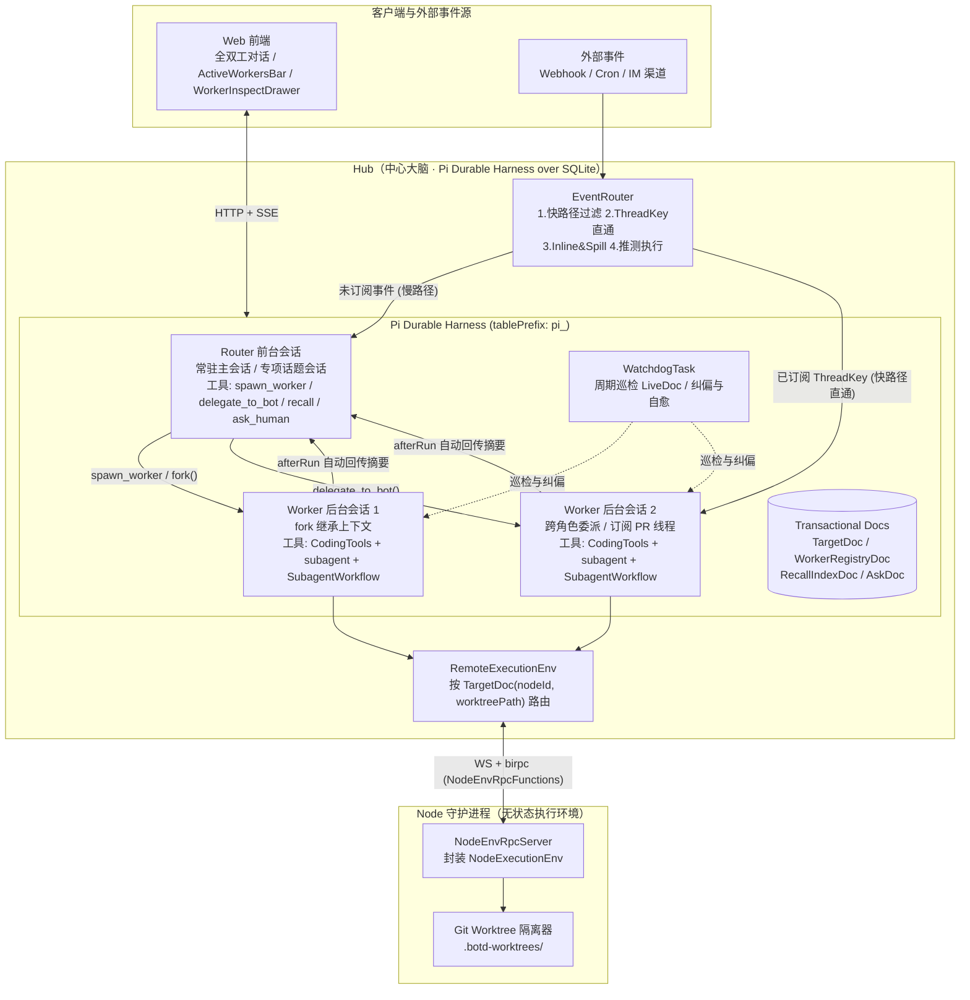
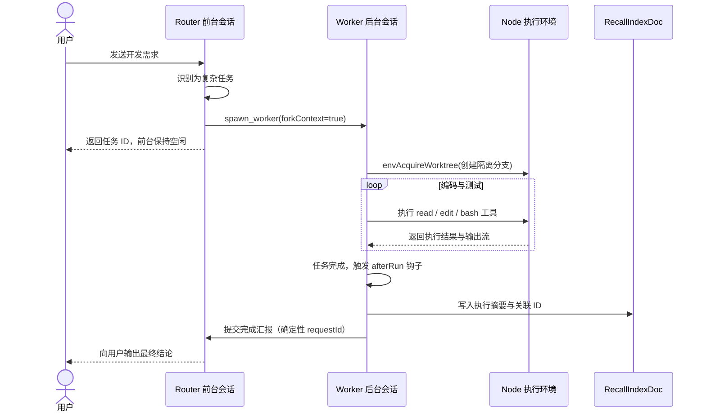
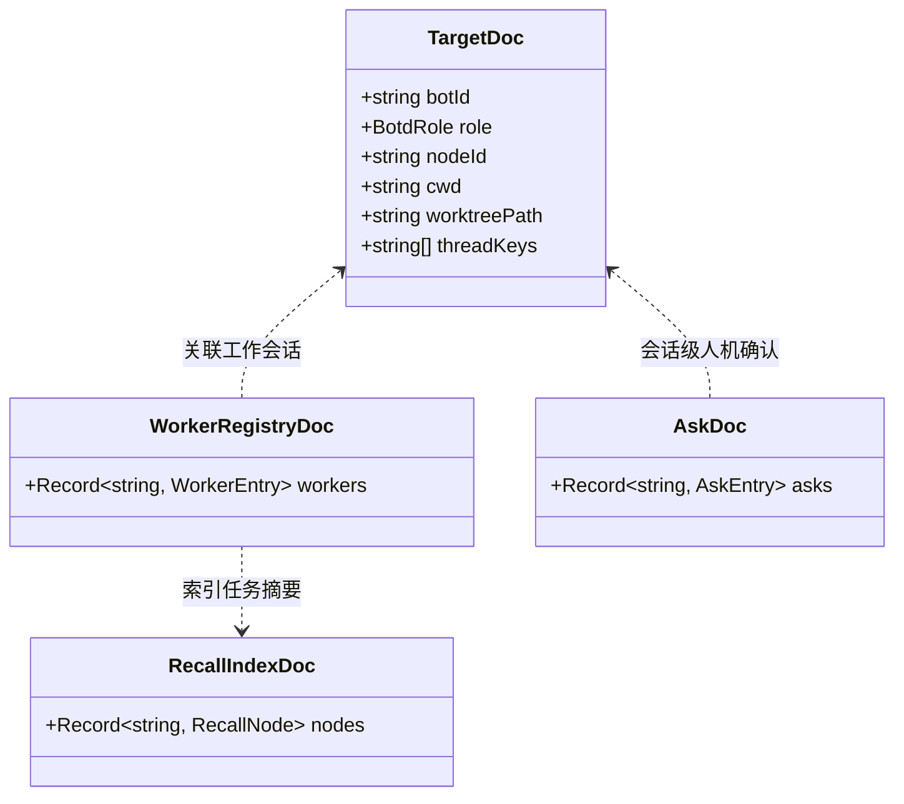
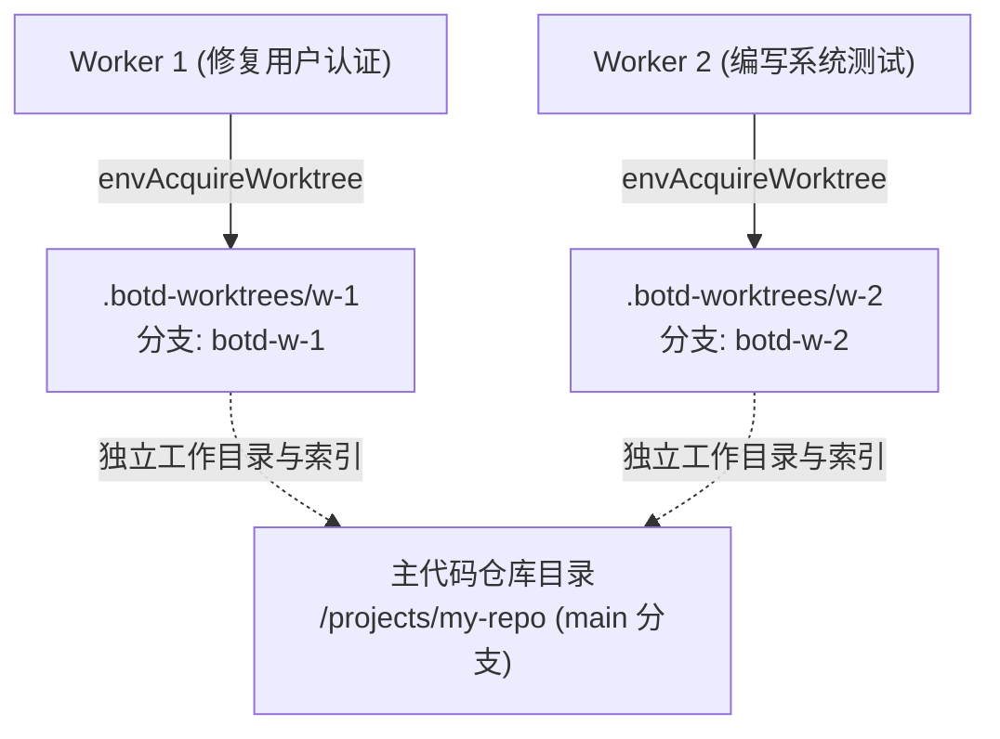
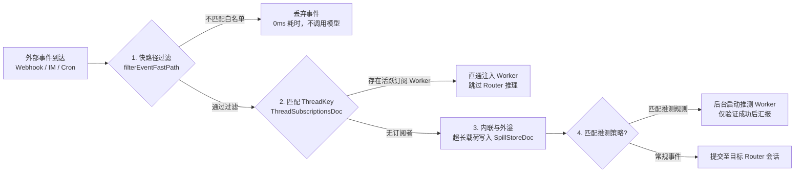
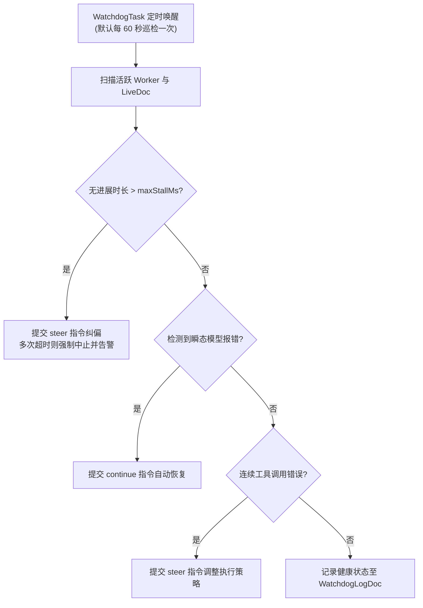

# 系统架构说明

[文档目录](file:///root/code/botd/docs/README.md)

本文档说明 botd 的系统架构、组件交互、调度模型与可靠性设计。系统实现以代码库为准。

## 1. 架构总览与系统拓扑

botd 采用脑手分离的三层架构：Web 客户端、Hub 中心服务与 Node 执行节点。

三层架构具有明确的分工边界：

- **Web 客户端**：提供全双工对话界面、顶部 `ActiveWorkersBar` 任务栏与 `WorkerInspectDrawer` 抽屉。
- **Hub**：系统状态中心。Hub 托管单个 `Pi Durable Harness` 实例与 SQLite 数据库。
- **Node**：无状态远程执行节点。Node 提供文件系统、Shell 执行与 Git Worktree 隔离。

## 2. 算存分离与 Pi Durable Harness 引擎

### 2.1 架构演进背景

传统智能体架构存在四个结构限制：

1. **状态源分裂**：会话元数据存储在 Hub，推理上下文存储在 Node 本地文件。
2. **连接中断丢状态**：网络断开会导致正在执行的回合直接终止。
3. **单目录锁限制并发**：同一工作区串行执行，阻塞多个并发任务。
4. **半双工阻塞对话**：前台会话执行长任务时，用户无法输入新消息。

### 2.2 单一持久状态源

Hub 独占本地 `hub.sqlite` 数据库。系统使用 `pi_` 作为数据表前缀。

Hub 统一管理所有会话记录、任务检查点与状态文档：

- 核心实现位于 [hub-harness.ts](file:///root/code/botd/apps/hub/src/harness/hub-harness.ts)。
- 系统创建全局唯一的 `Harness` 实例。
- 角色分身、后台 Worker 与子代理统一作为 Harness 内部的 `Conversation` 与 `Task` 执行。
- 任务派发与跨角色委派转化为本地数据库事务。

### 2.3 崩溃自愈与断点重放

Harness 提供任务所有权树（Ownership Tree）与检查点机制：

- 系统将每个关键步骤写入 SQLite 事务。
- 只读工具标记为 `replay: "safe"`。重启后 Harness 会直接重放只读工具。
- 产生副作用的工具不会重复执行。系统会保留中断前的输出与诊断信息。
- Hub 进程重启时调用 `harness.resume()`。调度器自动恢复未完成的任务。

## 3. 双层智能体架构（Router 与 Worker 分离）

系统在每个角色分身内部实现 Router 与 Worker 的双层分离。

### 3.1 角色分身（Bot Personas）

每个角色分身拥有独立的配置：

- 独立系统指令：读取分身目录下的 `SYSTEM.md`。
- 独立记忆文件：读取分身目录下的 `MEMORY.md`。
- 专属模型配置：指定默认模型服务商与模型名称。
- 默认绑定节点与工作目录：定义任务的默认执行位置。
- 会话结构：每个分身拥有一个常驻主会话与多个专项话题会话。

### 3.2 Router 前台层

Router 前台层负责即时沟通、意图识别与任务分发：

- 核心实现位于 [router-extension.ts](file:///root/code/botd/apps/hub/src/harness/router-extension.ts)。
- 会话仅挂载 `botd-router` 扩展。
- 系统物理移除 `CodingTools`（`read`、`write`、`edit`、`bash`）。
- Router 遇到耗时编码任务必须调用 `spawn_worker`。
- 前台会话在百毫秒内完成回复，不会阻塞后续消息。

Router 专有工具列表：

| 工具名称 | 功能说明 | 关键行为 |
| :--- | :--- | :--- |
| `spawn_worker` | 派发后台 Worker 会话 | 异步启动后台任务，立即返回任务标识。 |
| `delegate_to_bot` | 跨角色分身委派任务 | 加载目标分身配置并启动后台 Worker。 |
| `steer_worker` | 干预正在执行的 Worker | 向后台 Worker 注入指导指令。 |
| `stop_worker` | 中止后台 Worker 任务 | 中止会话并释放关联的 Git Worktree。 |
| `recall` | 检索历史或外溢上下文 | 按 ID 查询摘要、正文预览与关联节点。 |
| `ask_human` | 发起人机确认请求 | 登记待确认事项，等待人工决策。 |

### 3.3 Worker 后台层

Worker 后台层负责执行复杂代码修改与长耗时任务：

- 核心实现位于 [worker-extension.ts](file:///root/code/botd/apps/hub/src/harness/worker-extension.ts)。
- Worker 会话挂载 `botd-worker`、`CodingTools` 与 `SubagentWorkflow`。
- 支持通过 `conversation.fork()` 零拷贝继承父会话的历史上下文。
- Worker 拥有独立的 `ConversationId`，可以在后台并发执行。

### 3.4 完成自动汇报机制

Worker 执行结束时，`afterRun` 钩子自动处理汇报：

1. 提取 Worker 最终回复文本。
2. 创建 200 字以内的任务摘要。
3. 将摘要与关联 ID 写入 `RecallIndexDoc`。
4. 将父会话 `WorkerRegistryDoc` 中的状态更新为 `completed`。
5. 向父 Router 会话提交格式化汇报：
   `[Worker Completed: <workerId> | <title>]`
6. 汇报使用确定性 `requestId`，防止重启后重复通知。
7. 父 Router 唤醒后向用户总结任务产出。

## 4. 事务型状态文档模型（Transactional Docs）

Hub 通过 `defineDoc` 与 `defineDocFamily` 定义事务型状态文档。

核心实现位于 [docs.ts](file:///root/code/botd/apps/hub/src/harness/docs.ts)。所有文档与对话记录在同一事务中提交。

### 4.1 核心文档定义

| 文档名称 | 作用域 | Fork 策略 | 存储内容 |
| :--- | :--- | :--- | :--- |
| `TargetDoc` | `conversation` | `asOf` | 记录会话的角色分身、节点标识、工作目录与分支。 |
| `WorkerRegistryDoc` | `conversation` | `initial` | 记录 Router 派生的所有后台 Worker 状态表。 |
| `AskDoc` | `conversation` | `initial` | 记录会话内待确认与已确认的人机交互请求。 |
| `RecallIndexDoc` | `session` | 不适用 | 维护全局上下文召回索引，支持按跳检索。 |
| `ThreadSubscriptionsDoc` | `session` | 不适用 | 维护外部事件线程到活跃 Worker 的多对多映射。 |

### 4.2 原子提交机制

状态更新使用原子事务接口：

- 调用 `runtime.commit` 写入文档。
- 文档修改与会话条目（Transcript Entry）同事务落库。
- 彻底避免内存状态与磁盘状态不一致。

### 4.3 会话原生原语与上下文控制

运行时接入 `pi-durable` 原生会话操作原语：

- **零拷贝 Fork（`forkConversation`）**：调用 `conv.fork(at)` 继承上下文并重定向 `TargetDoc`，派生独立会话。
- **消息回滚（`rewindDurableSessionBeforeMessage`）**：编辑历史消息时，回滚上下文至指定锚点并重新计算。
- **上下文重置与压缩（`resetConversation` / `compactConversation`）**：注入 `pi.reset` 标记重启上下文，支持手动触发压缩任务。
- **机密注入执行环境（`SecretInjectingEnv`）**：执行命令时动态注入 `SecretStash` 中的活跃环境变量，实现零泄漏执行。

## 5. 脑手分离协议与远程执行环境

### 5.1 协议契约重构

系统废弃旧版 `runTurn` 巨石 RPC。

系统引入细粒度的环境调用接口：

- 协议定义位于 [env-rpc.ts](file:///root/code/botd/packages/protocol/src/env-rpc.ts)。
- 节点端实现位于 [env-rpc-server.ts](file:///root/code/botd/apps/node/src/env-rpc-server.ts)。
- Hub 端实现位于 [remote-env.ts](file:///root/code/botd/apps/hub/src/harness/remote-env.ts)。

核心 RPC 方法列表：

| 方法名称 | 传输方向 | 职责说明 |
| :--- | :--- | :--- |
| `envReadTextFile` | Hub → Node | 读取文本文件内容。 |
| `envWriteFile` | Hub → Node | 写入二进制或文本文件。 |
| `envEdit` | Hub → Node | 执行文本查找与替换。 |
| `envExec` | Hub → Node | 启动远端进程并指定输出采样窗口。 |
| `envAbortExec` | Hub → Node | 依据执行标识强制终止进程树。 |
| `envAcquireWorktree` | Hub → Node | 创建独立的 Git Worktree 与临时分支。 |
| `envReleaseWorktree` | Hub → Node | 移除 Git Worktree 并清理临时分支。 |
| `onEnvExecOutput` | Node → Hub | 实时单向推送标准输出与错误流数据块。 |

### 5.2 远程执行适配器（RemoteExecutionEnv）

`RemoteExecutionEnv` 实现 `pi-durable` 的 `ExecutionEnv` 接口：

- 标识符格式固定为 `node:<nodeId>`。
- 内置工具根据目标节点与路径执行写入串行化。
- 工作目录自动指向 `target.worktreePath` 或 `target.cwd`。

### 5.3 节点离线韧性（BYOM）

系统支持自带设备（BYOM）的离线恢复：

- 节点离线时，文件与命令操作不会立即抛错。
- 系统进入挂起等待状态，等待节点重连。
- 系统监听 Chord 取消信号。用户取消时立即中止等待。
- 节点重连后，挂起的执行流程自动恢复。

## 6. Git Worktree 并发隔离机制

多个 Worker 同时修改同一代码仓库时，传统单目录锁会导致严重的排队问题。

botd 采用 Git Worktree 隔离方案解决并发写入冲突。

### 6.1 隔离流程

1. Router 调用 `spawn_worker` 并指定 `worktree: true`。
2. Hub 向目标节点发送 `envAcquireWorktree` 请求。
3. Node 执行 `git worktree add -B <branch> <path> HEAD`。
4. 隔离目录路径格式为 `<repoDir>/.botd-worktrees/<workerId>`。
5. Node 将新路径写入 Worker 的 `TargetDoc.worktreePath`。
6. Worker 在独立工作树中执行文件读写与测试命令。

### 6.2 资源释放

1. 用户中止 Worker 任务或任务执行完毕。
2. Hub 调用 `envReleaseWorktree` 接口。
3. Node 执行 `git worktree remove --force <path>`。
4. Node 执行 `git worktree prune` 移除工作树记录。
5. Node 移除对应的临时开发分支。

## 7. 外部事件驱动流水线（EventRouter）

核心实现位于 [event-router.ts](file:///root/code/botd/apps/hub/src/harness/event-router.ts)。

外部事件经由四步流水线处理：

### 7.1 快路径过滤

`filterEventFastPath` 依据规则评估入站事件：

- 纯代码规则判断，不调用大语言模型。
- 检查事件来源、事件类型与发送者白名单。
- 无效事件在 0 毫秒内丢弃。

### 7.2 线程直通路由（Pass-through）

系统维护 `ThreadSubscriptionsDoc` 订阅表：

- 订阅键格式例如 `github:pr:repo#42`。
- 一个 Worker 可以订阅多个线程标识。
- 命中订阅的后续事件直接注入对应的 Worker 会话。
- 事件跳过 Router 前台推理，减少调用延迟。

### 7.3 内联与外溢（Inline & Spill）

系统控制注入模型的上下文长度：

- 默认仅内联事件 ID、标题与前 120 字符摘要。
- 超长载荷自动写入 `SpillStoreDoc`。
- 系统在消息末尾附带召回标识：
  `[Spilled: <spillId> | Call recall({ id: "<spillId>" })]`。
- 模型通过 `recall` 工具按需拉取完整载荷。

### 7.4 推测执行（Speculative Execution）

系统支持对特定事件执行推测性验证：

- 外部错误报告触发推测策略。
- 系统在后台静默启动推测 Worker 尝试复现。
- 推测失败则静默丢弃任务。
- 验证成功后才向 Router 会话汇报结论。

## 8. Watchdog 巡检与自愈控制循环

核心实现位于 [watchdog.ts](file:///root/code/botd/apps/hub/src/harness/watchdog.ts)。

### 8.1 巡检机制

`WatchdogTask` 作为常驻任务执行：

- 使用 `runtime.sleepUntil` 维持固定巡检周期（默认 60 秒）。
- 支持通过 `runWatchdogPass` 执行按需体检。
- 检查所有活跃 Worker 的 `LiveDoc` 状态。

### 8.2 错误处置策略

- **卡死检测**：Worker 处于执行状态超过 `maxStallMs` 且无进展时，系统自动发送纠偏指令。
- **连续纠偏失败**：纠偏无效后，Watchdog 强制中止任务并向父 Router 发送告警。
- **瞬态错误恢复**：检测到网络抖动或临时模型错误时，自动提交 `continue` 恢复执行。
- **健康诊断接口**：提供 `diagnoseSystemHealth` 接口，支持用自然语言查询系统执行状态。

## 9. 核心源码索引

| 架构分层 | 核心模块 | 代码路径 |
| :--- | :--- | :--- |
| Hub 调度底座 | Pi Durable Harness 门面 | [hub-harness.ts](file:///root/code/botd/apps/hub/src/harness/hub-harness.ts) |
| Hub 状态文档 | 事务型状态文档模型 | [docs.ts](file:///root/code/botd/apps/hub/src/harness/docs.ts) |
| Hub 智能体层 | 前台 Router 扩展与路由工具 | [router-extension.ts](file:///root/code/botd/apps/hub/src/harness/router-extension.ts) |
| Hub 智能体层 | 后台 Worker 扩展与汇报钩子 | [worker-extension.ts](file:///root/code/botd/apps/hub/src/harness/worker-extension.ts) |
| Hub 执行路由 | 远程执行环境适配器 | [remote-env.ts](file:///root/code/botd/apps/hub/src/harness/remote-env.ts) |
| Hub 事件总线 | 事件驱动流水线与直通订阅 | [event-router.ts](file:///root/code/botd/apps/hub/src/harness/event-router.ts) |
| Hub 可靠性 | Watchdog 巡检与自愈任务 | [watchdog.ts](file:///root/code/botd/apps/hub/src/harness/watchdog.ts) |
| Hub 工作流 | 持久化 SubagentWorkflow | [workflow-extension.ts](file:///root/code/botd/apps/hub/src/harness/workflow-extension.ts) |
| Node 执行层 | 节点环境 RPC 服务端 | [env-rpc-server.ts](file:///root/code/botd/apps/node/src/env-rpc-server.ts) |
| 协议层 | 远程执行与流式推送协议契约 | [env-rpc.ts](file:///root/code/botd/packages/protocol/src/env-rpc.ts) |
