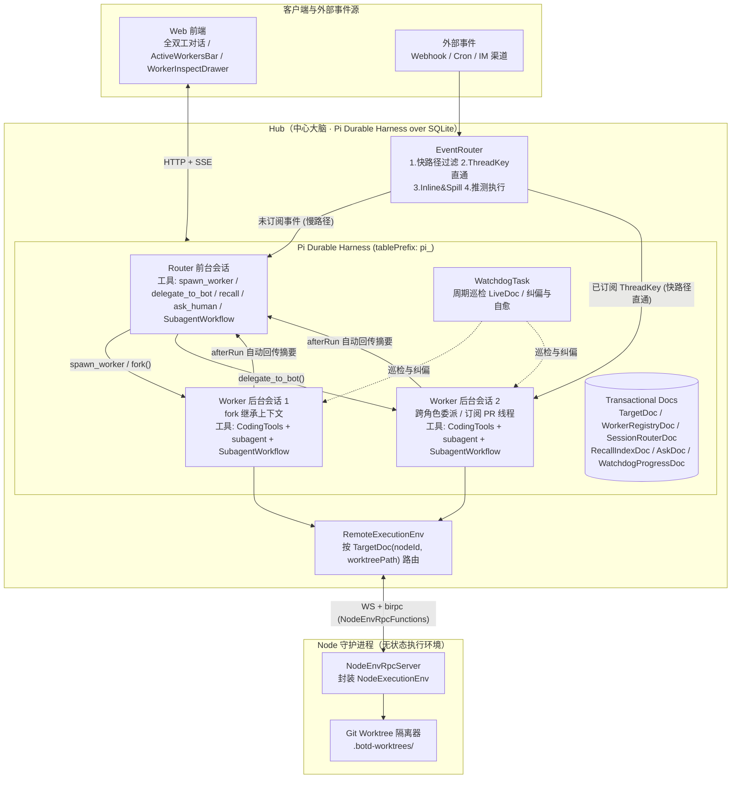
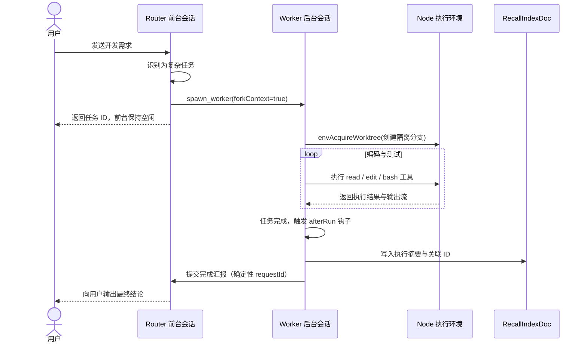
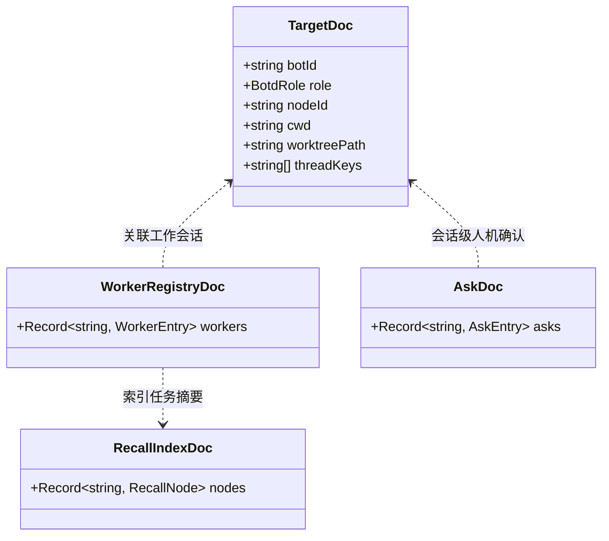
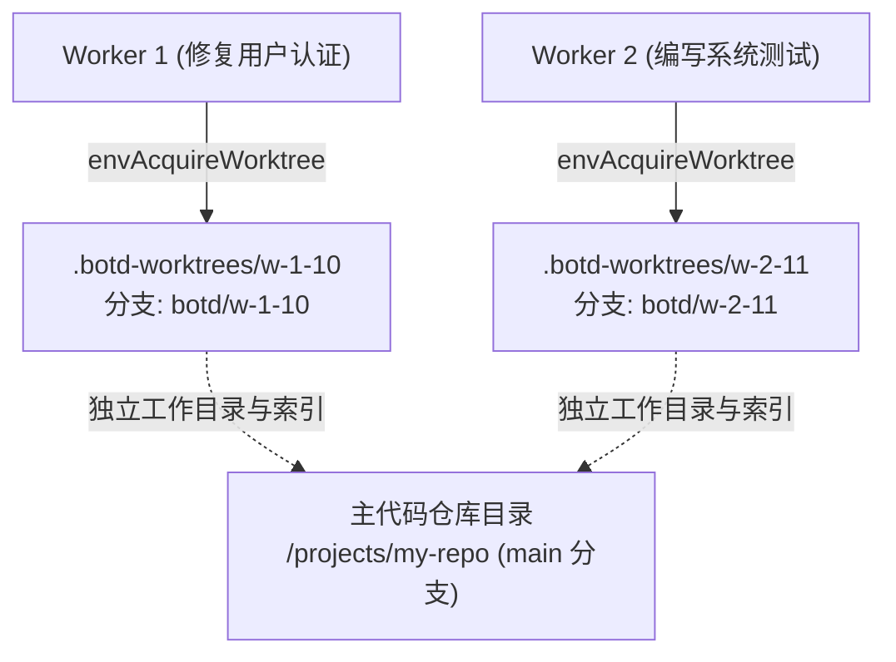
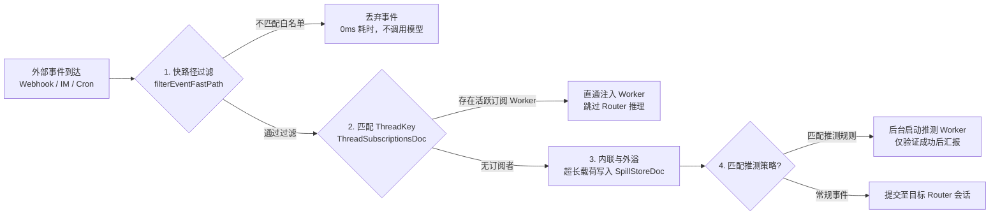
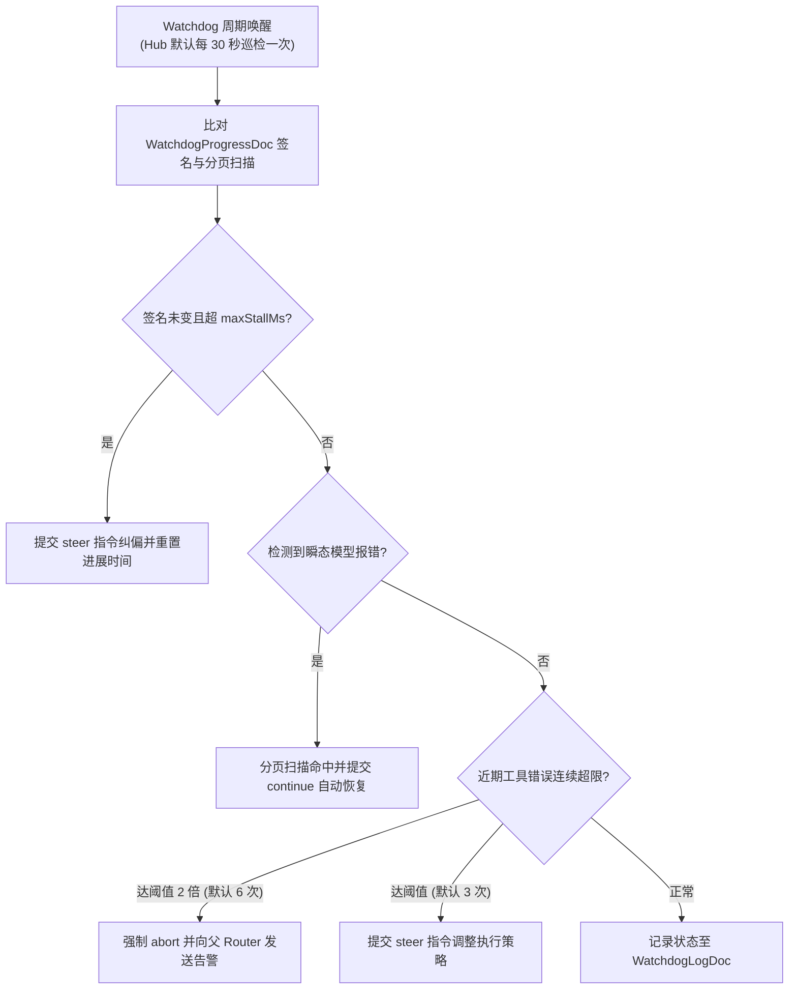

# 系统架构说明

[返回文档目录](README.md)

本文档说明 botd 的系统架构、组件交互、调度模型与可靠性设计。系统实现以代码库为准。

## 架构目录

| 章节 | 核心主题 | 说明 |
| :--- | :--- | :--- |
| [1. 架构总览与系统拓扑](#1-架构总览与系统拓扑) | 脑手分离 | 三层拓扑架构与数据流向。 |
| [2. 算存分离与调度底座](#2-算存分离与-pi-durable-harness-引擎) | Pi Durable | Harness 调度器、任务树与检查点。 |
| [3. 双层智能体架构](#3-双层智能体架构router-与-worker-分离) | Router / Worker | 前台轻量响应与后台并发编码。 |
| [4. 事务型状态文档模型](#4-事务型状态文档模型transactional-docs) | 状态一致性 | TargetDoc、WorkerRegistryDoc 与 RecallIndexDoc。 |
| [5. 脑手分离通信协议](#5-脑手分离协议与远程执行环境) | RemoteExecutionEnv | WebSocket Birpc 双向 RPC 与流式 Shell。 |
| [6. Git Worktree 隔离机制](#6-git-worktree-并发隔离机制) | 无锁并发 | 动态工作树挂载与多 Worker 并行读写。 |
| [7. 外部事件驱动流水线](#7-外部事件驱动流水线eventrouter) | EventRouter | 四步过滤、ThreadKey 直通与超长外溢。 |
| [8. 巡检自愈控制循环](#8-watchdog-巡检与自愈控制循环) | Watchdog | 任务心跳、超时纠偏与错误恢复。 |
| [9. 核心源码索引](#9-核心源码索引) | 源码导览 | Hub、Node 与 Protocol 关键文件定位。 |

## 1. 架构总览与系统拓扑

botd 采用脑手分离的三层架构：Web 客户端、Hub 中心服务与 Node 执行节点。

三层架构具有明确的分工边界：

- **Web 客户端**：提供全双工对话界面、顶部 `ActiveWorkersBar` 任务栏与 `WorkerInspectDrawer` 抽屉。
- **Hub**：系统状态中心。Hub 托管单个 `Pi Durable Harness` 实例与 SQLite 数据库。
- **Node**：无状态远程执行节点。Node 提供文件系统、Shell 执行与 Git Worktree 隔离。

## 2. 算存分离与 Pi Durable Harness 引擎

### 2.1 架构演进背景

传统智能体架构存在四个结构限制：

1. **状态源分裂**：会话元数据存储在 Hub，推理上下文存储在 Node 本地文件。
2. **连接中断丢状态**：网络断开会导致正在执行的回合直接终止。
3. **单目录锁限制并发**：同一工作区串行执行，阻塞多个并发任务。
4. **半双工阻塞对话**：前台会话执行长任务时，用户无法输入新消息。

### 2.2 单一持久状态源

Hub 独占本地 `hub.sqlite` 数据库。系统使用 `pi_` 作为数据表前缀。

Hub 统一管理所有会话记录、任务检查点与状态文档：

- 核心实现位于 [hub-harness.ts](../apps/hub/src/harness/hub-harness.ts)。
- 系统创建全局唯一的 `Harness` 实例。
- 角色分身、后台 Worker 与子代理统一作为 Harness 内部的 `Conversation` 与 `Task` 执行。
- 任务派发与跨角色委派转化为本地数据库事务。

### 2.3 崩溃自愈与断点重放

Harness 提供任务所有权树（Ownership Tree）与检查点机制：

- 系统将每个关键步骤写入 SQLite 事务。
- 只读工具标记为 `replay: "safe"`。重启后 Harness 会直接重放只读工具。
- 产生副作用的工具不会重复执行。系统会保留中断前的输出与诊断信息。
- Hub 进程重启时调用 `harness.resume()`。调度器自动恢复未完成的任务。

## 3. 双层智能体架构（Router 与 Worker 分离）

系统在每个角色分身内部实现 Router 与 Worker 的双层分离。

### 3.1 角色分身（Bot Personas）

每个角色分身拥有独立的配置与精确隔离边界：

- 独立系统指令与记忆：读取分身专属的 `SYSTEM.md` 与 `MEMORY.md`。
- 专属模型与目录配置：指定默认模型服务商、模型名称、绑定节点与工作目录。
- 精确扩展数组隔离：Router 与 Worker 均按分身 `enabledExtensions` 组装精确扩展数组，杜绝跨分身扩展污染。
- 双层工具权限过滤（`toolScope`）：同时过滤 `modelTools` 与底层 `tools`（含 QuickJS `codemode` 桥接层）。支持 `all`（默认）、`readonly`（禁用 `write`、`edit`、`bash`）与 `custom`（仅开放 `customTools` 白名单）。
- 存量会话热同步（`syncPersonas`）：修改分身配置、指令或凭据时，Hub 自动重配存量会话，下一轮生效。

### 3.2 Router 前台层

Router 前台层负责即时沟通、意图识别与任务分发：

- 核心实现位于 [router-extension.ts](../apps/hub/src/harness/router-extension.ts)。
- 会话挂载 `botd-router`、`SubagentWorkflow` 与分身启用的动态扩展。
- 系统从前台 `modelTools` 移除 `CodingTools`（`read`、`write`、`edit`、`bash`）。
- Router 遇到耗时编码任务必须调用 `spawn_worker` 或 `SubagentWorkflow`。
- 前台会话在百毫秒内完成回复，不会阻塞后续消息。

Router 专有工具列表：

| 工具名称 | 功能说明 | 关键行为 |
| :--- | :--- | :--- |
| `spawn_worker` | 派发后台 Worker 会话 | 异步启动后台任务，立即返回任务标识。 |
| `delegate_to_bot` | 跨角色分身委派任务 | 加载目标分身配置并启动后台 Worker。 |
| `steer_worker` | 干预正在执行的 Worker | 向后台 Worker 注入指导指令。 |
| `stop_worker` | 中止后台 Worker 任务 | 中止后台会话并将状态标记为 `aborted`。 |
| `recall` | 检索历史或外溢上下文 | 按 ID 查询摘要、正文预览与关联节点。 |
| `ask_human` | 发起人机确认请求 | 登记待确认事项，等待人工决策。 |

### 3.3 Worker 后台层

Worker 后台层负责执行复杂代码修改与长耗时任务：

- 核心实现位于 [worker-extension.ts](../apps/hub/src/harness/worker-extension.ts)。
- Worker 会话挂载 `botd-worker`、`CodingTools`、`codemode` 与 `SubagentWorkflow`。
- 支持通过 `conversation.fork()` 零拷贝继承上下文，并重置宿主扩展集以恢复编码工具。
- Worker 拥有独立的 `ConversationId`，可以在后台并发执行。

### 3.4 完成自动汇报机制

Worker 执行结束时，`afterRun` 钩子自动处理汇报：

1. 提取 Worker 最终回复文本。
2. 创建 200 字以内的任务摘要。
3. 将摘要、前 480 字符正文预览与关联 ID 写入 `RecallIndexDoc`。
4. 将父会话 `WorkerRegistryDoc` 中的状态更新为 `completed`。
5. 向父 Router 会话提交格式化汇报（挂载工作树时附带分支与路径）：
   `[Worker Completed: <workerId> | <title>]`
6. 汇报使用确定性 `requestId`，防止重启后重复通知。
7. 父 Router 唤醒后向用户总结任务产出。

## 4. 事务型状态文档模型（Transactional Docs）

Hub 通过 `defineDoc` 与 `defineDocFamily` 定义事务型状态文档。

核心实现位于 [docs.ts](../apps/hub/src/harness/docs.ts)。所有文档与对话记录在同一事务中提交。

### 4.1 核心文档定义

| 文档名称 | 作用域 | Fork 策略 | 存储内容 |
| :--- | :--- | :--- | :--- |
| `TargetDoc` | `conversation` | `asOf` | 记录角色分身、节点标识、工作目录、工作树路径、分支名与订阅键。 |
| `WorkerRegistryDoc` | `conversation` | `initial` | 记录 Router 派生的所有后台 Worker 状态表。 |
| `AskDoc` | `conversation` | `initial` | 记录会话内待确认与已确认的人机交互请求。 |
| `SessionRouterDoc` | `session` | 不适用 | 映射 Web 会话到 Router 会话，粘性存储会话级 `workspaceDir`。 |
| `RecallIndexDoc` | `session` | 不适用 | 维护全局上下文召回索引，支持按跳检索。 |
| `ThreadSubscriptionsDoc` | `session` | 不适用 | 维护外部事件线程到活跃 Worker 的多对多映射。 |
| `SpillStoreDoc` | `session` | 不适用 | 按标识分片存储超长外部事件的原始载荷。 |
| `WorkflowRunDoc` | `session` | 不适用 | 按执行标识记录 `SubagentWorkflow` 的阶段、日志与步骤账本。 |
| `WatchdogProgressDoc` | `session` | 不适用 | 记录活跃任务的进展签名与最近进展时间戳。 |
| `WatchdogLogDoc` | `session` | 不适用 | 记录 Watchdog 历次巡检干预动作与原因。 |

### 4.2 原子提交机制

状态更新使用原子事务接口：

- 调用 `runtime.commit` 写入文档。
- 文档修改与会话条目（Transcript Entry）同事务落库。
- 彻底避免内存状态与磁盘状态不一致。

### 4.3 会话原生原语与上下文控制

运行时接入 `pi-durable` 原生会话操作原语与主线路由策略：

- **合并凭据切流门槛**：Hub 合并 SQLite `provider_credentials` 与 `<dataDir>/.agent/auth.json` 凭据。存在任意有效凭据时，消息与触发器统一进入 Durable 运行时。
- **群聊点名与斜杠引导**：消息携带 `@分身` 时动态热切换 `TargetDoc` 目标角色与节点。输入 `/<skillId>` 时自动改写提示词，引导模型调用 `load_skill`。
- **磁盘多模态附件注入**：入站附件统一落盘为会话产物，数据库仅存轻量指针。图片构造多模态 `ImageContent` 块，全部附件追加 `[Attached Files]` 磁盘路径清单。
- **零拷贝 Fork 与消息回滚**：`conv.fork(at)` 零拷贝派生新会话，`rewindDurableSessionBeforeMessage` 支持编辑历史消息并回滚重跑。
- **上下文重置、压缩与机密注入**：支持 `/new` 重置与 `/compact` 异步压缩，`SecretInjectingEnv` 在命令执行时注入 `SecretStash` 临时机密变量。

## 5. 脑手分离协议与远程执行环境

### 5.1 协议契约重构

系统废弃旧版 `runTurn` 巨石 RPC。

系统引入细粒度的环境调用接口：

- 协议定义位于 [env-rpc.ts](../packages/protocol/src/env-rpc.ts)。
- 节点端实现位于 [env-rpc-server.ts](../apps/node/src/env-rpc-server.ts)。
- Hub 端实现位于 [remote-env.ts](../apps/hub/src/harness/remote-env.ts)。

核心 RPC 方法列表：

| 方法名称 | 传输方向 | 职责说明 |
| :--- | :--- | :--- |
| `envReadTextFile` | Hub → Node | 读取文本文件内容。 |
| `envWriteFile` | Hub → Node | 写入二进制或文本文件。 |
| `envEdit` | Hub → Node | 执行文本查找与替换。 |
| `envExec` | Hub → Node | 启动远端进程并指定输出采样窗口。 |
| `envAbortExec` | Hub → Node | 依据执行标识强制终止进程树。 |
| `envAcquireWorktree` | Hub → Node | 创建独立的 Git Worktree 与临时分支。 |
| `envReleaseWorktree` | Hub → Node | 移除 Git Worktree 并清理临时分支。 |
| `onEnvExecOutput` | Node → Hub | 实时单向推送标准输出与错误流数据块。 |

### 5.2 远程执行适配器（RemoteExecutionEnv）

`RemoteExecutionEnv` 实现 `pi-durable` 的 `ExecutionEnv` 接口：

- 标识符格式固定为 `remote:<nodeId>`。
- 内置工具根据目标节点与路径执行写入串行化。
- 工作目录自动指向 `target.worktreePath` 或 `target.cwd`，并注入 `BOTD_SESSION_ID` 与 `BOTD_BOT_ID`。
- `exec` 订阅取消信号。任务取消时立即调用 `envAbortExec` 终止远端进程树，并脱离取消信号执行清理动作。

### 5.3 节点离线韧性（BYOM）

系统支持自带设备（BYOM）的离线恢复与严格边界隔离：

- 绑定远端节点（`nodeId !== "local"`）的会话在节点离线时绝不回退到 Hub 本地目录。
- 文件读写、命令执行与首次工作树挂载均进入挂起等待状态，等待节点重连。
- 系统监听 Chord 取消信号。用户取消时立即中止等待。
- 节点重连后，挂起的执行流程自动恢复。

## 6. Git Worktree 并发隔离机制

多个任务同时修改同一代码仓库时，传统单目录锁会导致严重的排队问题。

botd 在全工具链路支持 Git Worktree 隔离方案，解决并发写入冲突。

### 6.1 全工具隔离矩阵与惰性挂载

1. `spawn_worker`、`delegate_to_bot`、`subagent` 与 `SubagentWorkflow` 的 `agent()` 步骤均支持 `worktree: true` 或 `isolation: "worktree"`。
2. 工具在事务中预计算工作树路径 `<repoDir>/.botd-worktrees/<id>` 与分支 `botd/<id>`，写入 `TargetDoc` 与注册表文档。
3. 未显式声明 `isolation: "off"` 时，`subagent` 与工作流子步骤默认继承父会话的工作树路径，防止子任务跳回主检出目录。
4. 首次解析会话 `ExecutionEnv` 时，Hub 惰性且幂等地调用 `envAcquireWorktree` 创建工作树并缓存结果。
5. 进程崩溃重放时，工具直接从持久文档恢复工作树路径与分支元数据。

### 6.2 工作树保留与显式清理

1. 任务完成或调用 `stop_worker` 中止后，系统默认保留工作树目录与分支，保护未合并的代码改动。
2. 审查或合并完成后，可通过节点 `envReleaseWorktree` 接口或 Git 命令移除工作树与临时分支。

## 7. 外部事件驱动流水线（EventRouter）

核心实现位于 [event-router.ts](../apps/hub/src/harness/event-router.ts)。

外部事件经由四步流水线处理：

### 7.1 快路径过滤

`filterEventFastPath` 依据规则评估入站事件：

- 纯代码规则判断，不调用大语言模型。
- 检查事件来源、事件类型与发送者白名单。
- 无效事件在 0 毫秒内丢弃。

### 7.2 线程直通路由（Pass-through）

系统维护 `ThreadSubscriptionsDoc` 订阅表：

- 订阅键格式例如 `github:pr:repo#42`。
- 一个 Worker 可以订阅多个线程标识。
- 命中订阅的后续事件直接注入对应的 Worker 会话。
- 事件跳过 Router 前台推理，减少调用延迟。

### 7.3 内联与外溢（Inline & Spill）

系统控制注入模型的上下文长度并保障事件幂等投递：

- 携带事件 ID 时按 `id:<eventId>` 去重，匿名事件分配单调递增序号避免同长摘要碰撞。
- 默认仅内联事件 ID、标题与前 120 字符摘要。
- 超长载荷先持久化写入 `SpillStoreDoc`，再在消息末尾附带召回标识：
  `[Spilled: <spillId> | Call recall({ "id": "<spillId>" }) to read full content]`。
- 无线程订阅的常规事件异步提交至目标 Router 会话，模型可按需调用 `recall` 拉取完整载荷。

### 7.4 推测执行（Speculative Execution）

系统支持对特定事件执行推测性验证：

- 外部错误报告触发推测策略。
- 系统在后台静默启动推测 Worker 尝试复现。
- 推测失败则静默丢弃任务。
- 验证成功后才向 Router 会话汇报结论。

## 8. Watchdog 巡检与自愈控制循环

核心实现位于 [watchdog.ts](../apps/hub/src/harness/watchdog.ts)。

### 8.1 巡检机制

Watchdog 作为后台控制循环持续执行：

- Hub 启动后默认每隔 30 秒自动执行一轮 `runWatchdogPass`。
- 管理员也可通过接口主动触发即时体检。
- `WatchdogProgressDoc` 记录回合数、工具状态与输出长度签名。新任务首次观测仅创建基线，避免误判。

### 8.2 错误处置策略

- **卡死检测**：进展签名跨轮未变且超过 `maxStallMs`（默认 5 分钟）时，系统自动发送 `steer` 指令。已请求中止的任务自动跳过。
- **失控任务中止**：近期工具调用错误达阈值两倍（默认 6 次）时，Watchdog 强制中止任务并告警。
- **瞬态错误分页恢复**：事务游标分页扫描全库会话。检测到瞬态模型错误时，系统自动提交 `continue` 恢复执行。
- **健康诊断接口**：提供 `diagnoseSystemHealth` 接口，汇总受阻任务与近期干预记录。

## 9. 核心源码索引

| 架构分层 | 核心模块 | 代码路径 |
| :--- | :--- | :--- |
| Hub 调度底座 | Pi Durable Harness 门面 | [hub-harness.ts](../apps/hub/src/harness/hub-harness.ts) |
| Hub 状态文档 | 事务型状态文档模型 | [docs.ts](../apps/hub/src/harness/docs.ts) |
| Hub 智能体层 | 前台 Router 扩展与路由工具 | [router-extension.ts](../apps/hub/src/harness/router-extension.ts) |
| Hub 智能体层 | 后台 Worker 扩展与汇报钩子 | [worker-extension.ts](../apps/hub/src/harness/worker-extension.ts) |
| Hub 执行路由 | 远程执行环境适配器 | [remote-env.ts](../apps/hub/src/harness/remote-env.ts) |
| Hub 事件总线 | 事件驱动流水线与直通订阅 | [event-router.ts](../apps/hub/src/harness/event-router.ts) |
| Hub 可靠性 | Watchdog 巡检与自愈任务 | [watchdog.ts](../apps/hub/src/harness/watchdog.ts) |
| Hub 工作流 | 持久化 SubagentWorkflow | [workflow-extension.ts](../apps/hub/src/harness/workflow-extension.ts) |
| Node 执行层 | 节点环境 RPC 服务端 | [env-rpc-server.ts](../apps/node/src/env-rpc-server.ts) |
| 协议层 | 远程执行与流式推送协议契约 | [env-rpc.ts](../packages/protocol/src/env-rpc.ts) |
