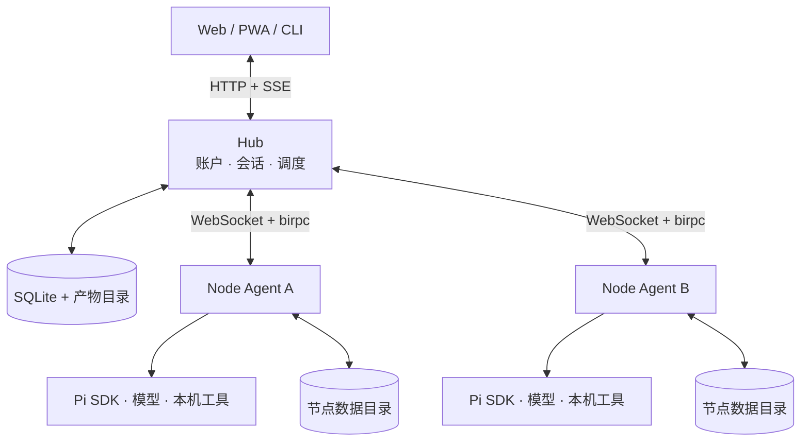

# 架构说明

[文档目录](README.md)

botd 把会话调度与任务执行分开。Hub 组织讨论，Node Agent 在任务所在的机器上调用模型和工具。

本文介绍当前实现。使用步骤见[入门指南](getting-started.md)。

## 组件与职责

| 组件 | 职责 | 代码入口 |
| --- | --- | --- |
| Hub | 认证、资源管理、会话调度、消息和产物存储 | [index.ts](../apps/hub/src/index.ts) |
| Node Agent | 节点注册、资源读写、模型运行、后台任务、本地控制 | [daemon.ts](../apps/node/src/daemon.ts) |
| 模型运行时 | 创建 Pi 会话，准备提示词、工具和工作目录 | [runtime.ts](../apps/node/src/runtime.ts) |
| Web | 会话操作、流式展示、节点配置、确认卡片 | [App.tsx](../apps/web/src/App.tsx) |
| 共享协议 | HTTP 数据类型、RPC 契约、SSE 事件、输入校验 | [protocol](../packages/protocol/src/index.ts) |
| 模型目录 | 从 Pi 模型目录提取公开元数据 | [models](../packages/models/src/index.ts) |

生产 Hub 同时托管构建后的 Web 页面。开发时，Vite 在 `3001` 提供网页，代理到 `3002` 的 Hub。

## 为什么在节点执行

代码仓库、编译器和专用 CLI 往往在不同设备上。Node Agent 让 Bot 在这些设备上执行任务，减少搬运环境的需要。

每个 Bot 属于固定节点。Hub 不负责运行 Bot 的 Bash 命令，也不自动将 Bot 迁移到其他节点。

技能描述操作方法，工具调用由模型决定。业务 CLI 通过 Bash 使用，不要求为每个 CLI 编写 Hub 适配器。

## 数据归属

| 数据 | 存储位置 | 说明 |
| --- | --- | --- |
| 用户、密码散列、节点所有权 | Hub SQLite | 决定登录身份与资源访问 |
| 节点在线状态、Bot 元数据清单 | Hub SQLite | 节点注册时更新，供界面与调度使用 |
| 公屏消息、工具轨迹预览、Token 用量 | Hub SQLite | 客户端读取的会话记录 |
| 产物元数据与内容 | Hub SQLite + 产物目录 | 元数据和文件都需要备份 |
| 触发器、离线待发任务、待确认记录 | Hub SQLite | 调度器与恢复流程读取 |
| Bot 配置、角色、记忆、私有环境变量 | 节点 Bot 目录 | Hub 通过 RPC 转发读写 |
| 模型凭据、自定义模型配置 | 节点 `.agent/` | Hub 转发登录输入，不维护模型凭据库 |
| Pi 会话及工具完整记录 | 节点 `sessions/` | 每个 Bot 保留自己的模型上下文 |

工具输出预览会进入公屏消息。不能把“完整日志保存在节点”理解成“工具输出不会传到 Hub”。

## 三条通信路径

### 客户端与 Hub

浏览器和 CLI 使用 HTTP API 管理资源。SSE 传输文本增量、工具状态、消息落库和确认事件。

会话 SSE 只订阅一个会话。全局 SSE 用于该用户的会话通知和节点状态。详细契约见 [API 参考](api.md)。

### 节点与 Hub

节点主动连接 `/ws/node`，通过 `birpc` 接收任务和上报结果。连接使用配对得到的节点身份认证。

节点注册 Bot、技能、扩展和运行状态。连接断开后，Node Agent 尝试重连。节点因此可以部署在允许出站连接的内网中。

### 本机 CLI 与 Node Agent

`wake`、`ask`、后台任务等操作通过本地 HTTP IPC 调用守护进程。

macOS 和 Linux 使用数据目录中的 Unix socket。Windows 使用根据数据目录生成的命名管道。此控制通道不监听 TCP 端口。

## 一轮消息怎样执行

1. Hub 校验用户的会话访问权限。
2. Hub 保存用户消息，解析斜杠命令和 Bot 提及。
3. 路由器确定本轮要执行的 Bot。
4. Hub 通过节点 RPC 派发任务。
5. Node Agent 准备工作区、附件、角色、记忆和模型会话。
6. Pi SDK 调用模型和工具，节点向 Hub 上报流式事件。
7. Hub 保存最终回复、工具轨迹和用量。
8. 路由器继续处理后续成员或接力任务。

调度实现见 [group-router.ts](../apps/hub/src/group-router.ts)。

## 会话调度

| 模式 | 默认调度 |
| --- | --- |
| `direct` | 指定 Bot 回答 |
| `lead` | 无有效提及时，由负责人回答；支持通过工作流 DSL 编排并发与接力 |

有效 `@Bot ID` 可以选择会话成员。Bot 回复中的编排指令与提及可以触发后续接力。

接力预算限制自动调用链，避免相互提及无限运行。

当前斜杠命令只发给一个 Bot。历史消息、回调文本和模型回复中的命令不会自动重新执行。

## 上下文与资源加载

每个 Bot 有独立的工作目录和 Pi 会话文件。运行时显式加载启用的技能、扩展和提示词模板，不扫描宿主机 Pi 配置。

群聊传递公屏上下文，不传递其他 Bot 的完整模型会话。`SYSTEM.md` 和 `MEMORY.md` 提供角色与长期记忆。

清空、编辑重发和删除会话会重置对应的模型会话。工作目录中的普通文件不因此自动恢复到过去的状态。

这是配置与上下文隔离。它不提供操作系统沙箱，不能阻止工具访问系统用户有权限访问的其他路径。

## 子会话与文件交接

委派接口创建独立子会话，记录父子关系，并继承父会话的产物引用。子会话完成或失败后，路由器向父会话回报。

同一底层产物可以有多条会话引用。文件回收需要检查剩余引用，避免删除其他会话仍使用的内容。

附件会下载到目标 Bot 的 `workspace/inbox/`。相关实现见 [delegation.ts](../apps/hub/src/delegation.ts) 和 [artifact-service.ts](../apps/hub/src/artifact-service.ts)。

## 重连与恢复边界

| 状态 | 恢复行为与限制 |
| --- | --- |
| 已保存的消息、配置和产物 | 随磁盘数据保留，恢复需要数据库和文件同时可用 |
| 发往离线节点的任务 | 写入 `outbound_task_queue`，节点上线时重放有效任务 |
| Cron 和延时触发器 | 保存于数据库，由 Hub 调度器检查到期状态 |
| 待确认卡片 | 记录保存在数据库，过期处理与在线等待分开 |
| 运行中的模型调用 | 不支持从断开的 Token 流继续执行 |
| Hub 内存中的活动接力队列 | 不保证跨 Hub 重启保留 |
| 配对码 | 保存在内存，Hub 重启后失效 |
| 本地后台进程 | 不保证跨机器断电或节点重启继续执行 |

离线暂存不等于任务恰好执行一次。执行有外部副作用的脚本时，需要任务自身处理重复请求和失败恢复。

Hub 启动会重置遗留在线和运行标记。节点重新注册后恢复可用状态。登录签名密钥保存在数据库中，正常重启保留有效登录。

触发器轮询不提供准点执行保证。到期检查、节点连接和当前会话任务都会影响实际执行时间。

部署与备份见[部署指南](deployment.md)，访问与工具权限见[安全边界](security.md)。
