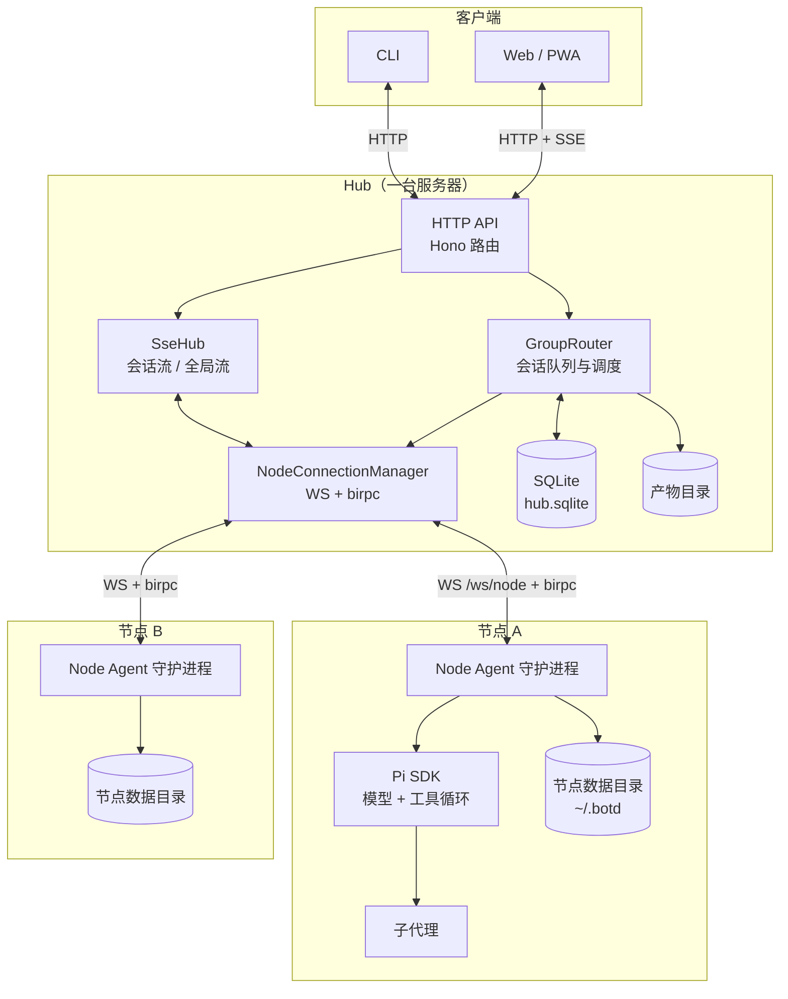
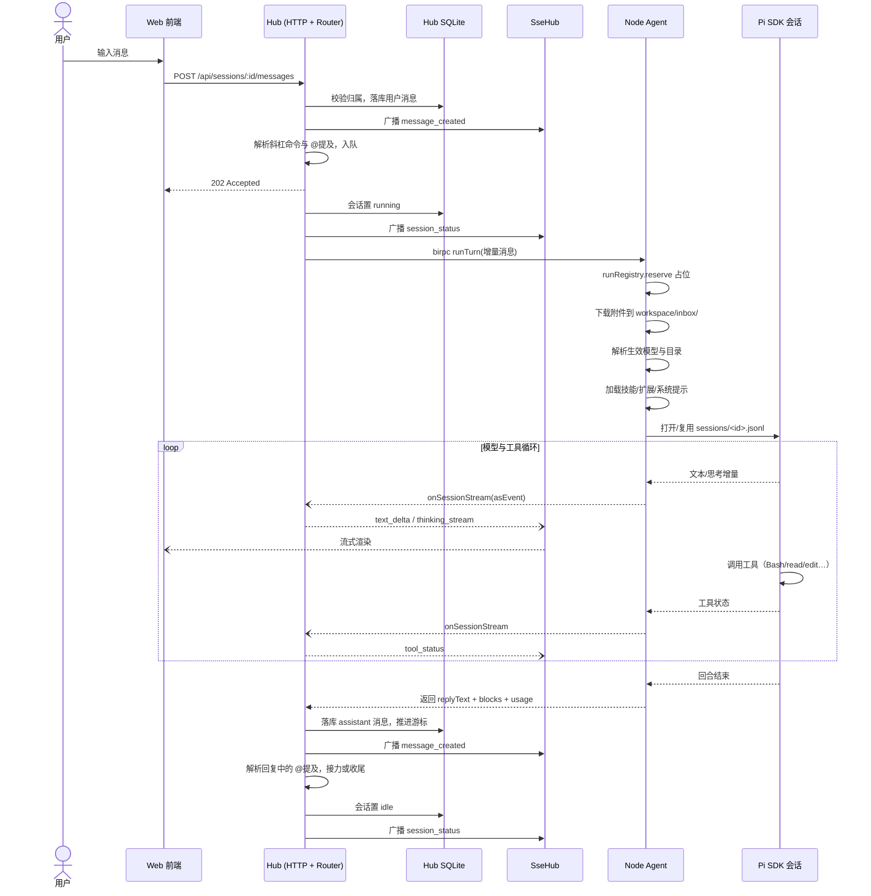
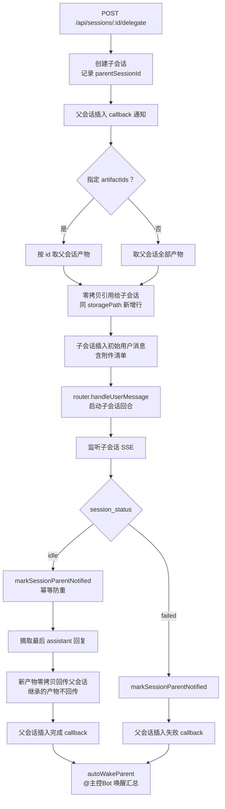

# 架构说明

[文档目录](README.md)

本文解释 botd 的组件划分、消息流转、调度模型与可靠性边界。当前实现以源码为准。使用步骤见[入门指南](getting-started.md)。

## 总览

botd 把任务调度与任务执行放在两台机器上。Hub 管账户、会话和存储。Node Agent 在任务所在的机器上调用模型和工具。

每个 Bot 属于固定节点。Hub 不运行 Bot 的命令，也不迁移 Bot。跨机器任务通过子会话委派完成。

## 组件与职责

| 组件 | 职责 | 代码入口 |
| --- | --- | --- |
| Hub | 认证、资源管理、会话调度、消息与产物存储、SSE 推送 | [index.ts](../apps/hub/src/index.ts) |
| WS 连接管理 | 节点注册、birpc 通道、心跳、节点侧 RPC 实现入口 | [ws-hub.ts](../apps/hub/src/ws-hub.ts) |
| 会话路由器 | 会话队列、回合派发、接力预算、取消与恢复 | [group-router.ts](../apps/hub/src/group-router.ts) |
| Hub 数据库 | SQLite 全部表结构、游标、离线任务队列 | [db.ts](../apps/hub/src/db.ts) |
| 子会话委派 | delegate 路由、父子会话同步、产物引用回传 | [delegation.ts](../apps/hub/src/delegation.ts) |
| Node Agent | 节点注册、重连、资源读写、本地 IPC、后台任务 | [daemon.ts](../apps/node/src/daemon.ts) |
| 模型运行时门面 | 回合编排入口与生命周期 API 汇总 | [runtime.ts](../apps/node/src/runtime.ts) |
| 回合执行 | 一个回合的十四步编排 | [execute-turn.ts](../apps/node/src/runtime/execute-turn.ts) |
| 回合生命周期 | 会话重置、取消、全量取消 | [turn-lifecycle.ts](../apps/node/src/runtime/turn-lifecycle.ts) |
| 子代理控制 | steer、stop、interact（回合外操控） | [subagent-control.ts](../apps/node/src/runtime/subagent-control.ts) |
| 回合注册表 | runKey 占位、取消标记、活跃回合上下文 | [run-registry.ts](../apps/node/src/runtime/run-registry.ts) |
| Web | 会话操作、流式渲染、节点配置、确认卡片 | [App.tsx](../apps/web/src/App.tsx) |
| 共享协议 | HTTP 类型、RPC 契约、SSE 事件、校验 | [protocol](../packages/protocol/src/index.ts) |

生产 Hub 同时托管构建后的 Web 页面。本机开发时 web 占 `3001`，Hub 占 `3002`，启动命令带 `BOTD_PORT=3002`。生产默认端口仍是 `3000`。

## 通道协议

系统有三种通信通道。每种通道承载不同内容。

### 客户端与 Hub：HTTP + SSE

浏览器和 CLI 用 HTTP API 管理资源。路由挂在 `/api/*` 下。登录后持有 `botd_token` Cookie（`HttpOnly`、`SameSite=Strict`）。

SSE 承担实时推送。有两路订阅：

- `GET /api/sessions/:id/events` 订阅单个会话。连接建立后先收到一条 `session_status` 事件。每 15 秒发一次 `ping` 保活。
- `GET /api/events` 订阅登录用户的全局事件。首条事件为 `hello` 握手。该路推送用户所有会话的事件与节点上下线通知。

会话内事件类型包括：

| 事件 | 内容 |
| --- | --- |
| `text_delta` | 回复文本增量 |
| `thinking_stream` | 思考流增量与状态 |
| `tool_status` | 工具调用状态、参数预览、输出预览 |
| `subagent_status` | 子代理运行记录（含 blocks、steers） |
| `message_created` | 消息落库（用户、assistant、system、callback） |
| `session_status` | 会话状态与队列计划 |
| `messages_truncated` | 编辑重发截断通知 |
| `interaction_request` / `interaction_resolved` | 人工确认卡片 |
| `artifact_created` | 新产物 |

全局事件额外包含 `node_status`（节点上下线）。详细契约见 [API 参考](api.md)。

### 节点与 Hub：WebSocket + birpc

节点主动连接 `GET /ws/node?nodeId=<id>&token=<token>`。连接用配对得到的节点令牌认证。同一 `nodeId` 的新连接会顶掉旧连接。

通道上跑 `birpc` 双向 RPC。调用超时 30 分钟，覆盖长回合。

Hub 侧可调的节点函数（`NodeRpcFunctions`）：

| 函数 | 用途 |
| --- | --- |
| `runTurn` | 执行一个回合 |
| `cancelTurn` / `steerBotTurn` | 取消回合 / 运行中注入消息 |
| `stopSubagent` / `interactSubagent` | 单停子代理 / 插话与追问 |
| `resetSession` | 删除节点本地 Pi 会话文件 |
| `saveBot` / `deleteBot` / `readFile` / `writeFile` | Bot 与资源读写 |
| `installResource` / `deleteResource` | 安装、删除技能或扩展 |
| `getModelCatalog` / `getCommands` | 模型目录、斜杠命令 |
| `startProviderLogin` 系列 / `logoutProvider` | 模型供应商登录 |
| `restartDaemon` / `checkUpgrade` / `upgradeDaemon` | 节点自管理 |
| `listBgJobs` / `getBgJobLogs` / `killBgJob` | 后台任务 |

节点侧可调的 Hub 函数（`HubRpcFunctions`）：

| 函数 | 用途 |
| --- | --- |
| `registerNode` | 全量上报节点清单（bots、技能、扩展、pid、版本） |
| `heartbeat` | 每 20 秒心跳 |
| `onSessionStream` | 回合流式事件上报 |
| `requestWakeupTurn` | 后台任务唤醒会话（`noTurn` 只落库；`delaySeconds` 延时） |
| `requestHumanInput` | 请求用户确认（写入 `pending_asks`，默认 300 秒超时） |
| `uploadArtifact` / `downloadArtifact` / `listSessionArtifacts` | 物产上传下载 |

节点可以部署在只允许出站连接的内网中。Hub 从不需要主动连节点。

### 本机 CLI 与 Node Agent：本地 IPC

`botd wake`、`botd ask` 等本机命令走本地 HTTP IPC。macOS 和 Linux 用数据目录里的 Unix socket。Windows 用命名管道。socket 权限 `0600`，请求带 `ipc-token` 鉴权。此通道不监听 TCP 端口。

## 一条消息的完整生命周期

从用户按下发送到前端渲染完成，一条消息经过以下阶段。

分步说明：

1. Hub 校验会话归属，把用户消息写入 `messages` 表，广播 `message_created`，返回 `202`。
2. Router 解析内容。斜杠命令按 `parseSlashCommand` 定向。普通消息按 `extractMentions` 提取 `@Bot`。无命令无提及时，派给主控 Bot。
3. Router 按增量游标（`cursor_map_json`，每 Bot 一个 rowid）收集未读消息，组装 `incrementalMessages`。Bot 自己发的消息不计入。
4. 会话状态改为 `running`，Router 通过节点 RPC 调 `runTurn`。
5. Node Agent 以 `runKey = sessionId:botId` 占位。占位失败说明同 Bot 同会话已有回合在跑，直接报错。
6. 附件经 `downloadArtifact` 落盘到 `workspace/inbox/`。视觉类图片转为模型输入。
7. 运行时解析生效配置：子代理可按 `inheritModel`、`inheritSkills` 跟随主控 Bot。子代理的工作区挂主控 Bot 目录，会话文件独立存放。
8. 主控 Bot 挂载 pi-subagents 底座，获得 `Agent` 与 `SubagentWorkflow` 工具。子代理不挂载，防止套娃。
9. Pi SDK 打开 `bots/<botId>/sessions/<sessionId>.jsonl`。文件存在则复用上下文，不存在则新建。
10. 回合进入模型与工具循环。节点把每个事件用 `onSessionStream` 单向推给 Hub。推流失败静默，不影响回合结果。
11. Hub 校验流事件（Bot 属该节点、是会话成员、会话在运行），转发为 SSE。
12. 回合结束后，节点返回 `replyText`、`blocks`、`toolCalls`、`usage`、`subagentRuns`。
13. Hub 落库 assistant 消息，推进该 Bot 的游标，广播 `message_created`。
14. Router 解析回复中的 `@提及`。命中时消耗接力预算并入队下一棒。预算 `MAX_RELAY_TURNS = 5`。回复以 `[PASS]` 开头时跳过路由。
15. 队列清空后会话置 `idle`，广播 `session_status`。

## 会话队列与并发模型

### 串行主回合

每个会话有一份内存态 `SessionRuntimeState`，包含 `queue`、`isRunning`、`generation`、`activeBotIds`。`processQueue` 用 `isRunning` 防重入。同一会话同一时刻最多跑一个主回合批次。

队列按先进先出消费。串行回合失败时会话置 `failed` 并清空剩余队列。

### 并行批次

带 `parallelGroupId` 的队列项组成并行批次。Router 把同组项一次 `shift` 出队，用 `Promise.all` 并发执行。批次内某个 Bot 失败只从 `activeBotIds` 移除自己，不阻塞其他成员。

会话内并发还有第二层：主控 Bot 可在同一回合内并发调用多个子代理（`Agent` 工具多次调用、`SubagentWorkflow` 编排）。这层并发发生在节点内，不经过会话队列。

### 运行中插话

会话运行中收到新用户消息时，Router 先尝试 `steerBotTurn`。节点把消息注入正在运行的回合，同时把阻塞中的前台子代理切为后台。注入成功则推进游标，不入队。节点不支持或注入失败时，回落到普通入队，等待当前回合结束后执行。

### queue append 与 skip

两个 HTTP 端点直接操作队列：

- `POST /api/sessions/:id/queue/append`：body 带 `orchestration` 表达式。Router 解析其中的 `@提及`，为每个提到的 Bot 生成一个新 stage 入队。
- `POST /api/sessions/:id/queue/skip`：body 带 `stageId` 或 `botId`。按 stage 移除整个并行组，或按 Bot 移除单个队列项。

两个端点都广播更新后的 `session_status`（含 `queuePlan`）。

### generation 取消语义

`cancelSession` 执行四步：

1. 把该会话的离线暂存任务标记 `failed`。
2. 拒绝全部待确认请求，`pending_asks` 置 `expired`。
3. `generation` 递增，清空队列。
4. 向节点 fire-and-forget 调 `cancelTurn`（5 秒超时保护，节点可能已失联）。

飞行中的回合返回后，Router 比对 `turnGen !== state.generation`，丢弃旧代结果。中止的部分输出仍会落盘（见下文）。

## 子会话委派

子会话委派把一个独立任务派给另一个 Bot。父子会话可以跨节点。实现见 [delegation.ts](../apps/hub/src/delegation.ts)。

关键语义：

- 委派要求目标 Bot 所在节点的 owner 是请求用户，否则 `403`。
- 产物传递是零拷贝引用：同一 `storagePath` 新增多行，不复制文件。删除安全性依赖按引用计数回收（`reclaimUnreferencedFiles`）。禁止改成删行即删文件。
- 子会话记录继承产物的 `storagePath` 集合。完成回传时只回传新产出，父会话自己的文件不会原样传回。
- 完成与失败回调通过 `markSessionParentNotified` 做幂等防重。Hub 重启后首个到达的回调仍然生效。
- `autoWakeParent !== false` 时，回调消息以 `@主控Bot` 前缀唤醒父会话执行汇总回合。
- 触发器的 `subsession` 分发模式复用同一机制。Webhook 原始载荷落盘为 `event_<id>.json` 产物投递到 inbox，防止提示词注入。

## 可靠性

### Hub 重启恢复

Hub 启动时执行 `resetStaleMetadata`：

- 全部节点状态重置为 `offline`。
- `running` 与 `queued` 会话重置为 `idle`。

节点重连后重新 `registerNode`，恢复 `online`。SQLite 中的消息、产物、触发器、待确认记录全部保留。登录签名密钥存数据库，正常重启后登录仍有效。

内存中的活动队列与接力状态不跨重启保留。运行中的模型调用不支持从断开的流恢复。配对码存内存，Hub 重启后失效。

`HUB_SCHEMA_VERSION` 当前为 `4`。升级迁移前先 `VACUUM INTO` 备份。数据库文件权限 `0600`。

停机走 `drain`：清空各会话队列，把 `queued` 会话置 `idle`，等待活动回合最多 25 秒，然后关闭。`/api/health` 公开返回 `draining` 与 `activeTurns`，供外部探活。

### 节点断线重连

节点用 `ReconnectingWebSocket` 维持连接：

- 连接超时 `10_000` ms。
- 最小重连间隔 `BOTD_WS_MIN_RECONNECT_DELAY_MS`，默认 `200` ms。
- 重试次数无上限。

每次 `open` 事件重建 birpc 实例并全量 `registerNode`。Hub 侧同一节点新连接顶掉旧连接。

Hub 侧也有心跳保护。服务端每 30 秒 `ping` 一次。连续 2 轮无 `pong` 即 `terminate`，触发下线清理。这防止 NAT 静默失联后 `runTurn` RPC 永久挂死。

节点检测到连接断开时执行 `cancelAllBotTurns`。本地回合立即中止，不等待 Hub 指令。

### 离线暂存

回合派发时节点不在线，Router 把任务写入 `outbound_task_queue`（状态 `queued_offline`），队列项放回内存队首，会话置 `queued`。节点上线触发 `onNodeOnline`：

1. 读取该节点的全部 `queued_offline` 任务。
2. 同一 Bot 已在内存队列时跳过该任务（防双跑），仅触发队列处理。
3. 不同 Bot 的任务全部入队，由串行消费逐个执行。
4. 任务确认入队后才标记 `dispatched`。

补发任务只携带旧的 `wakeupMessage` 引用。回合输入按增量游标重新收集全部未读消息，语义等于执行最新增量。过期任务（`expires_at` 到期）在读取时标记 `expired`。

离线暂存不保证任务恰好执行一次。执行有外部副作用的脚本时，任务自身需要处理重复请求。

### 回合中断与保留

用户点击停止后发生两级协作：

- Hub：`cancelSession` 递增 generation、清队列，并尽力通知节点。
- 节点：`cancelBotTurn` 先 `abortAll` 全部子代理（含后台），再 `session.abort()` 主会话。

中止的回合不丢弃已产生的输出。节点正常返回时带 `aborted: true` 与已收集的部分 `blocks`、`toolCalls`。Hub 把这些落盘为带 `aborted` 标记的 assistant 消息，跳过黑板提取与后续路由。节点抛出取消错误时，Hub 补一条空的「已中止」占位消息。

该行为由 `tests/turn-cancel-preserve.test.ts` 验证：中止后返回 `aborted: true`、部分文本保留在 blocks、无工具停留在 `running` 状态。

## 数据归属

| 数据 | 存储位置 | 同步方式 |
| --- | --- | --- |
| 用户、密码散列、`token_epoch` | Hub SQLite `users` | 仅 Hub |
| 节点注册信息、在线状态、清单缓存 | Hub SQLite `nodes` | 节点注册时单向上报 |
| Bot 元数据缓存 | Hub SQLite `bots` | 节点权威，注册时对账 |
| 会话、每 Bot 增量游标 | Hub SQLite `sessions` | 仅 Hub |
| 公屏消息、blocks、工具轨迹、用量 | Hub SQLite `messages` | 节点回合结果落库 |
| 产物元数据 | Hub SQLite `artifacts` | 上传时写入 |
| 产物文件内容 | Hub 产物目录 | 节点经 RPC 上传/下载 |
| 触发器、自动化事件 | Hub SQLite `triggers` / `automation_events` | 仅 Hub |
| 离线待发任务 | Hub SQLite `outbound_task_queue` | 节点上线重放 |
| 待确认记录 | Hub SQLite `pending_asks` | 仅 Hub |
| 会话参与者 | Hub SQLite `session_participants` | 仅 Hub |
| Bot 配置、SYSTEM.md、MEMORY.md、env.json | 节点 `bots/<botId>/` | Hub 经 RPC 转发读写 |
| Pi 会话完整记录 | 节点 `bots/<botId>/sessions/<sessionId>.jsonl` | 仅节点；重置时删除 |
| 工作区文件与 inbox | 节点 `bots/<botId>/workspace/` | 仅节点 |
| 模型凭据 | 节点 `.agent/` | Hub 转发登录输入，不维护凭据库 |
| 技能与扩展 | 节点 `skills/` 与 `extensions/` | Hub 经 RPC 安装读取 |

两类数据双向流动：回合结果（节点 → Hub）与产物（双向）。其余数据各有唯一权威方。

工具输出预览会进入公屏消息。完整日志保留在节点。「完整日志在节点」不代表「工具输出不传 Hub」。

## 术语与边界

- 子代理默认共享主控 Bot 的工作区目录。需要并发修改同一 Git 仓库时，可在调用 `Agent` 时传 `isolation: "worktree"`。
- `SYSTEM.md` 提供角色设定。`MEMORY.md` 提供长期记忆。Bot 可用 `edit`/`write` 工具更新自己的记忆文件。
- 清空、编辑重发、删除会话会调用 `resetSession` 删除节点本地会话文件。下一回合从 Hub 历史全量重建上下文。工作区普通文件不回滚。
- 这是配置与上下文隔离，不是操作系统沙箱。工具能访问系统用户有权限访问的任何路径。

部署与备份见[部署指南](deployment.md)。访问与工具权限见[安全边界](security.md)。环境变量清单见[配置参考](configuration.md)。
