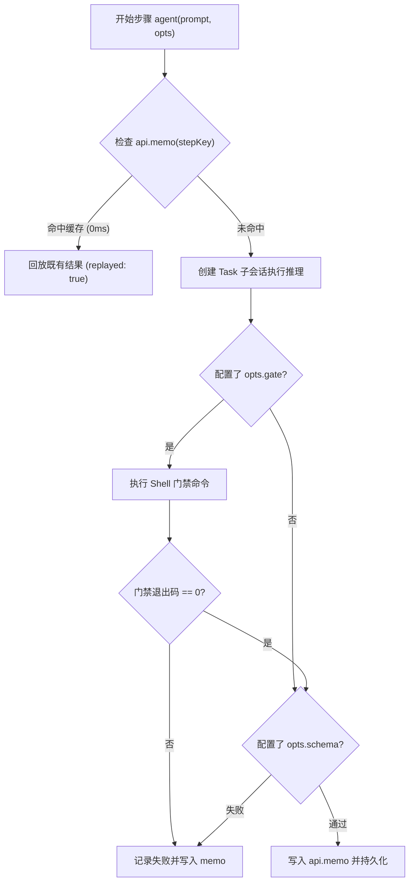

# 自动化工作流与 Watchdog 自愈

[文档目录](README.md)

本文档说明基于 pi-durable 的 SubagentWorkflow 持久工作流机制与 Watchdog 自愈巡检体系。

## 概述

系统使用原生持久任务树管理多智能体协作。

旧方案依赖文件日志手工重放。

新方案基于 `@earendil-works/pi-durable` 的 `api.memo` 机制。

工作流步骤在崩溃重启后自动命中缓存，无需重新调用模型。

Watchdog 周期巡检活跃任务，自动纠正卡死并恢复瞬态错误。

## SubagentWorkflow 持久工作流

SubagentWorkflow 作为标准工具暴露给 Worker。

工具配置 `replay: "safe"` 属性。

执行过程通过 `WorkflowRunDoc` 文档持久记录状态。

Web 界面通过 `api.details` 实时显示进度。

### 语法函数

工作流脚本在沙箱环境中执行，支持解构以下核心函数：

```ts
export const meta = {
  name: "release-pipeline",
  description: "构建并发布版本",
  phases: ["Prepare", "Build", "Verify"],
};

// 脚本主体支持异步调用
phase("Prepare");
log("开始准备环境");
```

#### 1. agent(prompt, opts)

`agent` 函数启动一个受管子代理：

- `label`：步骤标签，参与生成唯一的步骤键。
- `phase`：所属执行阶段。
- `model`：指定特定模型（例如 `deepseek/deepseek-chat`）。
- `schema`：结构化 JSON 约束。系统自动提取并检查返回值。
- `gate`：门禁命令。系统在执行环境中执行该 Shell 命令。非零退出码判定步骤失败。

#### 2. pipeline(items, ...stages)

`pipeline` 执行多阶段流水线。

实现具备项级流动特性，阶段之间没有阻断屏障（barrier）：

- 每个数据项独立流过各个阶段。
- 快速处理的数据项直接进入下一阶段。
- 快速项不等待慢速项完成前置阶段。

#### 3. parallel(thunks, concurrency?)

`parallel` 并发执行异步任务数组：

- 支持限制最大并发数，默认并发上限为 4。
- 单个任务失败返回 null，不中断其余任务。

#### 4. phase(title) 与 log(message)

- `phase(title)`：标记工作流进入新阶段。界面高亮显示当前阶段。
- `log(message)`：记录业务日志。日志直接持久化到 `WorkflowRunDoc`。

## 基于 api.memo 的确定性缓存与续跑

工作流每个子步骤生成确定性的步骤键：

```text
step:<stepIndex>:<label>
```



系统重启或进程崩溃后，同一工作流重新执行：

1. 已完成的步骤直接读取 memo 存储值，零延迟返回。
2. 模型调用次数不增加。
3. 未执行的步骤继续向子会话提交，实现断点续跑。

## 完整工作流脚本示例

以下提供软件版本发布的完整工作流：

```ts
export const meta = {
  name: "build-and-test",
  description: "编译检查并执行多平台测试",
  phases: ["Lint", "Build", "Test"],
};

// 阶段一：静态代码检查
await phase("Lint");
await log("执行语法检查");
const lintOk = await agent("检查代码规范并修复明显格式问题", {
  label: "lint-step",
  phase: "Lint",
  gate: "pnpm lint",
});

if (!lintOk) {
  throw new Error("代码规范检查未通过");
}

// 阶段二：生成构建制品信息
await phase("Build");
const buildResult = await agent("分析工程依赖并输出构建版本号", {
  label: "build-step",
  phase: "Build",
  schema: {
    type: "object",
    properties: {
      version: { type: "string" },
      bundleName: { type: "string" },
    },
    required: ["version", "bundleName"],
  },
});

await log(`构建版本已确认: ${buildResult.version}`);

// 阶段三：项级无阻断流水线验证
await phase("Test");
const platforms = ["linux-x64", "darwin-arm64", "windows-x64"];

const testReports = await pipeline(
  platforms,
  async (platform) => {
    // Stage A: 准备平台环境
    return await agent(`准备 ${platform} 环境配置`, {
      label: `prep-${platform}`,
      phase: "Test",
    });
  },
  async (prepInfo) => {
    // Stage B: 执行单元测试门禁
    return await agent(`执行测试并核对: ${prepInfo}`, {
      label: `verify-${prepInfo}`,
      phase: "Test",
      gate: "pnpm test",
    });
  }
);

return {
  version: buildResult.version,
  reports: testReports,
};
```

## Watchdog 周期巡检与卡死自愈

Watchdog 承担系统的外部监控控制循环职责。

实现位于 `apps/hub/src/harness/watchdog.ts`。

WatchdogTask 作为常驻任务定期唤醒（默认间隔 60 秒）。

系统也支持调用 `runWatchdogPass` 执行即时巡检。

### 巡检指标与处置策略

Watchdog 扫描所有 Worker 会话的 `LiveDoc` 状态：

| 检测场景 | 判定条件 | 处置动作 |
| :--- | :--- | :--- |
| 超时卡死 | 会话处于繁忙状态且超过 5 分钟无进展 | 向 Worker 发送 `steer` 纠偏提示 |
| 循环错误 | 连续 3 次发生工具执行错误 | 注入指令要求 Worker 修改策略 |
| 瞬态错误 | `runFailure` 报告网络或模型瞬态失败 | 自动提交 `{ type: "continue" }` 恢复 |
| 失控任务 | 多次纠偏后依旧处于超时无响应状态 | 调用 `abort` 强制终止并向父 Router 告警 |

每次干预均记录到全局单例 `WatchdogLogDoc` 文档中。

### 系统健康诊断接口

维护者或分身助手可调用 `diagnoseSystemHealth(harness)`。

该函数输出纯文本健康摘要：

- 汇报当前受阻（blocked）的任务数量与详情。
- 汇报正在超时的活跃 Worker 会话列表。
- 汇报最近执行的干预动作与原因说明。
