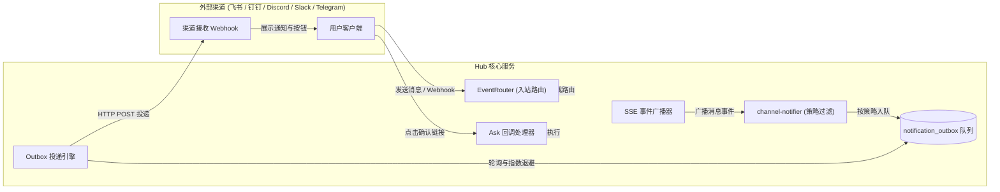
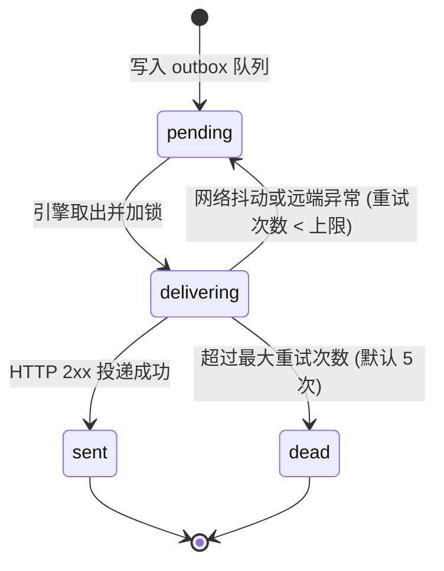

# 外部渠道集成

外部渠道连接即时通讯工具与外部系统。
系统把会话通知推送到外部渠道，并支持用户在渠道中提交确认指令。[返回文档目录](README.md)

## 双向消息路由模型

系统支持双向消息流转架构：

1. **入站路由**：外部系统向 Hub 发送 Webhook 或消息回调。EventRouter 识别事件并提取 `threadKey`（例如 `im:thread:<chatId>:<threadId>`）。系统命中订阅时直接直通 Worker，未命中时交由 Router 会话处理。
2. **出站投递**：会话产生回复或交互请求。系统触发 SSE 广播事件。`channel-notifier` 匹配目标通道并校验打扰策略。Outbox 队列执行异步安全投递。
3. **交互回调**：对于 `ask_request` 人机交互事件，系统创建带 HMAC 签名的免登录链接。用户在即时通讯软件中点击链接完成审批。



## 通道数据结构

通道记录保存在 Hub 数据库的 `notification_channels` 表。

| 字段 | 类型 | 说明 |
| :--- | :--- | :--- |
| `id` | string | 通道唯一标识。格式为 `chan_<uuid>`。 |
| `sessionId` | string | 关联的主会话 ID。 |
| `ownerId` | string | 通道创建者的用户 ID。 |
| `name` | string | 通道自定义显示名称。 |
| `kind` | string | 渠道类型：`feishu`、`dingtalk`、`discord`、`slack`、`telegram`、`webhook`。 |
| `targetUrl` | string | 渠道接收端 HTTP URL。 |
| `secret` | string | 可选。签名校验密钥。 |
| `events` | string[] | 订阅事件列表：`assistant_reply`、`ask_request`、`wakeup`。 |
| `tellPolicy` | string | 打扰策略：`always`、`needed`、`never`。 |
| `enabled` | boolean | 通道启用状态。 |
| `lastTriggeredAt` | string | 最近一次投递时间戳。 |
| `createdAt` | string | 通道创建时间戳。 |

## 事件类型与打扰策略

### 订阅事件

通道支持订阅三种核心事件：

1. `assistant_reply`：Bot 产生回复消息（role 为 `assistant`）。
2. `ask_request`：Bot 发起人机交互请求（调用 `ask` 或 `ask_human`）。
3. `wakeup`：系统收到回调或外部唤醒消息（role 为 `callback`）。

### 打扰策略（tellPolicy）

系统在事件勾选基础上应用二次过滤：

- `always`：系统投递所有已订阅的事件。此模式为接口默认值。
- `needed`：系统仅投递审批请求、失败回调与失败会话的回复。
- `never`：系统拦截所有通知。

系统判定失败回调的规则如下：
消息文本包含 `❌`、`失败`、`failed` 或 `error`（忽略大小写）。

### 静默规则

Bot 发言以 `[PASS]` 或 `[IGNORE]` 开头时，系统判定为静默路过指令。
系统跳过外部推送，避免产生通知噪音。

### 子会话通知继承

子会话事件自动继承父会话配置的启用通道。
系统按通道 ID 自动去重。
Webhook 载荷中附带 `channelSessionId` 字段。
即时通讯渠道在消息尾部追加 `（子会话 <id>）` 标注。

## Outbox 队列与投递引擎

Hub 采用 Outbox 事务队列保障通知可靠到达。



### 投递引擎机制

Outbox 引擎由 `createOutboxDeliverer` 初始化：

1. **即时首投**：事件写入队列后，引擎立即发起首次异步 HTTP 请求。
2. **并发控制**：内存集合 `outboxDelivering` 记录正在投递的任务。引擎避免重复并发请求。
3. **指数退避重试**：投递失败时，引擎按指数算法计算下次重试时间。基准延迟为 5 秒，最大延迟为 300 秒。
4. **终止状态**：当尝试次数达到 `BOTD_OUTBOX_MAX_ATTEMPTS`（默认 5 次）时，引擎将记录标记为 `dead`。
5. **状态更新**：投递成功时，引擎将记录状态更新为 `sent`，并刷新通道的 `last_triggered_at`。

## 渠道适配器规范与配置

### 飞书（feishu）

飞书适配器接入群聊自定义机器人 Webhook。

#### 目标 URL 格式
```text
https://open.feishu.cn/open-apis/bot/v2/hook/<HOOK_TOKEN>
```

#### 推送载荷格式
```json
{
  "msg_type": "text",
  "content": {
    "text": "[botd 交互确认] @architect 请求用户确认：\n部署到生产环境吗？\n\n请直接点击链接确认选项：\n👉 同意：https://hub.example.com/api/public/asks/ask-1/respond?sessionId=s1&answer=同意&token=sig123\n👉 拒绝：https://hub.example.com/api/public/asks/ask-1/respond?sessionId=s1&answer=拒绝&token=sig123"
  }
}
```

### 钉钉（dingtalk）

钉钉适配器接入自定义机器人 Webhook。

#### 目标 URL 格式
```text
https://oapi.dingtalk.com/robot/send?access_token=<ACCESS_TOKEN>
```

#### 推送载荷格式
```json
{
  "msgtype": "markdown",
  "markdown": {
    "title": "botd 交互确认",
    "text": "### botd 交互确认\n@architect 请求用户确认：部署到生产环境吗？\n\n- [同意](https://hub.example.com/api/public/asks/ask-1/respond?sessionId=s1&answer=同意&token=sig123)\n- [拒绝](https://hub.example.com/api/public/asks/ask-1/respond?sessionId=s1&answer=拒绝&token=sig123)"
  }
}
```

### Discord（discord）

Discord 适配器接入频道 Webhook。

#### 目标 URL 格式
```text
https://discord.com/api/webhooks/<WEBHOOK_ID>/<WEBHOOK_TOKEN>
```

#### 推送载荷格式
```json
{
  "content": "[botd] @architect: 任务已完成",
  "embeds": [
    {
      "title": "botd 交互确认",
      "description": "部署到生产环境吗？\n\n[点击确认: 同意](https://hub.example.com/api/public/asks/ask-1/respond?sessionId=s1&answer=同意&token=sig123)"
    }
  ]
}
```

### Slack（slack）

Slack 适配器接入 Incoming Webhook。

#### 目标 URL 格式
```text
https://hooks.slack.com/services/<T00>/<B00>/<XXXX>
```

#### 推送载荷格式
```json
{
  "text": "[botd 交互确认] *@architect* 请求用户确认：\n部署到生产环境吗？\n\n• <https://hub.example.com/api/public/asks/ask-1/respond?sessionId=s1&answer=同意&token=sig123|同意>\n• <https://hub.example.com/api/public/asks/ask-1/respond?sessionId=s1&answer=拒绝&token=sig123|拒绝>"
}
```

### Telegram（telegram）

Telegram 适配器接入 Bot API 的 `sendMessage` 方法。

#### 目标 URL 格式
```text
https://api.telegram.org/bot<TOKEN>/sendMessage?chat_id=<CHAT_ID>
```

#### 推送载荷格式
```json
{
  "text": "*【botd 交互确认】* @architect 请求用户确认：\n部署到生产环境吗？\n\n• [同意](https://hub.example.com/api/public/asks/ask-1/respond?sessionId=s1&answer=同意&token=sig123)",
  "parse_mode": "Markdown"
}
```

### 通用 Webhook（webhook）

通用 Webhook 接收完整结构化事件 JSON。

#### 请求头签名
当通道配置了 `secret` 时，Hub 在请求头添加 HMAC-SHA256 签名：
```text
X-Botd-Signature: sha256=<hex_digest>
```

#### 载荷格式
```json
{
  "event": "ask_request",
  "sessionId": "s_demo",
  "sessionTitle": "线上排障",
  "timestamp": "2026-11-04T12:00:00.000Z",
  "ask": {
    "id": "ask-1",
    "botId": "architect",
    "prompt": "确认重启网关服务吗？",
    "options": ["确认", "取消"],
    "expiresAt": "2026-11-04T12:30:00.000Z"
  },
  "respondUrls": {
    "确认": "https://hub.example.com/api/public/asks/ask-1/respond?sessionId=s_demo&answer=%E7%A1%AE%E8%AE%A4&token=sig123",
    "取消": "https://hub.example.com/api/public/asks/ask-1/respond?sessionId=s_demo&answer=%E5%8F%96%E6%B6%88&token=sig123"
  }
}
```

## HTTP 管理接口

### 创建通道
```bash
curl -X POST http://localhost:3002/api/sessions/s_123/channels \
  -H "Content-Type: application/json" \
  -b "botd_token=<TOKEN>" \
  -d '{
    "name": "飞书告警群",
    "kind": "feishu",
    "targetUrl": "https://open.feishu.cn/open-apis/bot/v2/hook/xxx",
    "events": ["assistant_reply", "ask_request", "wakeup"],
    "tellPolicy": "needed"
  }'
```

### 测试通道推送
```bash
curl -X POST http://localhost:3002/api/channels/chan_123/test \
  -b "botd_token=<TOKEN>"
```

### 查询 Outbox 投递日志
```bash
curl http://localhost:3002/api/sessions/s_123/outbox \
  -b "botd_token=<TOKEN>"
```
