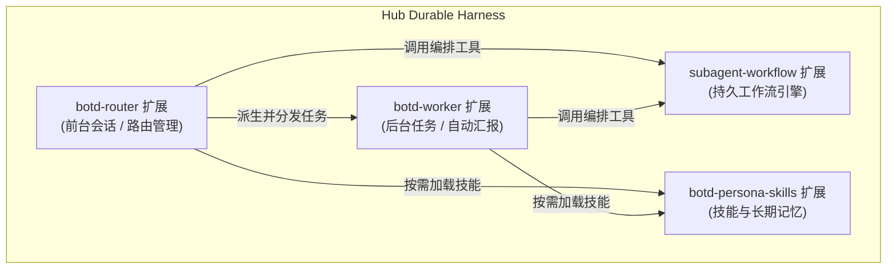

# 扩展架构与动态扩展加载器

[返回文档目录](README.md)

本文档说明 Pi Durable 扩展架构、四大核心扩展、动态扩展加载器以及 Hub 直管扩展机制。

## 概述

系统依托 `@earendil-works/pi-durable` 构建模块化扩展体系。

扩展直接与 Hub 的持久状态机及 SQLite 存储结合。

扩展通过定义工具、提示词片段、任务与钩子，丰富智能体能力。

所有扩展均支持在 Hub 端集中管理与动态加载。

## 核心扩展架构

系统在 Hub 内置四个核心扩展，覆盖路由、执行、工作流与技能。



### 1. botd-router 扩展

`botd-router` 扩展挂载于每个角色分身的前台会话。

前台会话承担全双工任务调度职责。

扩展从前台 `modelTools` 移除 `bash`、`write`、`edit`、`read` 等编码工具。

运行时按分身 `enabledExtensions` 组装精确扩展数组，并在 `tools` 与 `modelTools` 双层强制执行 `toolScope`（`all`、`readonly`、`custom`）。

该机制防止跨分身扩展泄漏，并阻断受限分身通过 QuickJS 沙箱绕过工具权限。

扩展注入以下提示词片段（Sections）：

- `persona`：注入当前角色的身份指令、记忆笔记与全双工路由规范。
- `active_workers`：动态读取当前会话关联的后台 Worker 执行状态。

扩展提供六大核心路由工具：

| 工具名称 | 功能说明 |
| :--- | :--- |
| `spawn_worker` | 创建后台 Worker 独立会话，支持 `forkContext`、`worktree` 与 `threadKey` |
| `delegate_to_bot` | 跨角色分身委派任务，支持 `worktree` 与 `threadKey` 隔离直通 |
| `steer_worker` | 向正在执行的 Worker 注入干预指令，微调执行策略 |
| `stop_worker` | 强制终止目标 Worker 会话并将状态标记为 `aborted` |
| `recall` | 查询 `RecallIndexDoc`，按跳召回任务细节与关联历史记录 |
| `ask_human` | 发起人机确认，将待确认事项持久化记录到 `AskDoc` |

### 2. botd-worker 扩展

`botd-worker` 扩展挂载于后台 Worker 会话。

后台 Worker 拥有完整的执行环境。

扩展挂载 `CodingTools`（`read`、`write`、`edit`、`bash`）以及 QuickJS 沙箱。

扩展提供任务级 `subagent` 工具（支持 `worktree`、`isolation` 与 `forkContext`）：

- 子会话所有权绑定到当前工具任务（`ownership: { kind: "task" }`）。
- 未指定 `isolation: "off"` 时默认继承父 Worker 的工作树路径。
- 进程崩溃重启后，系统自动重连已有子会话并恢复工作树元数据。

扩展在 `GenerationTask` 注册 `afterRun` 钩子：

1. Worker 执行完成时，钩子提取最终回复文本。
2. 钩子截取 200 字摘要与前 480 字预览，存入全局 `RecallIndexDoc`。
3. 钩子修改父会话 `WorkerRegistryDoc` 中的任务状态为 `completed`。
4. 钩子通过确定性请求标识 `worker-report:<taskId>` 唤醒父 Router。
5. 父 Router 接收汇报并向用户输出结论。

### 3. subagent-workflow 扩展

`subagent-workflow` 扩展在 Router 与 Worker 双层同时注册 `SubagentWorkflow` 工具。

工具执行解析后的工作流脚本，支持步骤级 `worktree` 隔离与跨重放 `resume` 续跑。

步骤产物写入 `api.memo`，实现确定性步骤缓存与崩溃续跑。

具体机制见[自动化指南](automation.md)。

### 4. botd-persona-skills 扩展

`botd-persona-skills` 扩展挂载于所有角色会话。

扩展将 Hub 托管的技能与记忆转化为标准工具：

- `load_skill`：按需读取技能目录的 `SKILL.md`，支持传入 `path` 参数读取包内指定辅助文件。
- `update_memory`：直接修改或追加当前角色的 `MEMORY.md` 长期记忆。
- `available_skills` 片段：汇总当前角色启用与继承的技能列表。用户在会话输入 `/<skillId>` 斜杠命令时，Hub 自动引导模型加载对应技能。

## 免节点 Hub 直管全局体系

传统方案需要在每个 Node 节点部署扩展代码与安装 npm 依赖。

这种方式导致多节点版本碎片化与环境维护困难。

新架构实现免节点 Hub 直管全局体系。

所有技能与扩展统一存储在 Hub 文件系统包目录（单一事实源，SQLite 不再存储内容）：

- `<dataDir>/skills/<id>/`：多文件技能目录（包含 `SKILL.md`、`references/*.md`、`scripts/*` 等）。
- `<dataDir>/extensions/<id>/`：多文件扩展包目录（入口 `index.ts`，支持相对导入 `./helper.ts` 等文件）。

此外，系统自动扫描并发现 Bot 工作区与用户主目录下的标准技能目录：

- `<workspaceDir>/.agents/skills/<id>/` 与 `<workspaceDir>/.agent/skills/<id>/`
- `~/.agents/skills/<id>/` 与 `~/.agent/skills/<id>/`

### 多源资源包安装与二进制保真

`POST /api/install` 与 `POST /api/nodes/:nodeId/install` 支持多种安装来源：

- 本地文件、本地目录或 `file://` 路径。
- `npm:<spec>`（如 `npm:@scope/pkg@1.0.0`）：自动将生产依赖随包安装至 `npm/node_modules/`，兼容 `package.json#pi.extensions`。
- Git 源：支持 `git:github.com/owner/repo@ref`、带 `@ref` 的完整地址、GitHub `tree` 子目录链接及 `owner/repo@skillName` 简写。

节点向 Hub 回传或本地安装资源包时，二进制文件通过 Base64 保真编码传输，可执行脚本保留 `0o755` 权限位。

全局写删路由（`PUT/DELETE /api/skills/:id` 与 `/api/extensions/:id`）强制要求 `admin` 管理员权限。

用户在 Hub 修改技能或扩展后，系统自动热同步全部存量会话，无需重启即时生效。

## 动态全栈扩展加载器

实现位于 `apps/hub/src/harness/dynamic-extension-loader.ts`。

`loadDynamicDurableExtensionFromDir` 与 `loadDynamicDurableExtension` 负责编译并加载动态扩展。

### 模块解析与加载流程

1. 加载器解析扩展包入口（优先读取 `package.json` 的 `pi.extensions`、`module` 或 `main`，否则匹配 `index.ts` 等约定名）。
2. 加载器在 `<dataDir>/extensions/` 补齐 ESM 标记，并创建指向宿主工作区 `node_modules` 的符号链接。
3. 目录包原地解析跨文件相对导入、自带 `npm/node_modules` 与 `@earendil-works/pi-durable` 依赖。
4. 加载器使用 `tsx/esm/api` 的 `tsImport` 配合时间戳随机查询参数动态导入，避开 ESM 缓存实现热重载。
5. 仅纯内存源码加载时才使用 `node_modules/.botd-dyn/<uuid>/` 临时目录并在导入后清理。
6. 加载器校验导出对象符合 `Extension` 规范并返回扩展实例。

### 声明式 Generative UI 格式化

动态扩展支持向前端输出自包含交互卡片。

工具只需将符合 `botd.v1` 契约的 JSON 规范包裹在 ````ui 围栏代码块中返回。

Web 界面与抽屉面板原生解析并渲染该交互规范。

## 扩展编写示例

以下显示一个完整的自定义审核扩展。

该扩展输出带声明式 UI 卡片的审批结果：

```ts
import { defineExtension, defineTool, section } from "@earendil-works/pi-durable";
import { obj, str } from "@earendil-works/pi-schema";

// 1. 定义安全审核工具
const securityAuditTool = defineTool({
  name: "request_shell_approval",
  description: "提交高危 Shell 执行申请并向用户显示审批卡片",
  parameters: obj({
    command: str({ description: "待执行的命令内容" }),
    reason: str({ description: "执行该命令的原因说明" }),
  }),
  async execute(input) {
    // 构造符合 botd.v1 规范的声明式 UI Spec
    const uiSpec = {
      root: "approval_card",
      elements: {
        approval_card: {
          type: "Card",
          props: { title: "高危命令执行审批", badge: "security" },
          children: ["meta"],
        },
        meta: {
          type: "KeyValueList",
          props: {
            items: [
              { key: "目标命令", value: input.command, mono: true },
              { key: "申请原因", value: input.reason },
            ],
          },
        },
      },
    };

    const outputText = `高危命令待确认\n\`\`\`ui\n${JSON.stringify(uiSpec, null, 2)}\n\`\`\``;
    return {
      output: [{ type: "text", text: outputText }],
    };
  },
});

// 2. 导出扩展定义
export default defineExtension({
  name: "custom-security-guard",
  tools: [securityAuditTool],
  sections: [
    section("security_notice", () => {
      return "检测到敏感操作时，必须优先调用 request_shell_approval 工具发起审批。";
    }),
  ],
});
```

扩展直接在 Hub 中创建并启用。

配置完成后，角色分身在下一轮对话中即可使用该审核工具。
