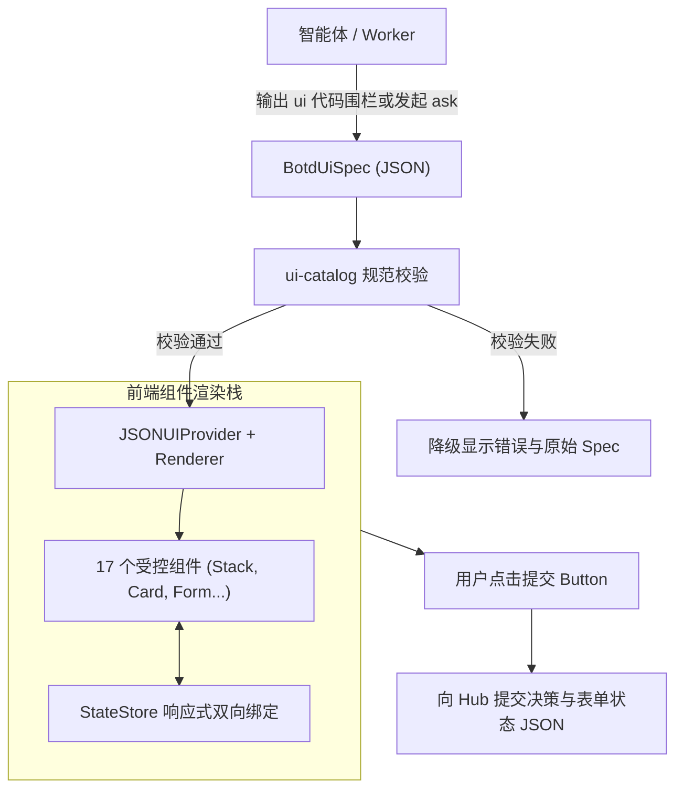
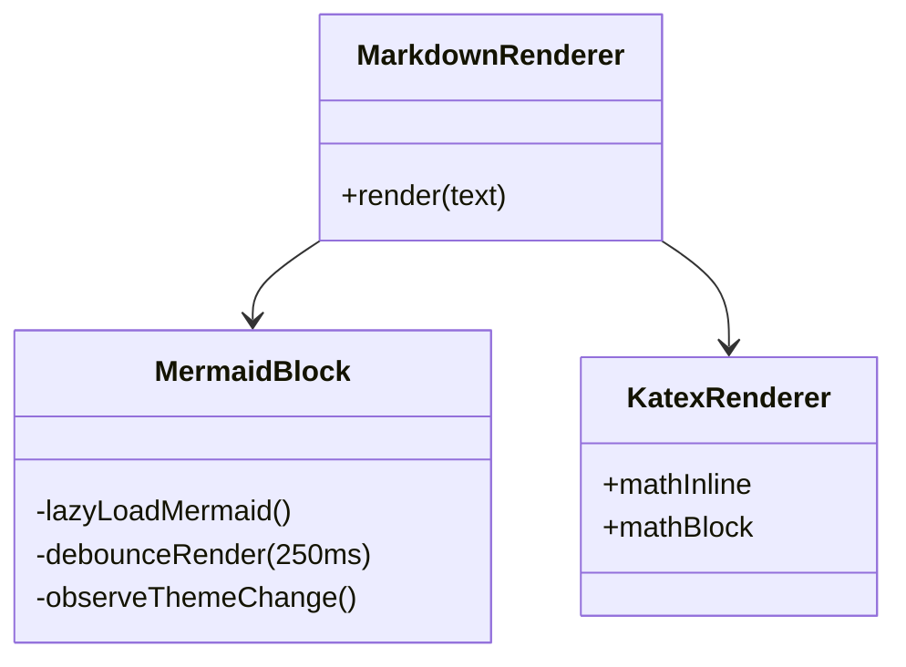

# 生成式 UI 规范与多模态渲染

botd 允许智能体在会话中输出结构化 Spec。
前端将其渲染为交互式界面、流式产物、架构图与数学公式。[文档目录](README.md)

## 架构概览

生成式 UI 系统由四部分构成：

1. **协议层**：定义在 `@botd/protocol/ui-catalog.ts`。版本标识为 `botd.v1`。
2. **渲染引擎**：基于 JSON Render 协议（`@json-render/core` 与 `@json-render/react`）。
3. **交互弹窗**：`AskCard.tsx` 解析表单 Spec 并支持人机协同确认。
4. **富文本渲染**：Markdown 渲染器集成 Mermaid 架构图、KaTeX 数学公式与流式产物抽屉。



## JSON Render 协议与 Spec 规范

### 顶层结构

Spec 包含根节点指针、元素字典与初始状态：

```json
{
  "root": "root_card",
  "elements": {
    "root_card": {
      "type": "Card",
      "props": { "title": "环境部署配置" },
      "children": ["env_select", "submit_btn"]
    },
    "env_select": {
      "type": "Select",
      "props": {
        "label": "目标集群",
        "value": { "$bindState": "/deploy/cluster" },
        "options": [
          { "value": "prod-us", "label": "北美生产区" },
          { "value": "prod-eu", "label": "欧洲生产区" }
        ]
      }
    },
    "submit_btn": {
      "type": "Button",
      "props": { "label": "确认部署", "variant": "primary" },
      "on": {
        "press": {
          "action": "submit",
          "params": { "decision": "approve" }
        }
      }
    }
  },
  "state": {
    "deploy": { "cluster": "prod-us" }
  }
}
```

### 规模与安全约束

系统在协议层限制 Spec 体积，防止前端卡顿：

| 约束项 | 常量定义 | 限制阈值 | 违规处理 |
| :--- | :--- | :--- | :--- |
| 最大字节数 | `MAX_UI_SPEC_BYTES` | 64 KB (65536 字节) | 抛出超限错误并拒绝渲染 |
| 最大元素数 | `MAX_UI_ELEMENTS` | 64 个元素 | 拒绝解析超量节点 |
| 最大树深度 | `MAX_UI_TREE_DEPTH` | 6 层嵌套 | 拦截深层嵌套结构 |
| 循环引用 | 递归路径检测 | 0 环路容忍 | 拦截自引用死循环 |

### 状态绑定语法

表单控件通过路径表达式绑定 StateStore：

- `{ "$state": "/key/path" }`：只读绑定。控件值跟随状态更新。
- `{ "$bindState": "/key/path" }`：双向绑定。用户输入同步写入状态字典。

## 17 个受控组件目录

组件库分为四大类别。

### 1. 布局与分组组件

- **Stack**：弹性布局容器。支持 `direction: "vertical" | "horizontal"` 与 `gap: "sm" | "md"`。
- **Card**：带边框的分组卡片。支持 `title`、`subtitle`、`badge` 与 `icon`。
- **Tabs**：标签页切换容器。支持 `tabs: Array<{ id, label, icon }>`。
- **Accordion**：折叠面板列表。用于 FAQ 与深度分析展开。

### 2. 指标与对比组件

- **MetricGrid**：自适应指标网格。支持 `columns: 2 | 3 | 4`。
- **MetricCard**：关键指标卡片。支持 `status: "ok" | "warn" | "error"` 与 `trend: "up" | "down" | "flat"`。
- **BarList**：横向对比条状图。用于性能跑分与比率对比。
- **KeyValueList**：紧凑键值对表格。支持单项代码字体与徽标。
- **Table**：二维结构化数据表格。支持指定列启用等宽代码字体。

### 3. 提示与流程组件

- **Callout**：高亮提示框。支持 `variant: "info" | "tip" | "warn" | "error"` 与 `mono` 代码模式。
- **Steps**：纵向生命周期步骤条。支持 `status: "done" | "current" | "pending"`。

### 4. 交互表单与操作组件

- **TextInput**：单行文本输入或多行文本域（`multiline: true`，`rows: 2-12`）。支持 `secret: true` 掩码机密输入（密码与 API Key），附带明文切换按钮，禁用后显示圆点遮罩。
- **Select**：下拉单选列表。
- **Switch**：布尔切换开关。
- **CheckboxGroup**：多选项复选框组。绑定字符串数组到状态。
- **ActionBar**：水平按钮排列栏。支持 `align: "left" | "right" | "between"`。
- **Button**：交互触发按钮。配置 `on.press: { action: "submit", params }`。

## 人机交互弹窗（AskCard）

智能体调用 `ask` 或 `ask_human` 时触发人机交互。

### 交互生命周期

1. **下发请求**：智能体输出包含 `previewType: "ui"` 的交互请求。
2. **校验与渲染**：`AskCard.tsx` 调用 `validateUiSpec` 校验 Spec 并渲染交互表单。
3. **收集输入**：用户修改表单控件时，StateStore 记录最新状态。
4. **提交决策**：用户点击按钮触发 `submit` 动作。系统向 Hub 发送带有决策标识与表单快照的 JSON 字符串：

```json
{
  "decision": "approve",
  "state": {
    "deploy": { "cluster": "prod-us" }
  }
}
```

### 机密输入零泄漏机制（SecretStash）

表单包含密码、API Key 或访问令牌时，系统启动零泄漏流水线：

1. **协议标记**：智能体在 `TextInput` 声明 `secret: true`。
2. **内存暂存**：用户提交后，Hub 将明文暂存至内存 `SecretStash`。Hub 分配临时环境变量名（如 `BOTD_SECRET_A1B2C3D4`，默认 5 分钟有效）。
3. **脱敏脱壳**：Hub 将应答数据中的机密字段替换为 `[REDACTED:$BOTD_SECRET_...]` 占位符。占位符落库至 `AskDoc` 并广播至前端与语言模型。
4. **环境注入**：本地执行环境与远端执行环境自动注入活动机密环境变量。子进程通过 `process.env.BOTD_SECRET_*` 跨平台读取明文。
5. **安全保证**：机密明文不写入 SQLite 数据库，不广播至 SSE 事件流，不进入命令行参数，不进入模型上下文。

### 文本渠道降级

对于飞书、Slack、钉钉等外部文本渠道，系统调用 `extractAskUiSummary` 提取降级摘要：

- Callout 与 KeyValueList 转换为紧凑文本摘要。
- 纯按钮审批转换为免登录一键确认链接。
- 包含表单输入项的卡片附带网页填写跳转链接。

## 实时产物流式渲染

智能体通过 ArtifactService 创建产物文件。

### 流式上传机制

- 节点或前端向 `POST /api/sessions/:id/artifacts` 发送数据。
- 服务端使用 `readBodyWithLimit` 流式接收二进制流。
- 服务端校验累计字节数。大小超出 `MAX_ARTIFACT_BYTES` 时立即中断连接并返回 413。
- 服务端将文件保存到磁盘，并在数据库创建 `ArtifactRecord`。

### 实时通知与抽屉显示

产物保存成功后，Hub 通过 SSE 广播 `artifact_created` 事件。
前端 `ArtifactsDrawer.tsx` 实时更新产物列表。
用户点击即可展开抽屉，在线预览代码、文本或下载二进制附件。

## 富文本渲染器

`Markdown.tsx` 提供结构化文档排版与动态渲染能力。

### Mermaid 架构图渲染



`MermaidBlock.tsx` 具备以下特性：

1. **按需懒加载**：组件在首次遇到 mermaid 代码块时动态加载核心包。系统减少首屏资源开销。
2. **主题自适应**：组件通过 `MutationObserver` 监听 `html.dark` 类名变化。主题切换时自动重绘 dark 或 default 风格。
3. **渲染防抖**：流式输出过程每隔 250 毫秒执行一次防抖渲染。系统防止半成品代码引起频繁触发错误。
4. **容错降级**：语法错误时显示友好警告框并保留原始代码，不中断消息阅读。
5. **全屏预览**：点击右上角放大按钮打开全屏预览窗口。

### KaTeX 数学公式渲染

系统集成 `remark-math` 与 `rehype-katex`：

- 行内公式：使用单个美元符号包裹，例如 `$E = mc^2$`。
- 块级公式：使用双美元符号包裹，支持复杂多行微积分与矩阵推导。

### 代码高亮与复制

系统集成 `rehype-highlight`。
代码块顶部独立显示语言标识与一键复制按钮。
复制按钮提供反馈提示，保障代码复制体验。
