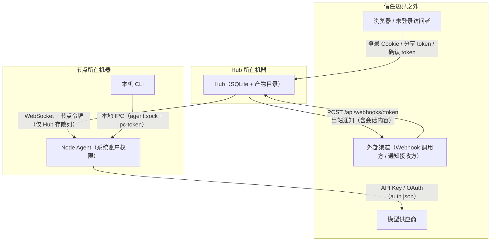

# 安全边界

[文档目录](README.md)

本文回答四个问题：谁能给 Bot 派任务，Bot 以谁的权限执行，凭据保存在哪里，公开入口如何防滥用。

## 资产与信任边界

边界两侧的信任假设：

| 边界 | 假设 |
| --- | --- |
| 浏览器到 Hub | 仅登录 Cookie 或公开 token 可达。公共部署必须加 HTTPS。 |
| 外部渠道到 Hub | URL 中的 token 即凭据。持有者可触发对应任务。 |
| Hub 到节点 | 节点主动外连。Hub 数据库泄露不直接泄露节点令牌原文。 |
| 节点到模型供应商 | 凭据存节点本地文件。Hub 不维护模型凭据库。 |
| 本机到 Node Agent | IPC 只在本机同用户可达。跨用户依赖 socket 与文件权限。 |

## 威胁与缓解总表

| 威胁 | 入口 | 当前缓解 | 残余风险 |
| --- | --- | --- | --- |
| Hub 账户被盗用 | 登录接口 | scrypt 加盐散列、HMAC 签名 Cookie、改密后旧 Cookie 立即失效 | 无二次验证；弱密码可被尝试 |
| 跨站请求伪造 | Cookie 会话 | `SameSite=Strict` | 无 CSRF Token，无 Origin 白名单校验 |
| 共享 Bot 被用于执行任意命令 | 团队共享 | 共享方自行评估；系统侧无命令白名单 | 共享即授权执行，不是只读 |
| 节点令牌泄露 | `node.json`、日志外贴 | Hub 只存散列；管理面接口拒绝节点令牌 | 持令牌者可以节点所有者身份调 Hub API |
| 配对码被暴破 | `/api/nodes/pairing/exchange` | 6 位码 10 分钟一次性；连续失败 5 次作废；按 IP 指数退避（1 秒起，上限 5 分钟） | 攻击窗口仍存在，退避为内存级 |
| 分享链接扩散 | `/api/public/shares/:token` | 36 字符随机 token；可设过期；可撤销或重生成 | 链接存活期内持有者可读会话 |
| Webhook URL 泄露 | `/api/webhooks/:token` | 可选 HMAC 签名校验；5 分钟去重；最小间隔 10 秒 | 未配 secret 时 URL 即完整凭据 |
| 确认链接伪造 | `/api/public/asks/:askId/respond` | HMAC 签名（`sessionId:askId`） | 密钥泄露即可替答 |
| 本机恶意进程控制 Node Agent | 本地 IPC | 0600 Unix socket 或每用户命名管道；`ipc-token` 校验 | 同用户进程可完全控制守护进程 |
| 模型凭据泄露 | 节点 `.agent/auth.json` | 目录权限 0700 | 文件内容不加密；备份需同等保护 |
| 提示注入诱导危险操作 | 会话消息、网页内容 | `botd ask` 确认需流程主动调用 | 无强制审批人机制；靠系统账户权限兜底 |
| 会话内容外泄到第三方 | 出站通知通道 | 配置时人工检查接收地址 | 通道一旦配置，消息会按规则外发 |

## 谁能给 Bot 派任务

按入口分类，每个入口对应不同的信任主体。

### Hub 登录用户

1. 节点所有者可以给自己的 Bot 派任务。
2. Bot 或节点设为 `visibility: team` 后，当前 Hub 的其他登录用户也可以使用。
3. 会话创建时用 `canUserUseBot` 校验这条规则。

共享 Bot 不限制为只读命令。其他用户请求它，等于请求该节点的模型和工具。

### 会话参与者

1. 会话所有者可以邀请已有用户成为参与者。
2. 参与者可以读取消息、发送消息、回答确认请求。
3. 参与者不是只读角色。部分会话修改操作按访问权校验，参与者也可能执行。

各操作的完整权限对照见[团队协作](team.md)。

### 外部入口

| 入口 | 持有凭据的人能做什么 |
| --- | --- |
| `POST /api/webhooks/:token` | 向该触发器绑定的会话和 Bot 派发任务 |
| `GET /api/public/shares/:token` | 免登录读取会话消息与产物 |
| `GET|POST /api/public/asks/:askId/respond` | 提交对应确认请求的答案 |

这些路由在认证中间件白名单中放行，不检查登录态。`/api/health` 和 `POST /api/auth/login`、`POST /api/nodes/pairing/exchange` 也免登录。

### 节点本机

1. 本机 CLI 通过本地 IPC 唤醒 Bot、跑后台命令。
2. 详见下文[节点本地 IPC 面](#节点本地-ipc-面)。

### `botd ask` 的定位

`botd ask` 需要流程主动调用。它收集人的答案，不自动拦截所有高风险操作，也不提供指定审批人的完整授权策略。高危边界应落在系统账户与文件权限上。

## Bot 以谁的权限执行

Node Agent 的 Bash、文件工具和后台任务，使用启动它的系统账户权限。

Bot 有独立工作目录和模型上下文，但没有操作系统沙箱。工具可以访问该账户有权访问的其他目录和服务。

为此采取三条措施：

1. 为节点使用专用系统账户。
2. 按任务需要收紧该账户的文件、网络和容器权限。
3. 不把生产密钥放进该账户可读的环境。

技能是说明文件，不是权限策略。模型是否遵守技能中的限制，不能替代操作系统访问控制。

扩展在 Node Agent 进程内执行代码。安装扩展按安装本地程序对待。技能引用的脚本和外部 CLI 同样需要检查来源。

## 凭据存放在哪里

| 位置 | 内容 | 保护措施 |
| --- | --- | --- |
| Hub SQLite（默认 `~/.botd/hub.sqlite`） | 用户 scrypt 散列、节点令牌散列、登录签名密钥 `auth_secret`、`ask_secret`、会话消息、工具调用预览、触发器 token 与 secret、分享 token、通道 secret | 文件权限 0600（非 Windows） |
| Hub 产物目录 | 上传文件、截图、报告、构建产物 | 随数据目录权限 |
| 节点 `node.json` | 节点 ID 与原始令牌 | 安全写入；访问即等于节点身份 |
| 节点 `cli.json` | CLI 登录令牌；显式 `--save-credentials` 时含明文密码 | 文件权限 0600 |
| 节点 `.agent/auth.json` | 模型 API Key 与 OAuth 凭据 | 目录权限 0700；内容不加密 |
| 节点 `ipc-token` | 本地 IPC 令牌（64 位 hex） | 文件权限 0600 |
| Bot `env.json` | 工具所需私有配置 | 文件权限 0600 |
| Bot 记忆、工作区、会话 JSONL | 项目资料、工具结果、模型上下文 | 随数据目录权限 |

数据库路径可用 `BOTD_HUB_DATA_DIR` 或 `BOTD_DB_PATH` 覆盖。这两个变量不影响上述权限规则。

补充三点：

1. Web 登录模型供应商时，API Key 与验证码先经过 Hub，再转发给节点。Hub 是该链路中的受信任组件。
2. `BOTD_API_KEY_<PROVIDER>` 优先于 `.agent/auth.json` 中保存的凭据。清除节点文件不会清除进程环境，也不会撤销供应商侧授权。
3. 工具子进程可能继承 Node Agent 的进程环境。不要把环境变量当作秘密隔离机制。

## 账户与登录机制

1. 密码以 scrypt 加盐散列保存，格式为 `scrypt$<salt>$<key>`。
2. 登录后签发 Cookie `botd_token`，有效期 7 天。
3. Cookie 带 `HttpOnly` 与 `SameSite=Strict`，用 HMAC-SHA256 签名。
4. 签名密钥存于数据库 `settings` 表。正常重启后登录态保持有效。
5. 修改密码会在同一事务内递增该用户的 `token_epoch`，旧 Cookie 立即失效。
6. 退出登录只清除客户端 Cookie，不维护服务端撤销名单。
7. 当前实现没有 CSRF Token，也没有 Origin 白名单校验。

### 管理员引导

1. 首次启动且用户表为空时，Hub 插入管理员账户 `admin`。
2. 设置 `BOTD_ADMIN_PASSWORD` 后，该值成为管理员密码。
3. 未设置时，Hub 生成一次性随机密码并打印到控制台日志。
4. 该变量只在用户表为空时生效，不会覆盖已有密码。

不存在固定的默认密码。不要把控制台打印的一次性密码用于长期运行。

## 配对码与节点令牌

### 配对流程的防护

1. 配对码是 6 位数字，有效期 10 分钟，只能使用一次。
2. 配对码绑定生成它的用户，存在内存中。Hub 重启后未使用的码全部失效。
3. 同一配对码连续校验失败 5 次即作废。
4. 按来源 IP 做失败退避：从 1 秒起步指数递增，上限 5 分钟。
5. 持有效配对码的请求不受退避拦截，避免误伤正常配对。

### 节点令牌的能力

1. 配对成功后，Hub 生成 24 字节随机令牌。节点把原文存入 `node.json`，Hub 只存 SHA-256 散列。
2. 节点用该令牌建立到 Hub 的 WebSocket 连接。
3. 令牌也可以经 `x-botd-node-id` 与 `x-botd-node-token` 请求头访问受保护 API，身份为节点所有者。
4. 管理面接口对此拒绝：`/api/users` 下的全部路由和创建配对码的 `POST /api/nodes/pairing` 返回 403。
5. 在 Hub 上移除节点即吊销该身份。再次接入需要重新配对。

因此，泄露节点令牌等价于泄露该用户在 Hub 上的大部分 API 权限。不要把 `node.json` 原文贴入日志或 Issue。

## 分享链接

### 机制

1. 会话所有者调用 `POST /api/sessions/:id/share` 创建分享。
2. token 为 18 字节随机数的 hex 编码，共 36 个字符。
3. 请求体可传 `expiresInHours`，取值 1 到 720 的整数。
4. 不传 `expiresInHours` 时分享永久有效。
5. 传 `regenerate: true` 会换发新 token，旧链接立即失效。
6. `DELETE /api/sessions/:id/share` 撤销分享，链接立即失效。

### 持有 token 的人能读什么

`GET /api/public/shares/:token` 免登录返回：

1. 会话标题、模式与成员 Bot 摘要。
2. 全部会话消息。
3. 会话产物列表。
4. 每个附件的重写地址 `GET /api/public/shares/:token/artifacts/:artifactId/content`，可下载内容。

### 风险

1. 分享不是冻结导出。访问者读取当时的数据，后续新消息同样可见。
2. 分享前检查消息、工具输出预览和附件。
3. 公开分享的会话里不要继续讨论敏感内容；需要时先撤销再讨论。
4. token 出现在 URL 中。代理日志、浏览器历史和聊天工具都可能留存它。
5. 公开部署应使用 HTTPS，避免 token 在传输中被截获。

## Webhook 触发器与出站通知

### 入站 Webhook

1. 创建 `webhook` 类型触发器时，Hub 生成随机 token 拼入 URL。
2. 可以为触发器配置 secret。配置后，请求必须携带匹配的 HMAC 签名头（`x-hub-signature-256`），校验用常数时间比较。
3. Hub 按 5 分钟窗口去重，按触发器限最小触发间隔 10 秒。
4. subsession 模式下，原始 payload 落盘为子会话产物 `./inbox/event_<id>.json`，不拼进提示词；初始消息只携带干净的元数据头，并显式声明该文件应视为外部不可信数据，降低提示注入面。
5. 未配置 secret 时，URL 本身就是完整凭据。对外公开的触发器应配置 secret。

### 出站通知

1. 会话可配置出站通道（如 webhook），把事件推送到第三方地址。
2. 通道配置 secret 后，Hub 为每个请求附加 `X-Botd-Signature` HMAC 签名头，供接收方验真。
3. 通知内容可能包含会话消息。配置前检查接收地址与事件范围。

### 外部确认链接

1. Bot 发起确认请求且会话配置了出站通道时，Hub 生成免登录应答链接。
2. 链接中的 token 由 `BOTD_ASK_SECRET` 对 `sessionId:askId` 做 HMAC-SHA256 签名得出，服务端用 `timingSafeEqual` 常数时间比对，防止时序侧信道逐字节猜解。
3. 密钥解析顺序：环境变量 `BOTD_ASK_SECRET` 优先，其次 `settings` 表中持久化的值，两者都没有时自动生成 64 位随机 hex 并落库。
4. 多实例部署时应显式统一设置 `BOTD_ASK_SECRET`，否则各实例密钥不一致，链接互不通用。

## 公共部署要求

Hub 默认监听 `0.0.0.0`，可用 `BOTD_HOST` 收紧。直接暴露公网前必须满足：

1. 配置 HTTPS 反向代理，覆盖 HTTP 与 WebSocket 升级。
2. 通过 `BOTD_ADMIN_PASSWORD` 设置强密码，或改掉控制台打印的一次性密码。
3. 设置 `BOTD_PUBLIC_URL` 为用户可访问的 HTTPS 地址。
4. 多实例时统一设置 `BOTD_ASK_SECRET`。
5. 用防火墙或 `BOTD_HOST` 限制 Hub 监听范围。
6. 向不信任网络开放时，逐个评估每个公开入口（分享、Webhook、确认链接）。

通用防护已内置：

1. 常规 `/api/*` 请求体上限 1MB；Webhook 上限 64KB；产物上传按上限放宽。
2. 内部错误不外泄原文，统一返回通用 500 信息，原文仅记录在 Hub 日志。
3. 节点升级只信任官方 registry 或显式设置的 `BOTD_NPM_REGISTRY`：Hub-RPC 下发的 registry 地址不在白名单内时直接丢弃，被攻破或配置错误的 Hub 无法把节点指向攻击者仓库。
4. 供应链完整性：升级 tarball 下载后计算 sha512，与 registry 元数据中该版本的 `dist.integrity` 比对，不一致则中止升级并清理临时目录（依赖包未逐一锁定，为已知残余风险）。
5. 防降级：不加 `--force` 时拒绝升级到比当前更低的版本，避免旧漏洞版本被回填。

具体部署步骤见[部署指南](deployment.md)，环境变量清单见[配置说明](configuration.md)。

## 节点本地 IPC 面

Node Agent 在本机开一个控制端口，供 CLI 使用。控制面地址：

1. POSIX 系统为 Unix domain socket，路径 `<dataDir>/agent.sock`，权限 0600。
2. Windows 为按用户隔离的命名管道，名称由 dataDir 哈希得出。

鉴权方式：

1. 守护进程启动时读取 `<dataDir>/ipc-token`（0600，64 位随机 hex），之后不再热加载。
2. 每个请求必须在 `x-botd-ipc-token` 头携带该令牌，比较用常数时间算法，失败返回 401。
3. token 文件不存在时请求仍然放行。此时依赖传输层限制：socket 与管道只对本机同用户开放。

能通过 IPC 执行的操作：

| 路由 | 操作 |
| --- | --- |
| `GET /status` | 读取节点状态与连接信息 |
| `GET /upgrade/check`、`POST /upgrade` | 检查并执行节点自升级 |
| `POST /shutdown` | 停止守护进程 |
| `POST /reload` | 向 Hub 重新注册资源 |
| `POST /wake` | 唤醒 Bot 执行回合 |
| `POST /bg/run`、`GET /bg/list`、`GET /bg/logs`、`POST /bg/kill` | 运行与管理系统命令后台任务 |
| `POST /ask` | 发起人工确认请求 |
| `POST /artifact/put`、`POST /artifact/pull`、`GET /artifact/list` | 上传、下载、列出产物 |

也就是说，能读写 `ipc-token` 或 socket 的本机进程，等同于能以该账户运行任意命令。多用户机器上不要用共享账户运行 Node Agent。

## 部署检查清单

首次上线前逐项勾选：

- [ ] 通过 `BOTD_ADMIN_PASSWORD` 设置了强管理员密码
- [ ] 控制台打印的一次性密码未被沿用
- [ ] HTTPS 反向代理已覆盖 HTTP 与 WebSocket
- [ ] `BOTD_HOST` 或防火墙已限制 Hub 监听范围
- [ ] `BOTD_PUBLIC_URL` 指向用户可访问的 HTTPS 地址
- [ ] 多实例部署时 `BOTD_ASK_SECRET` 已统一设置
- [ ] 每个节点使用专用系统账户运行
- [ ] 节点账户的文件与网络权限已按任务收紧
- [ ] 已安装的技能、扩展和第三方 CLI 均核对过来源
- [ ] 对外开放的 Webhook 触发器配置了 secret
- [ ] 出站通知通道的接收地址已核对
- [ ] 分享链接设置了过期时间，或明确了长期有效的理由
- [ ] Hub 数据库、产物目录和节点数据目录已纳入备份，并验证过恢复
- [ ] 备份文件的访问权限与生产数据一致

## 相关文档

- [部署指南](deployment.md)
- [配置说明](configuration.md)
- [团队协作](team.md)
- [自动化触发器](automation.md)
