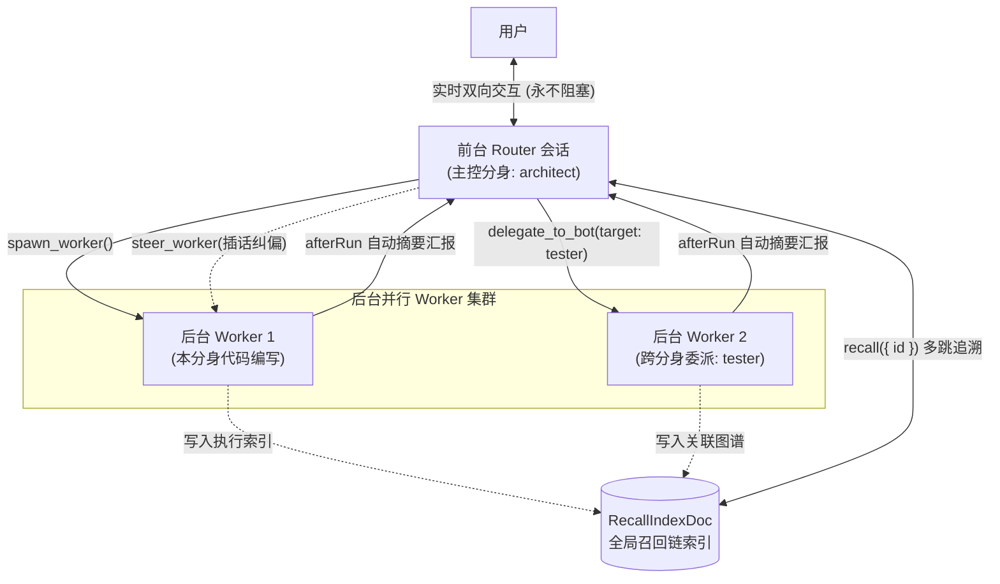

# 团队协作与多角色分身协同

botd 支持多用户团队共享、多角色分身协同与全局知识召回。[返回文档目录](README.md)

## 全双工协同心智

传统单 Agent 架构在执行耗时任务时会阻塞会话。
用户在任务执行期间无法提问，也无法调整执行方向。

botd 采用双层全双工架构：

1. **前台 Router 会话**：系统为每个分身维护前台会话。Router 物理剥夺耗时工具，仅保留秒级路由工具。Router 负责实时响应用户闲聊与指令分发。前台对话永不阻塞。
2. **后台 Worker 会话**：Router 调用 `spawn_worker` 或 `delegate_to_bot` 启动后台 Worker。Worker 拥有完整代码执行与环境操作工具。Worker 执行复杂任务并在完成后自动向 Router 汇报。
3. **协同插话**：Worker 执行期间，用户可随时向 Router 提问。用户调用 `steer_worker` 调整 Worker 方向，或调用 `stop_worker` 中止任务。



## 角色分身（Bot Personas）机制

每个角色分身代表一个特定职能的数字员工。

### 分身独立配置与持久状态

每个分身具备完全独立的状态上下文：

- `SYSTEM.md`：定义分身的角色定位、专业能力与行为准则。
- `MEMORY.md`：记录分身的长期记忆与业务背景知识。
- **专属模型配置**：每个分身可配置不同的提供商与模型规格。例如架构师使用推理模型，测试员使用高速模型。
- **默认节点与目录**：每个分身绑定默认 Node 执行节点与工作区路径。

### 团队共享与权限

Hub 内置多用户协作支持：

1. **用户角色**：
   - `admin`：系统管理员。管理用户账户并创建团队成员。
   - `member`：团队普通成员。创建私有会话并使用授权的 Bot。
2. **节点归属**：
   - 节点所有者在本地执行 `botd nodes pair` 创建 6 位配对码。
   - 目标主机执行 `botd join` 连接 Hub。节点归属配对者私有。
3. **Bot 团队共享**：
   - 节点所有者配置 Bot 的 `visibility` 为 `team`。
   - 团队所有成员均可使用该 Bot 开启会话。
   - 共享不转移底层宿主节点的管理控制权。

## 跨分身委派（delegate_to_bot）

当任务超出当前分身的专业范围时，分身可跨角色委派任务。

### 委派参数与接口

Router 通过 `delegate_to_bot` 工具发起委派：

```typescript
export interface DelegateToBotArgs {
  targetBotId: string; // 目标角色分身 ID (例如 "tester")
  title: string;       // 任务标题
  task: string;        // 完整任务说明
  threadKey?: string;  // 关联的渠道线程标识
}
```

### 委派生命周期

委派执行流程如下：

1. **参数解析**：Hub 检索目标分身的人设配置，包含其专属指令、模型、节点与工作目录。
2. **创建 Worker**：Hub 创建全新的独立 Worker 会话。系统挂载目标分身的指令与模型。
3. **登记状态**：Hub 在主控会话的 `WorkerRegistryDoc` 登记该 Worker，状态标记为 `running`。
4. **异步启动**：Hub 提交任务指令到 Worker 会话。工具调用向 Router 立即返回 Worker ID。
5. **自动汇报**：Worker 执行结束后触发 `afterRun` 钩子。系统向主控 Router 会话投递完成通知。投递包含确定性 `requestId`，杜绝重复汇报。

## 全局召回链（Chain of Recall）

系统使用会话级持久文档 `RecallIndexDoc` 统一维护全局知识索引。
所有分身与 Worker 共享此召回图谱。

### 召回节点结构（RecallNode）

```typescript
export interface RecallNode {
  id: string;               // 节点唯一标识 (如 workerId 或 spillId)
  kind: RecallKind;         // 节点类型: worker | trigger | entry | artifact | thread
  title: string;            // 节点标题
  summary: string;          // 1 到 3 行紧凑摘要 (内联展示层)
  contentPreview: string;   // 正文内容预览 (截断上限 240 字符)
  conversationId?: string;  // 保存完整 Transcript 的会话 ID
  relatedIds: string[];     // 关联的下一跳节点 ID 列表
  createdAt: number;        // 创建时间戳
}
```

### 多跳关联追溯

超长文本载荷或历史会话不会直接全部装载到模型上下文。
系统采用多跳追溯策略控制上下文消耗：

1. **内联索引**：Router 会话平时仅保留最近任务的单行摘要。
2. **单跳召回**：Agent 调用 `recall({ id: "w-1-102" })`。系统返回该节点的正文预览与所有 `relatedIds` 紧凑摘要。
3. **多跳追溯**：Agent 根据 `relatedIds` 中的关联 ID，继续调用 `recall({ id: "spill_xxx" })`。Agent 顺藤摸瓜定位跨分身、跨线程的深层关联细节。

```text
# w-1-102 — 自动化集成测试
kind: worker  created: 2026-11-04T12:00:00.000Z
summary: 完成用户注册模块测试，发现 1 处并发竞争漏洞
content: Running jest test suites... 14 passed, 1 failed in auth.test.ts
related (next hops):
- spill_9f2a (entry): 详细错误堆栈与复现日志摘要
- art_881b (artifact): 导出的 HTML 覆盖率报告
```

## Router 常用协同工具

Router 会话内置以下协同管理工具：

| 工具名 | 参数 | 功能说明 |
| :--- | :--- | :--- |
| `spawn_worker` | `title`, `task`, `cwd?`, `worktree?` | 启动当前分身名下的后台 Worker。 |
| `delegate_to_bot` | `targetBotId`, `title`, `task` | 跨角色委派后台任务给其他分身。 |
| `steer_worker` | `workerId`, `message`, `mode?` | 向执行中的 Worker 发送插话指令。 |
| `stop_worker` | `workerId` | 强制中止正在执行的 Worker。 |
| `recall` | `id` | 按 ID 查询召回链节点与下一跳关联。 |
| `ask_human` | `prompt`, `options?` | 向人类发起决策询问并挂起等待回复。 |
