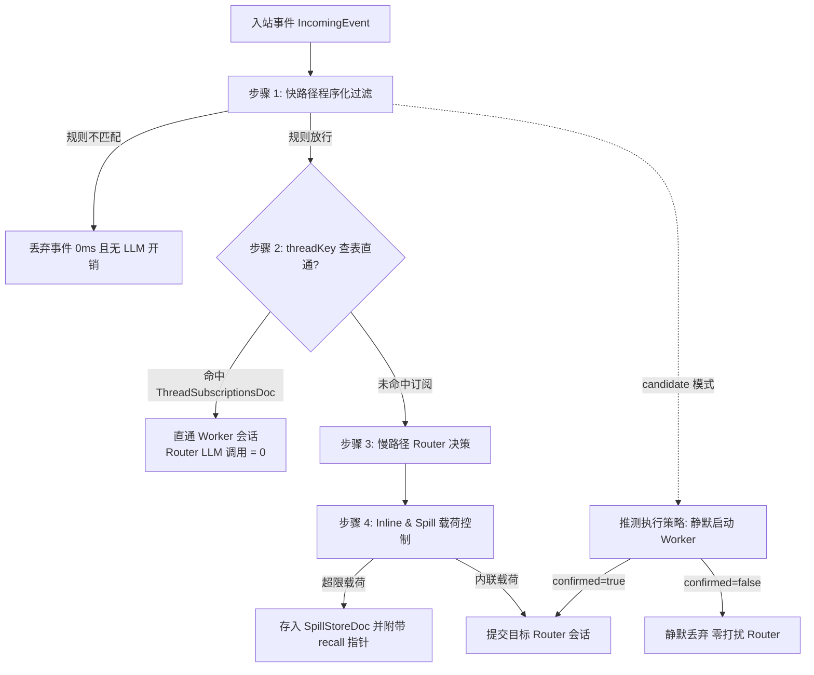

# 触发器与 EventRouter

触发器让会话按计划时间或外部事件自动执行任务。[文档目录](README.md)

## 架构概览

EventRouter 是 Hub 的事件路由中枢。
系统支持四种触发源：

1. **Webhook**：外部系统向专属 URL 发送 HTTP POST 请求。
2. **Cron 定时**：系统按 5 段式 Cron 表达式周期触发。
3. **Once 延时**：系统到达指定时间点执行一次。
4. **IM 外部事件**：飞书、钉钉、Discord 或 Slack 渠道推送消息事件。



## 数据模型

触发器配置保存在 Hub 数据库。
`TriggerRecord` 包含以下字段：

| 字段 | 类型 | 说明 |
| :--- | :--- | :--- |
| `id` | string | 触发器 ID。格式为 `trg_<uuid>`。 |
| `sessionId` | string | 绑定的会话 ID。 |
| `botId` | string | 执行提示词的主控 Bot ID。 |
| `name` | string | 触发器显示名称。 |
| `kind` | string | 触发类型：`webhook`、`cron` 或 `once`。 |
| `token` | string | Webhook 专属随机令牌。 |
| `secret` | string | 可选。HMAC-SHA256 验签密钥。 |
| `cronExpr` | string | 仅 cron 类型。标准 5 段式表达式。 |
| `runAt` | string | 仅 once 类型。ISO 8601 时间戳。 |
| `prompt` | string | 触发时提交给 Bot 的指令。 |
| `enabled` | boolean | 启用状态。默认值为 `true`。 |
| `dispatchMode` | string | 分发模式：`append` 或 `subsession`。 |
| `skillId` | string | 可选。触发时挂载的技能 ID。 |
| `eventFilter` | object | 仅 webhook 类型。过滤规则对象。 |
| `lastTriggeredAt` | string | 上次触发时间戳。 |
| `createdAt` | string | 创建时间戳。 |

### 过滤规则结构

`eventFilter` 支持三项条件匹配：

```json
{
  "source": "github",
  "types": ["pull_request.opened", "issue_comment.created"],
  "payloadMatch": {
    "action": "opened",
    "repository.owner.login": "team4u"
  }
}
```

- `source`：限定事件来源。
- `types`：限定事件类型数组。
- `payloadMatch`：深度匹配载荷键值。支持点号路径下钻。

## 四步事件流水线

EventRouter 处理入站事件包含四个阶段。

### 步骤 1：快路径过滤

`filterEventFastPath` 使用确定性规则计算结果。
该函数不调用语言模型。判定耗时低于 1 毫秒。

```typescript
export interface EventFilterPolicy {
  source?: string[];
  eventTypes?: string[];
  senderWhitelist?: string[];
  mode: 'explicit_only' | 'candidate' | 'ignore';
}
```

过滤逻辑执行三次校验：

1. 校验 `source` 是否在允许列表。
2. 校验 `event.type` 是否在允许类型列表。
3. 校验 `event.sender` 是否命中白名单。

任意一项不满足时，系统抛出 `EventDropped` 异常。
调用方记录日志并结束处理。

### 步骤 2：threadKey 查表直通

事件通过快路径后，系统推导确定性 `threadKey`：

- GitHub PR：`github:pr:<repo>#<number>`。
- GitHub Issue：`github:issue:<repo>#<number>`。
- IM 话题：`im:thread:<chatId>:<threadId>`。

系统读取 `ThreadSubscriptionsDoc` 快照。
如果存在活跃 Worker 订阅该 `threadKey`，系统执行直通投递：

1. 系统格式化内联载荷。
2. 系统直接调用 `worker.submit()`。
3. 系统配置 `whenBusy` 策略为 `steer`。
4. 前台 Router 产生 0 次模型调用。

Worker 如果无法处理后续事件，可调用 `handbackToRouter`。
系统退订该 Worker，并将事件重投给慢路径 Router。

### 步骤 3：上下文内联与外溢

系统使用 `formatEventInlineAndSpill` 控制注入上下文的体积。
默认内联字符上限为 120 字符（`DEFAULT_INLINE_CHAR_LIMIT`）。

处理规则如下：

1. 载荷未超限时，系统完整内联正文。
2. 载荷超限时，系统截取前 120 字符。
3. 系统创建 `SpillStoreDoc` 保存完整载荷。
4. 系统创建唯一指针 `spill_<hash>`。
5. 系统在消息末尾追加 recall 指令提示。

```text
[github] pr.comment from alice
summary: Review feedback for PR #42
content: Please optimize SQL query index…
[Spilled: spill_x89a2bc1 | Call recall({ "id": "spill_x89a2bc1" }) to read full content]
```

Worker 在后续回合中调用 `recall({ id: "spill_x89a2bc1" })`。
系统按需从 `SpillStoreDoc` 取出完整数据。

### 步骤 4：推测执行策略

当事件过滤模式为 `candidate` 时，系统触发推测执行。
典型场景包括可疑 Bug 报告与候选工单。

执行流程如下：

1. 系统静默创建后台 Worker 会话。
2. Worker 尝试在沙箱中复现问题。
3. 验证成功时（`confirmed: true`），Worker 向 Router 提交交付产物。
4. 验证未确认时（`confirmed: false`），系统静默销毁 Worker。
5. 未确认的任务不会打扰用户与前台 Router。

## 分发模式

传统触发器支持两种分发模式。

### append 模式

Hub 向目标主会话追加一条系统消息。
系统随后排队启动一个模型回合。
消息前缀标明触发器类型与名称。

### subsession 模式

Hub 为本次触发派生独立子会话：

1. 系统创建标题为 `[自动任务] <名称>` 的子会话。
2. 系统把原始载荷写入产物文件 `event_<id>.json`。
3. 系统向子会话投递提示词。
4. 子会话执行完成后，系统向父会话发送摘要汇报。
5. 执行期间产生的产物文件自动同步至父会话。

## Cron 与 Once 语法

### Cron 表达式

botd 使用标准 5 段式空格分隔语法：

```text
*    *    *    *    *
┬    ┬    ┬    ┬    ┬
│    │    │    │    └ 星期 (0 - 6, 0 为周日)
│    │    │    └───── 月份 (1 - 12)
│    │    └────────── 日期 (1 - 31)
│    └─────────────── 小时 (0 - 23)
└──────────────────── 分钟 (0 - 59)
```

支持字段符号：
- `*`：匹配任意值。
- `,`：枚举多个值（如 `1,15,30`）。
- `-`：定义数值区间（如 `9-17`）。
- `/`：定义间隔步长（如 `*/10`）。

### Once 表达式

一次性延时支持两种参数：

1. `runAt`：标准 ISO 8601 时间戳（如 `2026-11-04T12:00:00Z`）。
2. `delaySeconds`：相对当前时间的延时秒数（如 `3600`）。

## HTTP API 接口

### 创建触发器

发送 POST 请求到 `/api/sessions/:id/triggers`：

```bash
curl -X POST http://localhost:3002/api/sessions/s_123/triggers \
  -H "Content-Type: application/json" \
  -b "botd_token=<TOKEN>" \
  -d '{
    "name": "GitHub CI 监控",
    "botId": "architect",
    "kind": "webhook",
    "prompt": "分析 CI 失败日志并提交修复代码",
    "dispatchMode": "subsession",
    "eventFilter": {
      "source": "github",
      "types": ["workflow_run.completed"]
    }
  }'
```

### 触发 Webhook

发送 POST 请求到专属 URL：

```bash
curl -X POST http://localhost:3002/api/triggers/webhook/<TOKEN> \
  -H "Content-Type: application/json" \
  -H "X-GitHub-Event: workflow_run" \
  -H "X-GitHub-Delivery: d-456" \
  -d '{"action": "completed", "workflow_run": {"conclusion": "failure"}}'
```

系统按去重窗口与速率限制校验请求。
校验通过后，EventRouter 执行流水线分发。
