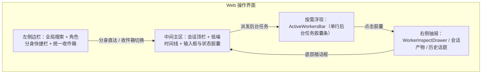
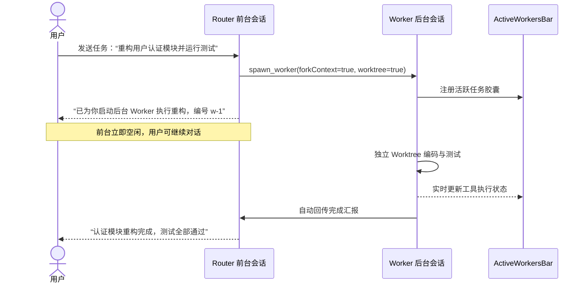
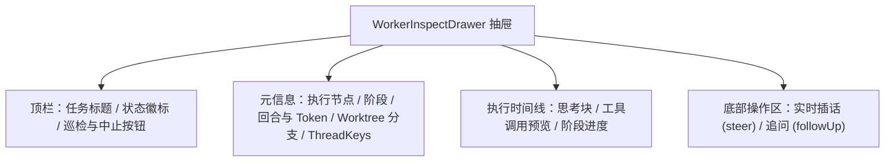
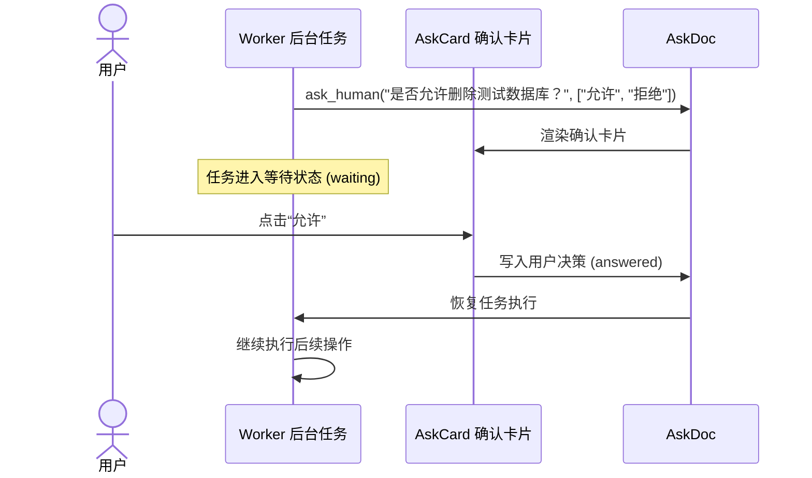

# 用户操作与协同指南

[返回文档目录](README.md)

本指南说明 botd 的界面布局、全双工交互、后台任务协同与人机确认流程。

## 1. 界面总览与全双工协同

botd 采用全双工协同模型。前台对话与后台任务解耦执行。



界面划分为四个核心交互层次：

- **欢迎空态**：未选中会话时，主区显示最多 6 个主分身直达卡片与「节点与分身管理」入口。点击分身卡片即可进入活跃对话或自动创建新会话。
- **左侧边栏**：顶栏提供全局搜索框、节点分身入口与配置入口。下方依次排列「角色分身」快捷栏与「最近协同」统一收件箱。底部默认收起子代理任务与已归档折叠区。
- **中间主区**：包含会话顶栏、按需浮现的单行任务条（`ActiveWorkersBar`）与低噪消息时间线。底部提供输入框与状态胶囊（`ComposerStatusBar`）。
- **右侧抽屉**：按需滑出任务检视台（`WorkerInspectDrawer`）、会话产物抽屉（`ArtifactsDrawer`）或历史话题抽屉（`BotHistoryDrawer`）。

用户在前台发送耗时任务时，系统不会锁定输入框。你可以随时向 Router 发送新消息。

## 2. 角色分身与统一收件箱

### 2.1 角色分身心智（Bot Personas）

系统支持创建多个专职角色分身（例如架构师、前端专家、测试助手）：

- 每个分身拥有独立的系统指令（`SYSTEM.md`）。
- 每个分身拥有独立的持久记忆（`MEMORY.md`）。
- 每个分身绑定专属的模型配置与默认工作目录（`workspaceDir`）。

点击左侧边栏「角色分身」快捷卡或欢迎页分身卡片，系统自动打开该分身最新活跃的未归档会话。无现有会话时，系统自动创建新会话。

### 2.2 统一收件箱与注意力浮顶

左侧边栏「最近协同」统一收件箱支持三种视图筛选：`全部`、`运行中/待看` 与 `按项目 Space`。

收件箱按注意力四级优先级自动浮顶排序：

1. **错误**：任务失败的会话排在最顶部，显示红色状态标识。
2. **待验收**：已完成且存在未读回复的会话排在其次，显示绿色状态标识。
3. **处理中**：正在执行或排队的会话排在第三位，显示蓝色呼吸点。
4. **空闲会话**：其余未归档会话按最近活跃时间倒序排列。

点击收件箱右上角勾选按钮可开启批量管理模式，多选删除空闲会话。会话行右侧 `⋯` 菜单支持单独归档、恢复或删除。全局搜索框输入满 2 个字符后，经 250 毫秒防抖自动检索历史消息。点击检索结果可直达目标消息位置。

### 2.3 会话顶栏与一键开启新话题

会话顶栏收纳高频会话控制入口：

- **顶栏左侧**：显示分身徽章、会话标题与等宽副标题（分身名与工作目录尾段名）。点击标题区域可直接行内重命名会话。
- **开启新话题按钮**：点击顶栏 `+` 图标（或按 `Ctrl / Cmd + Shift + O`、发送 `/new`）可立即创建新话题。新话题自动继承当前主控分身与工作目录，并自动归档旧会话。
- **会话产物按钮**：实时显示当前会话产物数量角标，点击滑出产物抽屉。
- **更多操作菜单（`⋯`）**：提供上下文水位与 `/compact` 压缩、历史话题、后台任务与巡检入口。菜单还支持切换工作区目录、分身配置、定时触发器、只读分享与删除会话。

## 3. 后台任务派发与委派

### 3.1 任务派发（spawn_worker）

用户在前台交代复杂开发任务时，Router 会自动调用 `spawn_worker`：

1. Router 评估任务耗时。
2. Router 异步创建后台 Worker 会话。
3. Router 立即向前台返回任务标识。
4. 前台会话结束当前轮次，立即回到空闲状态。



### 3.2 零拷贝上下文继承（forkContext）

当你在前台与 Router 讨论了多轮技术细节后再执行任务时：

- `spawn_worker` 指定 `forkContext: true` 参数。
- 系统调用 `conversation.fork()` 复制当前上下文。
- Worker 零拷贝继承讨论记录，不需要用户重新输入背景信息。

### 3.3 跨角色分身委派（delegate_to_bot）

当任务属于其他分身的专业领域时：

- Router 调用 `delegate_to_bot` 工具。
- 系统加载目标角色分身的模型与指令配置。
- 系统派发归属于目标分身的后台 Worker。
- 任务执行完毕后自动向当前 Router 汇报。

### 3.4 Git Worktree 并发隔离

当任务涉及修改代码时，系统自动创建 Git Worktree：

- Worker 拥有独立的工作目录与开发分支。
- 多个 Worker 可以同时修改同一个代码仓库。
- 任务代码修改互不干扰，彻底避免代码冲突。

## 4. 顶部任务栏（ActiveWorkersBar）

零后台任务时，`ActiveWorkersBar` 默认隐藏且不占用视口高度。当前会话存在活跃或近期完成的后台任务时，顶栏下方自动浮现单行横向滚动的任务胶囊条。用户也可通过会话顶栏 `⋯` 菜单手动呼出该任务栏，无任务时自动展开派发表单。

组件实现位于 [ActiveWorkersBar.tsx](../apps/web/src/components/ActiveWorkersBar.tsx)。

### 4.1 任务胶囊元素说明

每个后台任务显示为一个不换行的状态胶囊：

| 元素 | 说明 | 示例 |
| :--- | :--- | :--- |
| **状态图标** | 显示任务执行状态。活跃时旋转，完成显示对勾，失败显示感叹号。 | 旋转动画 / 对勾 / 感叹号 |
| **任务标题** | 任务简短描述，文本过长时自动省略。 | `重构用户认证模块` |
| **工具徽标** | 显示当前正在调用的工具名称或工作流阶段。 | `bash` / `Phase: Verify` |
| **执行计时** | 实时显示任务已耗费的时间。任务结束后冻结。 | `01:23` |
| **Worktree 徽标** | 显示任务是否在独立的 Git Worktree 中执行。 | `🌿 worktree` |
| **直通订阅徽标** | 显示任务订阅的外部事件线程标识，多键自动折叠计数。 | `🔗 github:pr#42 +1` |
| **停止按钮** | 仅在活跃状态显示。点击立即中止该后台任务，不打断前台对话。 | `×` |

### 4.2 快捷操作与手动派发

- **打开检视抽屉**：点击任务胶囊任意区域，右侧滑出检视抽屉。
- **中止任务**：点击胶囊右侧的 `×` 按钮。系统调用 `stop_worker` 并释放工作树。
- **一键巡检**：点击任务栏右端固定的「巡检」按钮，立即触发 Watchdog 健康检查并显示诊断结果。
- **手动派发任务**：点击任务栏右端固定的「派发任务」按钮打开表单。填写标题、指令、Worktree 选项与可选线程键即可创建后台 Worker。

## 5. 检视抽屉与实时插话（WorkerInspectDrawer）

点击任务胶囊会滑出 `WorkerInspectDrawer` 抽屉。

组件实现位于 [WorkerInspectDrawer.tsx](../apps/web/src/components/WorkerInspectDrawer.tsx)。



### 5.1 实时时间线检视

检视抽屉完整显示后台任务的执行轨迹：

- **思考轨迹**：展开查看大语言模型的深度思考内容。
- **工具调用详情**：查看命令参数、输入参数与执行返回值。
- **工作流阶段**：直观查看 SubagentWorkflow 的当前阶段与进度。
- **历史干预记录**：显示历次人工插话指令与系统纠偏记录。

### 5.2 执行中插话（Steer）

后台任务执行方向偏离预期时，你可以在抽屉底部直接插话：

1. 在抽屉底部输入框键入干预指导。
2. 点击发送按钮。
3. 系统提交 `{ type: "input", whenBusy: "steer" }` 指令。
4. Worker 在当前工具调用结束后立即读取指导指令，调整后续操作。

### 5.3 任务完成追问（Follow-up）

后台任务执行完毕后，抽屉底部输入框自动切换为追问模式：

1. 在输入框输入补充疑问。
2. 点击发送按钮。
3. Worker 基于现有执行结果继续分析并回答。

## 6. 人机协同确认（ask_human）

当后台任务执行高危操作（如删除数据库或强制推送代码）时，智能体会发起确认请求。

系统基于 [AskDoc](../apps/hub/src/harness/docs.ts) 管理确认状态。



### 6.1 确认卡片交互（AskCard）

前台对话区会渲染交互卡片：

- 显示提示问题。
- 列出预设选项按钮。
- 提供自定义补充输入框。

### 6.2 处理确认

1. 查阅操作说明与风险提示。
2. 点击对应选项按钮，或输入自定义决策文本。
3. 点击提交按钮。
4. 任务接收确认结果，恢复后续执行。

## 7. 上下文按跳召回（Chain of Recall）

### 7.1 为什么需要召回

为了降低提示词成本，系统采用按需召回策略：

- 外部大事件载荷自动外溢并保存。
- 后台 Worker 汇报仅包含精简摘要。
- 完整详情保存在会话持久索引中。

### 7.2 召回机制

你或 Router 可以调用 `recall({ id })` 工具获取完整信息：

```ts
// 召回指定 Worker 的详细执行记录
recall({ id: "w-1" })

// 召回外溢的 Webhook 原始载荷
recall({ id: "spill-evt-102" })
```

### 7.3 多跳追溯（relatedIds）

召回响应包含 `relatedIds` 字段：

- 支持从任务摘要跳转至关联的代码差异产物。
- 支持从当前错误追溯到关联的 PR 线程。
- 模型沿着关联标识逐步排查，避免单次加载过多上下文。

## 8. 输入区微控栏、快捷键与触发指令

### 8.1 模型与思考档位状态胶囊（ComposerStatusBar）

输入框底部常驻两个快捷状态胶囊，无需打开配置弹窗即可调整推理参数：

- **模型切换胶囊**：支持按模型名称、模型 ID 或服务商搜索切换。未配置凭据时自动回退显示收录了模型的服务商列表。
- **思考档位胶囊**：组件挂载时预取目录，支持直接切换 `off` 至 `xhigh` 思考档位。切换模型时若目标模型不支持原档位，前端自动收敛至最接近的受支持档位。

### 8.2 键盘快捷键

| 快捷键 | 功能说明 |
| :--- | :--- |
| `Enter` | 发送当前输入框消息（编辑态下为保存修改）。 |
| `Shift + Enter` / `Ctrl / Cmd + Enter` | 在输入框内插入换行。 |
| `Ctrl / Cmd + Shift + O` | 一键开启新话题并归档当前会话。 |
| `↑`（空输入框且无补全菜单时） | 编辑最近一条已发送的用户消息。 |
| `Esc` | 依次关闭补全菜单、取消编辑状态，或关闭当前抽屉与弹窗。 |

### 8.3 输入触发菜单与附件上传

- `/`（斜杠命令与技能引导）：在行首或单个 `@分身 ` 后输入 `/` 呼出菜单。内置命令包含 `/new`（开启新话题）与 `/compact`（压缩上下文）。菜单同时列出分身技能与扩展命令，发送 `/技能名` 会引导模型加载 `SKILL.md`。
- `#`（工作区文件引用）：输入 `#` 拉取当前工作区文件树并支持模糊检索。选中文件后自动插入相对路径代码片段。
- `@`（角色分身点名）：输入 `@` 选择其他角色分身。发送带 `@分身` 的消息时，Hub 将本轮对话路由至目标分身执行。
- **图片与通用文件附件**：点击回形针按钮或直接粘贴截图与任意格式文件。所有附件统一落盘为会话产物。图片自动注入多模态视觉输入，全部附件自动向模型上下文追加 `[Attached Files]` 磁盘路径清单。

## 9. 扩展阅读与参考文档

- [系统架构说明](architecture.md)：查阅双层智能体与 Pi Durable 调度机制。
- [工作区指南](workspace.md)：查阅 Git Worktree 隔离机制与文件操作。
- [模型与供应商](models.md)：配置多模态模型与思考档位。
- [CLI 命令参考](cli.md)：使用命令行检视 Worker 与执行插话。
- [生成式 UI](generative-ui.md)：查阅 AskCard 与交互表单组件规范。
