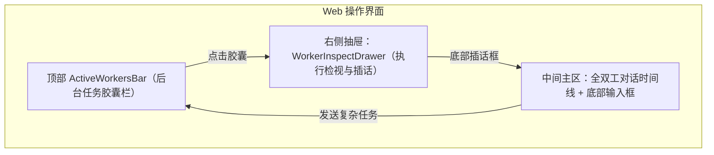
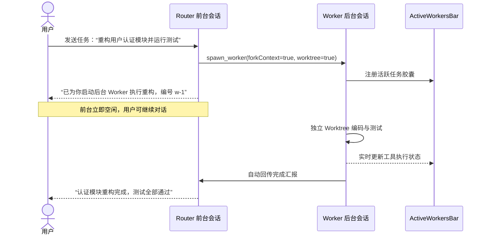
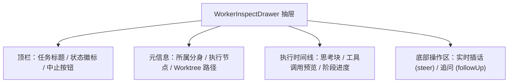
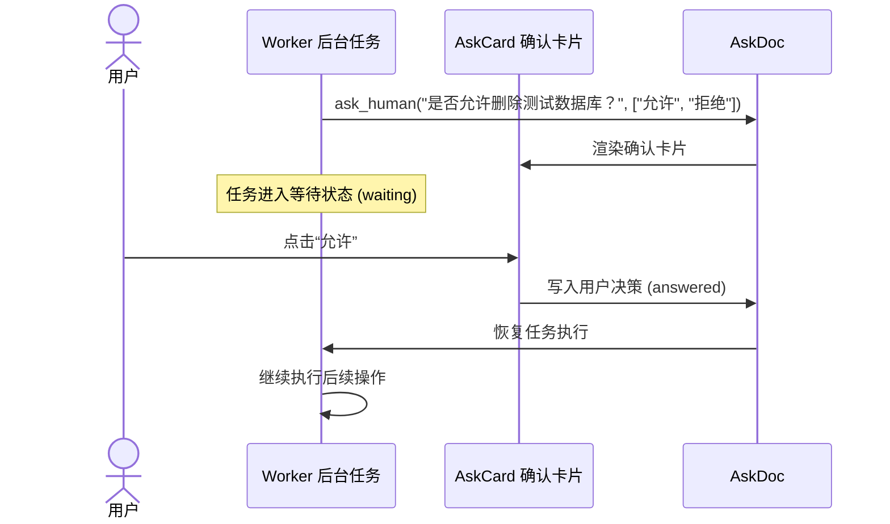

# 用户操作与协同指南

[文档目录](file:///root/code/botd/docs/README.md)

本指南说明 botd 的界面布局、全双工交互、后台任务协同与人机确认流程。

## 1. 界面总览与全双工协同

botd 采用全双工协同模型。前台对话与后台任务解耦执行。



界面划分为三个核心区域：

- **左侧边栏**：显示角色分身、常驻主会话、专项话题列表与全局搜索。
- **中间主区**：显示会话顶栏、顶部任务栏（`ActiveWorkersBar`）、消息时间线与输入框。
- **右侧抽屉**：显示任务检视台（`WorkerInspectDrawer`）、代码差异与历史记录。

用户在前台发送耗时任务时，系统不会锁定输入框。你可以随时向 Router 发送新消息。

## 2. 角色分身与会话管理

### 2.1 角色分身心智（Bot Personas）

系统支持创建多个专职角色分身（例如架构师、前端专家、测试助手）：

- 每个分身拥有独立的系统指令（`SYSTEM.md`）。
- 每个分身拥有独立的持久记忆（`MEMORY.md`）。
- 每个分身绑定专属的模型配置与默认工作目录。

### 2.2 常驻主会话与专项话题

系统为每个角色分身提供两类会话：

- **常驻主会话**：全天候处于待命状态。主会话保存日常沟通记录与长期上下文。
- **专项话题会话**：针对特定需求创建独立会话。话题会话拥有干净的对话空间。

### 2.3 开启新话题

当你需要处理全新任务时，建议开启新话题：

1. 点击会话顶栏的创建话题图标。
2. 输入新话题标题。
3. 选择绑定的项目工作目录。
4. 点击确认创建话题。

新话题会自动继承目标分身的角色配置。

## 3. 后台任务派发与委派

### 3.1 任务派发（spawn_worker）

用户在前台交代复杂开发任务时，Router 会自动调用 `spawn_worker`：

1. Router 评估任务耗时。
2. Router 异步创建后台 Worker 会话。
3. Router 立即向前台返回任务标识。
4. 前台会话结束当前轮次，立即回到空闲状态。



### 3.2 零拷贝上下文继承（forkContext）

当你在前台与 Router 讨论了多轮技术细节后再执行任务时：

- `spawn_worker` 指定 `forkContext: true` 参数。
- 系统调用 `conversation.fork()` 复制当前上下文。
- Worker 零拷贝继承讨论记录，不需要用户重新输入背景信息。

### 3.3 跨角色分身委派（delegate_to_bot）

当任务属于其他分身的专业领域时：

- Router 调用 `delegate_to_bot` 工具。
- 系统加载目标角色分身的模型与指令配置。
- 系统派发归属于目标分身的后台 Worker。
- 任务执行完毕后自动向当前 Router 汇报。

### 3.4 Git Worktree 并发隔离

当任务涉及修改代码时，系统自动创建 Git Worktree：

- Worker 拥有独立的工作目录与开发分支。
- 多个 Worker 可以同时修改同一个代码仓库。
- 任务代码修改互不干扰，彻底避免代码冲突。

## 4. 顶部任务栏（ActiveWorkersBar）

当前会话有正在执行或最近完成的后台任务时，聊天区顶部显示 `ActiveWorkersBar`。

组件实现位于 [ActiveWorkersBar.tsx](file:///root/code/botd/apps/web/src/components/ActiveWorkersBar.tsx)。

### 4.1 任务胶囊元素说明

每个后台任务显示为一个状态胶囊：

| 元素 | 说明 | 示例 |
| :--- | :--- | :--- |
| **状态图标** | 显示任务执行状态。活跃时旋转，完成显示对勾，失败显示感叹号。 | 旋转动画 / 对勾 / 感叹号 |
| **任务标题** | 任务简短描述，文本过长时自动省略。 | `重构用户认证模块` |
| **工具徽标** | 显示当前正在调用的工具名称或工作流阶段。 | `bash` / `Phase: Verify` |
| **执行计时** | 实时显示任务已耗费的时间。任务结束后冻结。 | `01:23` |
| **Worktree 徽标** | 显示任务是否在独立的 Git Worktree 中执行。 | `🌿 worktree` |
| **直通订阅徽标** | 显示任务订阅的外部事件线程标识。 | `🔗 github:pr#42` |
| **停止按钮** | 点击胶囊右侧的关闭图标，立即中止该后台任务。 | `×` |

### 4.2 快捷操作

- **打开检视抽屉**：点击任务胶囊任意区域，右侧滑出检视抽屉。
- **中止任务**：点击胶囊右侧的 `×` 按钮。系统会调用 `stop_worker` 并清理工作树。

## 5. 检视抽屉与实时插话（WorkerInspectDrawer）

点击任务胶囊会滑出 `WorkerInspectDrawer` 抽屉。

组件实现位于 [WorkerInspectDrawer.tsx](file:///root/code/botd/apps/web/src/components/WorkerInspectDrawer.tsx)。



### 5.1 实时时间线检视

检视抽屉完整显示后台任务的执行轨迹：

- **思考轨迹**：展开查看大语言模型的深度思考内容。
- **工具调用详情**：查看命令参数、输入参数与执行返回值。
- **工作流阶段**：直观查看 SubagentWorkflow 的当前阶段与进度。
- **历史干预记录**：显示历次人工插话指令与系统纠偏记录。

### 5.2 执行中插话（Steer）

后台任务执行方向偏离预期时，你可以在抽屉底部直接插话：

1. 在抽屉底部输入框键入干预指导。
2. 点击发送按钮。
3. 系统提交 `{ type: "input", whenBusy: "steer" }` 指令。
4. Worker 在当前工具调用结束后立即读取指导指令，调整后续操作。

### 5.3 任务完成追问（Follow-up）

后台任务执行完毕后，抽屉底部输入框自动切换为追问模式：

1. 在输入框输入补充疑问。
2. 点击发送按钮。
3. Worker 基于现有执行结果继续分析并回答。

## 6. 人机协同确认（ask_human）

当后台任务执行高危操作（如删除数据库或强制推送代码）时，智能体会发起确认请求。

系统基于 [AskDoc](file:///root/code/botd/apps/hub/src/harness/docs.ts) 管理确认状态。



### 6.1 确认卡片交互（AskCard）

前台对话区会渲染交互卡片：

- 显示提示问题。
- 列出预设选项按钮。
- 提供自定义补充输入框。

### 6.2 处理确认

1. 查阅操作说明与风险提示。
2. 点击对应选项按钮，或输入自定义决策文本。
3. 点击提交按钮。
4. 任务接收确认结果，恢复后续执行。

## 7. 上下文按跳召回（Chain of Recall）

### 7.1 为什么需要召回

为了降低提示词成本，系统采用按需召回策略：

- 外部大事件载荷自动外溢并保存。
- 后台 Worker 汇报仅包含精简摘要。
- 完整详情保存在会话持久索引中。

### 7.2 召回机制

你或 Router 可以调用 `recall({ id })` 工具获取完整信息：

```ts
// 召回指定 Worker 的详细执行记录
recall({ id: "w-1" })

// 召回外溢的 Webhook 原始载荷
recall({ id: "spill-evt-102" })
```

### 7.3 多跳追溯（relatedIds）

召回响应包含 `relatedIds` 字段：

- 支持从任务摘要跳转至关联的代码差异产物。
- 支持从当前错误追溯到关联的 PR 线程。
- 模型沿着关联标识逐步排查，避免单次加载过多上下文。

## 8. 快捷键与常用命令

### 8.1 键盘快捷键

| 快捷键 | 功能说明 |
| :--- | :--- |
| `Ctrl / Cmd + Enter` | 发送当前输入框消息。 |
| `Ctrl / Cmd + Shift + O` | 开启新话题。 |
| `↑`（空输入框时） | 编辑最近一条发送的消息。 |
| `Esc` | 关闭当前滑出的抽屉或弹窗。 |

### 8.2 常用输入指令

- `#`：唤起工作区文件路径自动补全。
- `@`：在输入框中点名特定角色分身。
- `/`：呼出斜杠指令面板（Hub 本地直出，零节点在线时同样可用）。
- `/new`：快速创建新话题。
- `/help`：查看当前可用命令与技能列表。
- 粘贴图片：直接在输入框粘贴或拖入图片，触发多模态视觉分析。
