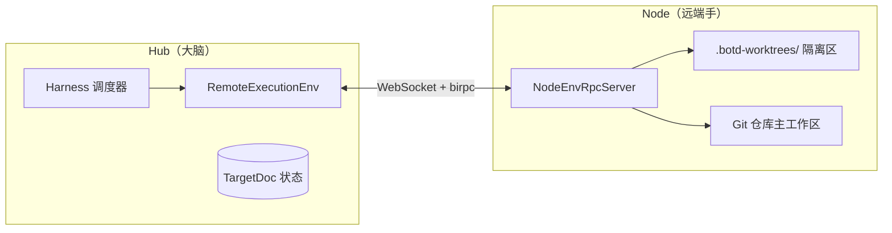
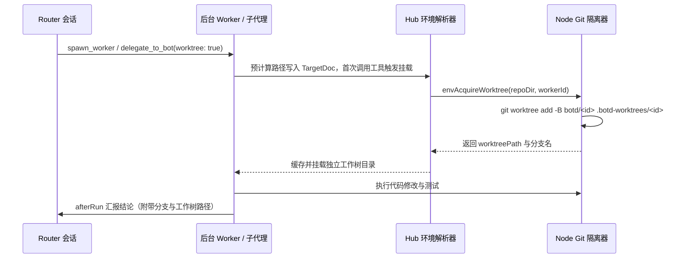

# 工作区与远端执行环境

[返回文档目录](README.md)

本文档说明工作区隔离机制、脑手分离架构与临时工作树生命周期。

## 架构原理

系统采用脑手分离架构。

Hub 承担大脑职责。Hub 托管 Harness 调度器、任务状态机与 SQLite 事务存储。

Node 承担远端手职责。Node 作为无状态守护进程，提供真实文件系统与 Shell 环境。

Hub 与 Node 通过 WebSocket 连接通信。底层 RPC 采用 birpc 双向通道。



### RemoteExecutionEnv 契约

Hub 在 `apps/hub/src/harness/remote-env.ts` 中实现 `RemoteExecutionEnv`。

该类实现 `ExecutionEnv` 接口。

每次工具调用时，Harness 从会话的 `TargetDoc` 读取 `nodeId`、`worktreePath` 与 `cwd`。

若会话单独绑定了 `workspaceDir`，`SessionRouterDoc` 会粘性覆盖分身的默认工作目录。

执行环境自动向 Shell 注入 `BOTD_SESSION_ID` 与 `BOTD_BOT_ID` 变量。

实例标识固定为 `remote:<nodeId>`。

系统对同一节点同一路径的文件写入自动排队，消除并发写入冲突。

### 节点离线等待与恢复

BYOM 模式支持节点临时离线，并严格隔离宿主机边界。

绑定远端节点（`nodeId !== "local"`）的会话在节点离线时绝不回退到 Hub 本地目录。

无论是文件读写、Shell 命令还是首次工作树挂载，`RemoteExecutionEnv` 均调用 `waitForNodeOnline` 挂起等待。

等待过程监听 Chord 的 `Context` 取消信号。

用户取消任务时，环境立即返回终止错误。

节点重新上线后，挂起的操作继续执行。

## 文件系统与 Shell 执行

Node 端在 `apps/node/src/env-rpc-server.ts` 中启动 `createNodeEnvRpcServer`。

Node 封装 `NodeExecutionEnv`，按目录缓存执行环境。

### 文件系统操作

Hub 将文件操作转化为 RPC 请求发送给 Node：

- `envReadTextFile` 与 `envWriteFile`：读写文本文件。
- `envReadBinaryFile`：读写二进制文件，数据通过 Base64 传输。
- `envOpenTextLineReader`：打开流式行读取器句柄。
- `envOpenBinaryReader`：打开二进制按需分块读取器句柄。
- `envFileInfo` 与 `envListFiles`：读取文件元信息与目录树。

### Shell 命令执行与流式传输

Worker 调用 `bash` 工具时触发 `envExec` RPC。

Node 收到请求后执行命令：

1. Node 为每个命令分配唯一的 `execId`。
2. Node 使用 `withCancel` 派生独立的取消上下文。
3. Node 子进程将输出分块推入 `onEnvExecOutput` 回调。
4. Hub 侧 `ExecOutputHub` 按 `execId` 分发输出，实时推送到 Web 界面。
5. 进程超时或用户取消任务时，Hub 监听取消信号并立即调用 `envAbortExec` 销毁远端进程树。
6. 会话清理阶段剥离已触发的取消信号，保证远端临时文件清理动作完整执行。

Node 启动环境将 `~/.botd/bin` 放入 `PATH` 首位。

Worker 在脚本中可直接调用 `botd` 命令行工具。

## Git Worktree 并发隔离

旧架构使用全局工作区互斥锁。

同一目录上的任务必须串行排队。

新架构采用 Git Worktree 隔离机制，支持并发修改。



### 全工具并发隔离矩阵

系统在四个层级的工具中统一支持 `worktree: true` 与 `isolation: "worktree"`：

- `spawn_worker` 与 `delegate_to_bot`：路径为 `<cwd>/.botd-worktrees/w-<seq>-<convId>`，分支为 `botd/w-<seq>-<convId>`。
- `subagent`：显式隔离时路径为 `<cwd>/.botd-worktrees/sub-<convId>`，分支为 `botd/sub-<convId>`。
- `SubagentWorkflow` 的 `agent()` 步骤：显式隔离时路径为 `<cwd>/.botd-worktrees/wf-<convId>`，分支为 `botd/wf-<convId>`。步骤配置的 `gate` 门禁命令自动进入该工作树目录执行。

未显式指定 `isolation: "off"` 时，`subagent` 与工作流子步骤默认继承父会话的工作树路径。

若目标目录非 Git 仓库，节点自动回退原目录并标记 `isGitRepo: false`。

多个任务同时修改同名文件时，各自在独立工作树中读写，全程无需互斥锁等待。

## 工作树挂载与保留生命周期

### 惰性幂等挂载与重放恢复

工具在事务中预先计算确定性的工作树路径与分支名，并写入 `TargetDoc`。

首次解析该会话的 `ExecutionEnv` 时，Hub 向节点发送 `envAcquireWorktree` 请求：

1. 若工作树目录已存在，直接幂等复用该目录。
2. 若目录不存在，节点执行清理与创建命令：

```bash
git worktree add -B botd/<id> <worktreePath> HEAD
```

进程崩溃重启并触发重放时，工具从持久文档恢复原有的工作树路径与分支信息。

### 默认保留与按需释放

Worker 执行完成或收到 `stop_worker` 中止指令后，系统默认保留工作树目录与对应分支。

该策略防止未合并的代码提交与测试现场意外丢失。

代码合并或确认废弃后，可通过 `envReleaseWorktree` 接口或以下命令显式清理：

```bash
git worktree remove --force <worktreePath>
git worktree prune
git branch -D botd/<id>
```
