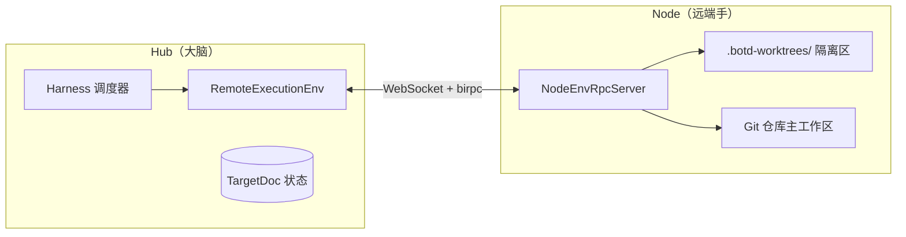
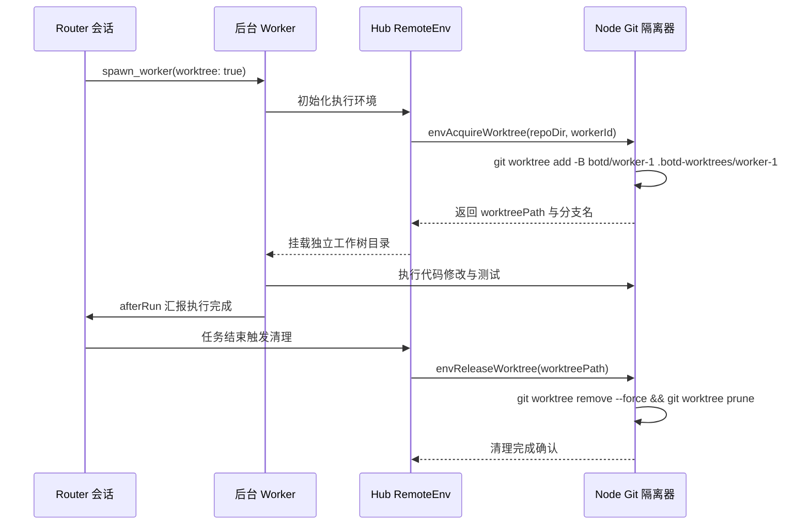

# 工作区与远端执行环境

[返回文档目录](README.md)

本文档说明工作区隔离机制、脑手分离架构与临时工作树生命周期。

## 架构原理

系统采用脑手分离架构。

Hub 承担大脑职责。Hub 托管 Harness 调度器、任务状态机与 SQLite 事务存储。

Node 承担远端手职责。Node 作为无状态守护进程，提供真实文件系统与 Shell 环境。

Hub 与 Node 通过 WebSocket 连接通信。底层 RPC 采用 birpc 双向通道。



### RemoteExecutionEnv 契约

Hub 在 `apps/hub/src/harness/remote-env.ts` 中实现 `RemoteExecutionEnv`。

该类实现 `ExecutionEnv` 接口。

每次工具调用时，Harness 从会话的 `TargetDoc` 读取 `nodeId` 与 `cwd`。

Harness 据此构造 `RemoteExecutionEnv` 实例。

实例标识固定为 `remote:<nodeId>`。

系统对同一节点同一路径的文件写入自动排队，消除并发写入冲突。

### 节点离线等待与恢复

BYOM 模式支持节点临时离线。

当目标节点离线时，`RemoteExecutionEnv` 调用 `waitForNodeOnline`。

调用挂起并等待节点重新创建连接。

等待过程监听 Chord 的 `Context` 取消信号。

用户取消任务时，环境立即返回终止错误。

节点重新上线后，挂起的操作继续执行。

## 文件系统与 Shell 执行

Node 端在 `apps/node/src/env-rpc-server.ts` 中启动 `createNodeEnvRpcServer`。

Node 封装 `NodeExecutionEnv`，按目录缓存执行环境。

### 文件系统操作

Hub 将文件操作转化为 RPC 请求发送给 Node：

- `envReadTextFile` 与 `envWriteFile`：读写文本文件。
- `envReadBinaryFile`：读写二进制文件，数据通过 Base64 传输。
- `envOpenTextLineReader`：打开流式行读取器句柄。
- `envOpenBinaryReader`：打开二进制按需分块读取器句柄。
- `envFileInfo` 与 `envListFiles`：读取文件元信息与目录树。

### Shell 命令执行与流式传输

Worker 调用 `bash` 工具时触发 `envExec` RPC。

Node 收到请求后执行命令：

1. Node 为每个命令分配唯一的 `execId`。
2. Node 使用 `withCancel` 派生独立的取消上下文。
3. Node 子进程将输出分块推入 `onEnvExecOutput` 回调。
4. Hub 侧 `ExecOutputHub` 按 `execId` 分发输出，实时推送到 Web 界面。
5. 进程超时或用户终止任务时，Hub 调用 `envAbortExec` 销毁进程树。

Node 启动环境将 `~/.botd/bin` 放入 `PATH` 首位。

Worker 在脚本中可直接调用 `botd` 命令行工具。

## Git Worktree 并发隔离

旧架构使用全局工作区互斥锁。

同一目录上的任务必须串行排队。

新架构采用 Git Worktree 隔离机制，支持并发修改。



### 并发安全机制

当 Router 派发后台任务时，传入 `worktree: true` 参数。

Hub 向 Node 发送 `envAcquireWorktree` 请求：

- Node 检查目标目录是否为 Git 仓库。
- 若目标目录非 Git 仓库，Node 返回原目录并标记 `isGitRepo: false`。
- 若目标目录为 Git 仓库，Node 创建独立工作树。

工作树路径规则：`<repoDir>/.botd-worktrees/<workerId>`。

对应分支规则：`botd/<workerId>`。

两个 Worker 同时修改同名文件时，各自在独立的工作树中读写。

Worker 之间的修改互不覆盖，不需要互斥等待。

## 临时工作树生命周期管理

### 创建阶段

Node 接收 `envAcquireWorktree` 请求。

Node 先执行清理动作，保障幂等性：

```bash
git worktree remove --force <worktreePath>
git worktree prune
```

接着 Node 执行工作树创建命令：

```bash
git worktree add -B botd/<workerId> <worktreePath> HEAD
```

Hub 将创建的 `worktreePath` 存储到 Worker 的 `TargetDoc`。

Worker 后续所有文件读写和 Shell 命令均在该目录下执行。

### 释放与清理阶段

Worker 结束执行后，生命周期钩子触发释放流程：

1. Hub 发送 `envReleaseWorktree` RPC 请求。
2. Node 强制删除临时工作树目录：
   ```bash
   git worktree remove --force <worktreePath>
   ```
3. Node 修剪过期的工作树索引记录：
   ```bash
   git worktree prune
   ```
4. 若指定 `deleteBranch: true`，Node 同时删除临时分支：
   ```bash
   git branch -D botd/<workerId>
   ```

Node 进程重启或收到清理信号时，调用 `envCleanup`。

Node 扫描并清理所有残留的临时工作树。
